# Large Language Models (LLMs): Complete Foundation Study Notes

> **Source:** User-provided lecture transcript, approximately **1 hour 28 minutes**, organized into **16 chapters**.  
> **Focus:** Tokens, tokenization, embeddings, attention, transformers, LLMs, context windows, inference, reasoning models, Mixture of Experts, model evolution, RAG, fine-tuning, and model evaluation.  
> **How to use these notes:** Read sequentially on the first pass. Use the summary tables, worked examples, diagrams, glossary, and self-test for revision.
>
> **Source fidelity:** Explanations and examples are based on the supplied transcript. To make the notes reliable for studying, sections labeled **Technical clarification** distinguish a simplified statement in the lecture from the more precise technical explanation. Mathematical worked examples are **study additions**, not claims that the lecture derived those equations in full. The transcript is conversational and contains speech-to-text errors; these notes normalize obvious terminology (for example, *byte-pair encoding*, *logits*, *top-p*, *KV cache*, *RLHF*).

---

## Contents

1. [Big Picture: From Text to an Answer](#1-big-picture-from-text-to-an-answer)
2. [Why AI Changed Around 2022](#2-why-ai-changed-around-2022)
3. [What Are Tokens?](#3-what-are-tokens)
4. [Tokenization and Byte-Pair Encoding (BPE)](#4-tokenization-and-byte-pair-encoding-bpe)
5. [Tokens, Token IDs, Vectors, and Embeddings](#5-tokens-token-ids-vectors-and-embeddings)
6. [Self-Attention and Context](#6-self-attention-and-context)
7. [Transformer Architecture](#7-transformer-architecture)
8. [What Exactly Is an LLM?](#8-what-exactly-is-an-llm)
9. [Context Window Explained](#9-context-window-explained)
10. [Why Context Matters for AI Agents](#10-why-context-matters-for-ai-agents)
11. [The LLM Inference Pipeline](#11-the-llm-inference-pipeline)
12. [Reasoning Models](#12-reasoning-models)
13. [Mixture of Experts (MoE)](#13-mixture-of-experts-moe)
14. [Evolution of GPT and Model Deployment](#14-evolution-of-gpt-and-model-deployment)
15. [Prompting vs. RAG vs. Fine-Tuning](#15-prompting-vs-rag-vs-fine-tuning)
16. [Model Comparison and Benchmarks](#16-model-comparison-and-benchmarks)
17. [Complete Worked Example](#17-complete-worked-example)
18. [Key Formulas and Comparisons](#18-key-formulas-and-comparisons)
19. [Interview Questions and Answers](#19-interview-questions-and-answers)
20. [Practice Questions and Answers](#20-practice-questions-and-answers)
21. [Glossary and Further Reading](#21-glossary-and-further-reading)

---

## 1. Big Picture: From Text to an Answer

**Lecture anchor:** Chapter 1, **00:00–02:21**; this chapter introduces concepts revisited throughout the lecture.

An LLM receives text and generates text, but it does **not** operate directly on complete words in the way a human reads them. It converts text into **tokens**, maps tokens to numeric IDs, uses **embeddings** to represent these IDs numerically, processes relationships using **attention** and neural-network layers, and computes scores for possible next tokens.

Consider these sentences:

- **“Dog bites man.”**
- **“Man bites dog.”**

They contain nearly identical words but communicate opposite events. A model must account for **word order** and **relationships**, not merely the presence of the words *dog*, *man*, and *bites*. This motivates **positional information** and **self-attention**.

### Simplified end-to-end view

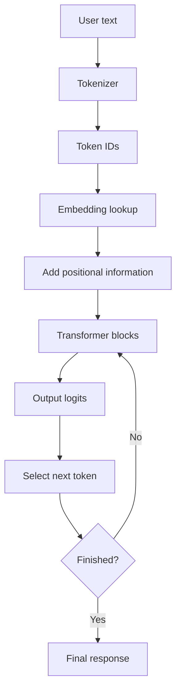

**How to interpret this diagram:** During generation, the model repeatedly processes the available sequence and predicts the next token. The loop is conceptual: efficient implementations reuse previous computations rather than redoing every operation from scratch.

### The foundational ideas in one table

| Concept | Meaning | Why it matters |
|---|---|---|
| Token | A piece of text handled by a tokenizer | Defines the model's text units |
| Token ID | Integer assigned to a token in a vocabulary | Provides an index into model tables |
| Embedding | A learned vector representing a token or text | Gives the model numerical features |
| Position | Information about sequence order | Distinguishes swapped-word sentences |
| Self-attention | Mechanism that mixes information among tokens | Captures context and relationships |
| Feed-forward network | Learned transformation within a transformer block | Enriches each token's representation |
| Logits | Unnormalized scores for possible next tokens | Used to compute generation probabilities |
| Context window | Token budget available to the model for a request | Limits how much material can be considered |
| Inference | Running a trained model to generate an answer | Determines runtime behavior, cost, and speed |

**Key idea:** An LLM is a learned mathematical system for processing token sequences. Its usefulness comes from the patterns captured during training and the context provided at runtime.

---

## 2. Why AI Changed Around 2022

**Lecture anchor:** Chapter 2, **02:22–05:47**.

### Before the generative-AI wave

The lecture describes a common engineering environment before 2022: teams built targeted machine-learning applications for **fraud detection**, **outlier detection**, classifications, and data-driven predictions. Such systems frequently involved data pipelines, training infrastructure, and model deployment to environments such as Kubernetes clusters.

A traditional application often looked like this:


For example, a fraud classifier might produce `fraud` or `not fraud`. It is not inherently a general conversational assistant.

### What changed?

The lecture highlights three connected developments:

1. **Transformer architecture (2017):** The landmark paper *Attention Is All You Need* introduced a highly influential attention-based architecture.
2. **Training at scale:** Large datasets and substantial compute produced general-purpose models that could perform many language tasks.
3. **Instruction-following chat products (especially 2022):** User-friendly chat interfaces made these capabilities accessible through ordinary language.

The result was a change in the *application interface*: instead of designing a different user interaction for every narrow task, developers could send a natural-language instruction to a general-purpose model and obtain text, code, summaries, or explanations.

| Earlier task-specific ML emphasis | General-purpose LLM application emphasis |
|---|---|
| Build or train a model for a defined prediction task | Adapt a capable pretrained model to many tasks |
| Input typically follows a fixed data schema | Input may be natural language, code, or documents |
| Output frequently a label, score, or numeric estimate | Output can be generated language or structured content |
| Significant work on feature engineering | Significant work on prompts, context, tools, and evaluation |
| Model may be deployed as a dedicated service | Model often accessed via hosted APIs or self-hosted serving |

**Technical clarification:** LLMs have **not replaced** classical ML. Fraud detection, numerical forecasting, anomaly detection, and many other applications still use conventional methods where those are more appropriate. The lecture is describing a change in the popularity and capabilities of generative-AI applications, not the disappearance of other ML systems.

---

## 3. What Are Tokens?

**Lecture anchor:** Chapter 3, **05:48–14:03**.

### 3.1 Definition

A **token** is one of the text units into which a **tokenizer** divides input. The lecturer calls tokens the **“atoms of language”** as a teaching analogy.

Tokens may represent:

- A whole common word, such as `cat` in some tokenizers.
- A common part of a word, such as `ing`.
- Punctuation, such as `.` or `,`.
- Text including a leading space, such as ` hello`.
- Other character or byte sequences, depending on the tokenizer.

**Important:** **One token is not necessarily one word.** A single word might require multiple tokens, and some tokens include whitespace or punctuation.

### 3.2 Tokens are not token IDs

Suppose a hypothetical tokenizer makes these divisions:

```text
Input:       I love AI agents.
Tokens:      ["I", " love", " AI", " agents", "."]
Token IDs:   [17, 204, 81, 940, 6]
```

The ID values above are **illustrative, not actual IDs** from a specific model. Different tokenizer vocabularies produce different splits and IDs.

A **token ID** is an integer that identifies a vocabulary entry. It is not a measure of a token's meaning. ID `500` is not “more intelligent,” “larger,” or semantically closer to ID `501` merely because the numbers are nearby.

### 3.3 Why use tokens instead of complete words?

A vocabulary that required a unique entry for every whole-word form would grow rapidly. Think of:

```text
run
runs
running
runner
runners
```

Subword tokenization can reuse pieces across related spellings. This allows a model to handle unfamiliar words without needing a separate vocabulary entry for every form.

### 3.4 Estimating token counts

The lecture gives a frequently used **English-language rough approximation**:

$$
1\text{ token}\approx 4\text{ characters}
$$

Therefore, if a text contains approximately 400 English characters:

$$
\text{Estimated tokens}\approx \frac{400\text{ characters}}{4\text{ characters/token}}
$$

$$
\text{Estimated tokens}\approx 100
$$

For a hypothetical context window of 100,000 tokens:

$$
100{,}000\times 4\approx 400{,}000\text{ characters}
$$

This is **400,000 characters, not 400,000 words**. Actual counts depend on the tokenizer, language, punctuation, numbers, code, and formatting. Do not use this approximation for billing-critical calculations; count with the relevant tokenizer instead.

### 3.5 Why token counts matter in AI engineering

Token usage affects:

- **Cost:** Hosted model pricing is often related to input and output token counts.
- **Capacity:** A model accepts only a limited amount of context per request.
- **Latency:** Longer input and output sequences can require additional computation.
- **Prompt design:** System instructions, retrieved documents, chat history, and tool outputs all consume context.
- **Agent design:** A tool-heavy workflow may consume many tokens over multiple model calls.

**Remember:** *Characters, words, tokens, token IDs, and embeddings are different things.*

---

## 4. Tokenization and Byte-Pair Encoding (BPE)

**Lecture anchor:** Chapter 4, **14:04–18:14**.

### 4.1 Tokenization

**Tokenization** is the process of transforming raw text into a sequence of token units, then mapping those units to token IDs using a tokenizer vocabulary.

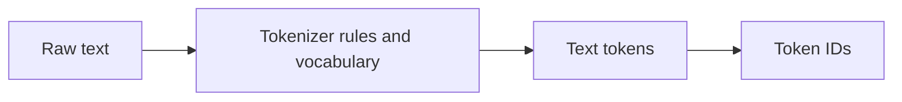

A model usually works with the **IDs** rather than literal words. The text can later be reconstructed from output tokens using the tokenizer's decoding rules.

### 4.2 What is BPE?

**Byte-Pair Encoding (BPE)** is a family of tokenization methods that repeatedly merges common adjacent units. In modern language-model contexts, some implementations operate on bytes; others have related subword-processing designs.

The lecture's intuition is that **frequently occurring patterns can be combined into tokens**, while uncommon patterns may remain split.

### 4.3 BPE step-by-step example

Consider a tiny, fictional training collection:

```text
low
lower
lowest
```

We want to reuse frequent character patterns across words.

**Step 1 — Start with small units.** For illustration:

```text
l o w
l o w e r
l o w e s t
```

**Step 2 — Count adjacent pairs.** The sequence `l o` appears in all three words; `o w` also appears in all three.

**Step 3 — Merge a frequent pair.** Suppose the algorithm merges `l` and `o` into `lo`:

```text
lo w
lo w e r
lo w e s t
```

**Step 4 — Merge again.** Suppose the algorithm next learns `lo` + `w` = `low`:

```text
low
low e r
low e s t
```

**Step 5 — Continue learning useful merges.** Depending on the corpus, merge limits, and tokenizer implementation, it may learn common endings or complete forms.

The final result is a **vocabulary of reusable units** plus rules for encoding text using that vocabulary. Real tokenizers have much larger training corpora and more exact implementation details than this toy example.

### 4.4 Why common words and rare words can tokenize differently

| Text category | Typical behavior | Explanation |
|---|---|---|
| Very common sequence | May be represented by one token | Merged sequence appeared frequently in training |
| Uncommon long word | May split into multiple tokens | No single vocabulary entry is available |
| Punctuation | May form a separate token or share a token | Depends on learned merges and vocabulary |
| Whitespace | May be grouped with a nearby token | Many tokenizers encode spaces as part of tokens |
| Code or unusual identifiers | May split in ways different from ordinary prose | Character patterns differ from natural language |

**Technical clarification:** The lecture sometimes describes BPE as choosing what **“could be a meaningful word.”** BPE does **not** need to understand semantic meaning when learning merges. It learns frequent adjacent patterns from text or bytes.

### 4.5 Practical tokenization mindset

Before putting a large file, conversation, source-code tree, or knowledge-base result into an LLM prompt, ask:

1. What tokenizer does the target model use?
2. How many **input tokens** will the request consume?
3. How much space must remain for the **output**?
4. Can irrelevant content be removed without losing necessary facts?

---

## 5. Tokens, Token IDs, Vectors, and Embeddings

**Lecture anchor:** Chapter 5, **18:15–34:10**.

### 5.1 Why arbitrary numeric IDs are not enough

The lecturer assigns animals simple labels:

```text
cat   -> 1
dog   -> 2
tiger -> 3
lion  -> 4
```

But the numeric distance between labels cannot explain the animals' real similarity. The fact that `1` is numerically closer to `2` than to `4` is a consequence of arbitrary numbering, not a meaningful biological relationship.

**Key distinction:** An ID **identifies** an item. An embedding attempts to **represent** it in a way that supports useful computations.

### 5.2 Hand-designed feature vectors: animal example

The lecture introduces properties such as **tail**, **fur**, **pet**, **wild**, **number of legs**, and a rough **size/weight score**.

| Animal | Tail | Fur | Pet | Wild | Legs | Illustrative size score |
|---|---:|---:|---:|---:|---:|---:|
| Cat | 1 | 1 | 1 | 0 | 4 | 1 |
| Dog | 1 | 1 | 1 | 0 | 4 | 2.5 |
| Tiger | 1 | 1 | 0 | 1 | 4 | 5 |
| Lion | 1 | 1 | 0 | 1 | 4 | 10 |

These values reproduce the lecture's illustrative scheme, **not biological measurements**. The table intentionally simplifies real animals; for example, the size ranking should not be treated as a scientific comparison of tigers and lions.

A cat is represented by a six-dimensional vector:

$$
\mathbf{v}_{\text{cat}}=[1,1,1,0,4,1]
$$

A dog can be represented as:

$$
\mathbf{v}_{\text{dog}}=[1,1,1,0,4,2.5]
$$

The vector has **six dimensions** because we chose six properties.

### 5.3 Worked example: distance between vectors

One way of comparing vectors is **Euclidean distance**:

$$
d(\mathbf{x},\mathbf{y})=\sqrt{\sum_{i=1}^{d}(x_i-y_i)^2}
$$

Using the simplified cat and dog vectors:

$$
\begin{aligned}
d(\text{cat},\text{dog})
&=\sqrt{(1-1)^2+(1-1)^2+(1-1)^2+(0-0)^2\\
&\quad +(4-4)^2+(1-2.5)^2}\\
&=\sqrt{0+0+0+0+0+2.25}\\
&=\sqrt{2.25}\\
&=1.5
\end{aligned}
$$

The result reflects the **chosen features and their scales**, not a universal measure of animal similarity. In practical ML, features often require normalization or learning appropriate weights so a large numeric range does not dominate comparisons.

### 5.4 Learned embeddings

Real LLMs do not generally have a human expert manually fill in a column for *fur*, *pet*, or *wild* for every word. Instead, a model learns numerical vector values from large amounts of training data. At initialization, vector weights may be random; training adjusts them through optimization and **backpropagation**.

An embedding can have hundreds or thousands of dimensions:

$$
\mathbf{e}_t=[e_1,e_2,\ldots,e_d]\in\mathbb{R}^{d}
$$

The lecturer uses **1,536** and **3,072** dimensions as examples associated with embedding services. These are examples of possible dimensions, not a universal property of every LLM.

The individual dimensions of learned embeddings generally **do not correspond cleanly to named properties** such as “dimension 1 = pet.” Those properties are a teaching analogy to explain a numerical feature space.

### 5.5 Embedding matrix

Suppose a model has:

- Vocabulary size: $V=150{,}000$ token entries.
- Embedding dimension: $d=1{,}536$.

Its input embedding table can be represented as:

$$
E\in\mathbb{R}^{150{,}000\times1{,}536}
$$

A lookup of token ID $t$ selects its row:

$$
\mathbf{e}_t=E[t]\in\mathbb{R}^{1{,}536}
$$

To understand the shape:

- **Rows** correspond to vocabulary entries.
- **Columns** correspond to learned numerical dimensions.
- **One row** provides a vector used to represent the selected token.

The number of scalar values in this illustrative matrix is:

$$
150{,}000\times1{,}536=230{,}400{,}000
$$

This is an example of how representation tables become large. It is **not** the total parameter count of a modern LLM, which contains many additional weight matrices.

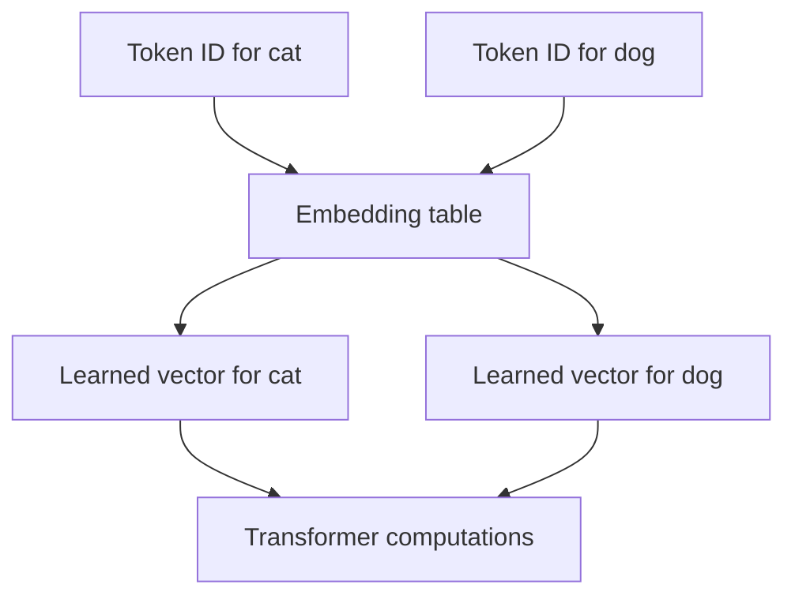

### 5.6 Static vs contextual representations

The lecture discusses embeddings changing with context, as in:

- “Dog bites man.”
- “Man bites dog.”

**Technical clarification:** There are two distinct levels:

1. **Initial token embeddings:** In a conventional embedding-lookup layer, a given token ID retrieves the same learned base vector, before positional and contextual processing.
2. **Contextual hidden representations:** After position-dependent attention and other transformer operations, a token's representation can differ from sentence to sentence.

This distinction explains how identical token strings can participate in different meanings without requiring the embedding table itself to change on every request.

### 5.7 Relationship to Word2Vec

The lecture mentions **Word2Vec**, an earlier approach to learning useful word vectors. The key shared intuition is that **patterns of word use** can be reflected in numerical representations. Modern transformer-based contextual representations go beyond one fixed vector per word by allowing meanings to depend on surrounding text.

**Remember:** Token ID = lookup identifier; embedding = learned numerical vector; contextual representation = vector modified through the network based on sequence context.

---

## 6. Self-Attention and Context

**Lecture anchor:** Chapter 6, **34:11–46:57**.

### 6.1 The core problem

Consider the lecture's example:

> “The cat was thirsty, so it drank milk.”

A reader naturally interprets **“it”** as referring to **“the cat.”** An LLM must capture relationships between distant or nearby tokens to build an appropriate contextual representation.

In the lecture, this is explained as tokens comparing themselves with other tokens to determine which information is important.

### 6.2 Query, key, and value intuition

Each token representation is transformed into three kinds of vectors:

- **Query (Q):** What information is this position looking for?
- **Key (K):** What information can this position match against?
- **Value (V):** What information can this position contribute if attended to?

The model calculates how strongly a query matches keys. It then uses those match scores to form a **weighted combination of value vectors**.

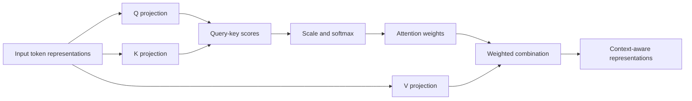

### 6.3 Scaled dot-product attention: formula

A standard mathematical description is:

$$
\operatorname{Attention}(Q,K,V)
=\operatorname{softmax}\!\left(\frac{QK^T}{\sqrt{d_k}}+M\right)V
$$

where:

| Symbol | Meaning |
|---|---|
| $Q$ | Query matrix |
| $K$ | Key matrix |
| $V$ | Value matrix |
| $K^T$ | Transpose of the key matrix |
| $d_k$ | Size of each key vector |
| $\sqrt{d_k}$ | Scaling factor for attention scores |
| $M$ | Optional attention mask (e.g., to block future tokens) |
| $\operatorname{softmax}$ | Converts scores into nonnegative weights that sum to 1 along the attended dimension |

**What the calculation accomplishes:** Each token receives a new representation formed from relevant information in other *permitted* positions.

### 6.4 A hand-calculated softmax example

Suppose a query produces two attention scores:

$$
\mathbf{s}=[1,2]
$$

Softmax is defined as:

$$
p_i=\frac{e^{s_i}}{\sum_j e^{s_j}}
$$

**Step 1 — Exponentiate the scores:**

$$
e^1\approx2.718,\qquad e^2\approx7.389
$$

**Step 2 — Add the exponentials:**

$$
2.718+7.389=10.107
$$

**Step 3 — Normalize:**

$$
p_1=\frac{2.718}{10.107}\approx0.269
$$

$$
p_2=\frac{7.389}{10.107}\approx0.731
$$

**Step 4 — Check the sum:**

$$
0.269+0.731=1.000
$$

The second position therefore receives about **73.1%** of the attention weight in this toy example.

**Step 5 — Combine values:** If the two value vectors are one-dimensional and equal to $v_1=10$ and $v_2=20$, the new weighted value is:

$$
\begin{aligned}
\text{output}&=p_1v_1+p_2v_2\\
&\approx(0.269)(10)+(0.731)(20)\\
&=2.69+14.62\\
&=17.31
\end{aligned}
$$

This demonstrates the role of attention weights, not the exact behavior of a real model on “cat” and “it.”

### 6.5 What does the dot product measure?

For two vectors:

$$
\mathbf{q}=[q_1,q_2,\ldots,q_d],\quad
\mathbf{k}=[k_1,k_2,\ldots,k_d]
$$

Their dot product is:

$$
\mathbf{q}\cdot\mathbf{k}=\sum_{i=1}^{d}q_ik_i
$$

For example:

$$
\mathbf{q}=[1,2],\qquad \mathbf{k}=[3,4]
$$

Then:

$$
\mathbf{q}\cdot\mathbf{k}=(1\times3)+(2\times4)=3+8=11
$$

In attention, this produces a **compatibility score**. It is **not automatically a percentage, semantic similarity metric, or probability**. Scaling and softmax are applied to obtain normalized attention weights.

### 6.6 Multi-head attention

Instead of using one attention pattern, transformers typically use **multiple heads**, each with separate learned projections. Heads can attend to different relationships at the same time.

Examples of relationships that a head *may* learn to help represent include:

- Pronouns and possible referents.
- Connections between verbs and their arguments.
- Relevant tokens separated by many words.
- Context-dependent meaning or structural patterns.

**Technical clarification:** A head is **not permanently assigned** a guaranteed role such as “head 1 = nouns” or “head 2 = adjectives.” These are illustrative ways to describe what some learned patterns might capture.

### 6.7 Self-attention vs masked self-attention

- **Self-attention:** Tokens attend to permitted tokens within the same sequence.
- **Causal/masked self-attention:** While predicting the next token, a decoder-only model prevents positions from attending to **future** positions.
- **Cross-attention:** In an encoder–decoder architecture, one sequence can attend to representations of another sequence.

**Remember:** Self-attention is about **weighted information exchange**, not merely finding the single “most similar” word.

---
## 7. Transformer Architecture

**Lecture anchor:** Chapter 7, **46:58–51:33**.

### 7.1 What is a transformer?

A **transformer** is a neural-network architecture built around attention mechanisms and other learned transformations. The lecture emphasizes that transformer layers can process the relationships among many input token positions in parallel, unlike classic recurrent networks that inherently pass hidden state from one time step to the next.

A simplified transformer block includes:

1. **Attention:** Each token mixes information from relevant allowed positions.
2. **Feed-forward network (FFN):** Each token's representation undergoes learned nonlinear transformations.
3. **Residual connections:** Information can pass around individual sublayers.
4. **Normalization:** Helps stabilize and support deep-network computations.

Transformers stack many such blocks, producing progressively richer representations.

### 7.2 The effect of position

The word order matters:

| Sentence | Subject | Action | Object |
|---|---|---|---|
| Dog bites man. | Dog | Bites | Man |
| Man bites dog. | Man | Bites | Dog |

Without information about position, the model could struggle to distinguish the order of identical tokens. Modern transformers use mechanisms such as **learned positional embeddings**, **absolute positional encodings**, or **relative/rotary position techniques**, depending on the model.

### 7.3 Full simplified transformer flow

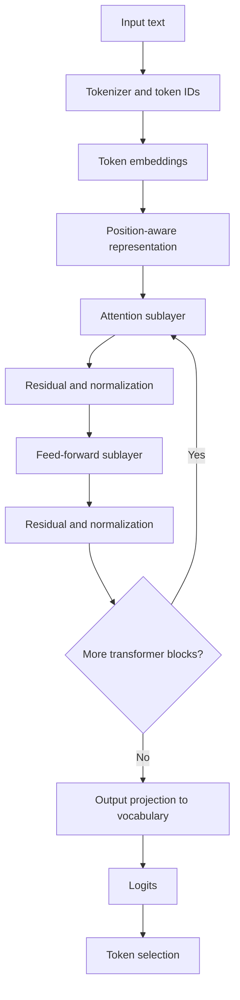

**Explanation:** Each block updates token representations. After the final block, an output projection produces scores for tokens in the vocabulary. A decoding strategy then selects the next token.

### 7.4 How attention and FFNs differ

| Component | Main responsibility | Simple analogy |
|---|---|---|
| Attention | Exchange information across token positions | Consult the relevant words in a sentence |
| Feed-forward network | Transform each updated representation | Process what was learned about each word |
| Positional mechanism | Encode ordering information | Keep track of where each word is located |
| Output projection | Map a hidden representation to vocabulary scores | Score candidate next tokens |

**Technical clarification:** The lecture sometimes attributes **next-token generation directly to the feed-forward block**. In a transformer, FFNs help transform representations, while final next-token probabilities come from the **entire network's final hidden representation and output head**.

### 7.5 Transformers vs RNNs

| Property | Traditional RNN | Transformer |
|---|---|---|
| Sequence processing during training | Hidden states depend sequentially on previous steps | Attention calculations over input positions can be parallelized |
| Long-range relations | Can be challenging, despite variants such as LSTMs | Attention gives direct paths between permitted positions |
| Positional/sequence order | Built into recurrent processing | Requires a positional mechanism |
| Compute patterns | Sequential dependence limits training parallelism | Matrix operations efficiently use accelerators |
| Generation | Typically sequential | **Also sequential across generated next tokens** |

**Technical clarification:** A transformer processes many **prompt positions in parallel during prefill**, but an autoregressive text generator still emits new tokens **one after another** during decoding. “Transformers are parallel” does not mean they generate every output token simultaneously.

### 7.6 Encoder, decoder, and encoder–decoder

- **Encoder-only:** Produces contextual representations of input sequences; suitable for many understanding or classification tasks.
- **Decoder-only:** Autoregressively predicts subsequent tokens using causal attention; central to GPT-style models.
- **Encoder–decoder:** Processes source information with an encoder and generates an output sequence with a decoder; common in many sequence-to-sequence designs.

The lecturer describes the encoder as understanding input and the decoder as generating output. This is a useful high-level picture, with one crucial qualification: **GPT-style models are decoder-only** and do not require a separate encoder stack to process the input prompt.

### 7.7 Why transformers became influential

The lecture identifies three advantages:

- **Training parallelism:** Efficient processing of many positions using matrix operations.
- **Long-range relationships:** Attention can connect tokens that are far apart.
- **Scaling:** Architectures can be trained with more layers, data, and compute, although costs grow significantly.

---

## 8. What Exactly Is an LLM?

**Lecture anchor:** Chapter 8, **51:34–56:00**.

### 8.1 Definition

A **Large Language Model (LLM)** is a large neural network trained on substantial amounts of language-related data to model patterns of token sequences. In a common GPT-style training formulation, it learns to **predict the next token given preceding tokens**.

The lecture stresses that an LLM is **not a traditional dictionary or a simple lookup database**. It contains learned **weights** that encode statistical patterns from training.

### 8.2 Next-token prediction

Given an input sequence:

```text
The cat drank
```

The model assigns scores to possible continuations. The examples below are invented for explanation, not real model measurements.

| Candidate next token | Example probability |
|---|---:|
| ` milk` | 0.55 |
| ` water` | 0.25 |
| ` slowly` | 0.12 |
| Other tokens combined | 0.08 |

Depending on sampling settings, the model selects a next token, appends it to the sequence, and repeats.

### 8.3 Autoregressive generation

Let the prompt be $x$ and output tokens be $y_1,y_2,\ldots,y_n$. A common factorization is:

$$
p(y_1,\ldots,y_n\mid x)=\prod_{t=1}^{n}p(y_t\mid x,y_1,\ldots,y_{t-1})
$$

**Read this step by step:**

1. Predict $y_1$ given the original prompt $x$.
2. Predict $y_2$ given $x$ and the already-generated $y_1$.
3. Predict $y_3$ given $x$, $y_1$, and $y_2$.
4. Continue until a stopping condition is reached.

Each generated token is conditioned on the earlier tokens. This is **autoregressive** generation.

### 8.4 Training and inference are different

| Training | Inference |
|---|---|
| Learn or update model parameters from examples | Use existing model parameters to answer a request |
| Can use backpropagation and optimization | Normally does not update model weights |
| Requires training data and substantial compute | Requires running the model to produce output |
| Builds model capabilities | Applies capabilities to current context |

### 8.5 What a model “knows”

A model has learned patterns through training, but it may:

- Produce plausible but incorrect statements.
- Lack access to newly published facts.
- Be unaware of private business documents unless those are supplied or accessed through a permitted system.
- Perform differently depending on the prompt, available tools, and evaluation task.

**Remember:** General next-token modeling can produce impressive language abilities, but outputs still require validation when correctness matters.

---

## 9. Context Window Explained

**Lecture anchor:** Chapter 9, **56:01–1:06:12**.

### 9.1 Definition

The **context window** is the maximum amount of tokenized material the model can consider within its supported runtime context for a request. The lecture treats it as the model's **working space**.

The context may include:

- **System instructions** or other higher-priority application instructions.
- **Developer/application instructions**, when present.
- **Current user message**.
- **Conversation history** retained in the request.
- **Retrieved documents** from RAG.
- **Tool results** and relevant metadata.
- **Generated output tokens**, subject to model and API limits.

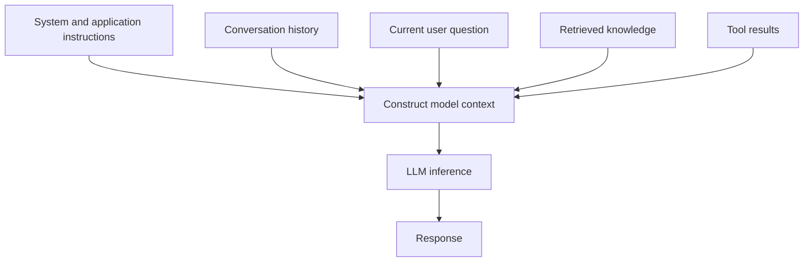

### 9.2 Worked token-budget example

Assume a hypothetical **16,000-token total budget** for context and planned answer, purely for illustration.

| Component | Tokens |
|---|---:|
| System and app instructions | 1,000 |
| Chat history | 8,000 |
| Retrieved documents | 4,000 |
| User question | 500 |
| Planned output allowance | 1,500 |
| **Total** | **15,000** |

**Step 1 — Add input tokens:**

$$
1{,}000+8{,}000+4{,}000+500=13{,}500
$$

**Step 2 — Include the proposed output allowance:**

$$
13{,}500+1{,}500=15{,}000
$$

**Step 3 — Calculate remaining headroom:**

$$
16{,}000-15{,}000=1{,}000
$$

The request fits this **illustrative combined budget** with 1,000 tokens to spare. In real APIs, **context size, maximum output tokens, and any reserved budgets have model-specific rules**, so always check the model's actual limits.

### 9.3 What happens if the context is too large?

The application or serving system may:

- Reject the request as too large.
- Remove older conversation turns.
- Summarize earlier dialogue.
- Trim or compress retrieved material.
- Keep only the most relevant documents.

Do **not** assume every model or API automatically drops old tokens. That is a **product or application behavior**, not a universal rule of the neural network.

### 9.4 Context-management techniques

**A. Truncation** — Remove selected text, often older or less relevant context. Risk: important details may be lost.

**B. Summarization** — Replace lengthy conversation sections with concise summaries preserving decisions, definitions, and constraints. Risk: a summary can omit crucial nuance.

**C. Context pruning** — Identify and remove low-value messages, redundant tool outputs, or irrelevant passages.

**D. Retrieval (RAG)** — Store large collections outside the context window; bring in only selected chunks when needed.

**E. Memory systems** — Persist relevant information outside an individual model call, then selectively insert that information into later calls.

**F. Caching** — Reuse compatible previously computed information when the serving infrastructure supports it, improving efficiency for repeated context.

### 9.5 Cost and latency considerations

The lecture emphasizes that a bigger context is **not free**. Depending on the service, longer prompts may increase:

- Input-token charges.
- Computation and memory use.
- Time to process the initial prompt (**prefill**).
- Attention-related runtime overhead.

The exact scaling depends on architecture, kernels, cache strategy, hardware, and provider pricing.

### 9.6 “Lost in the middle”

The lecture mentions research demonstrating that models can sometimes use information less effectively when it appears in the **middle** of long inputs rather than at the beginning or end.

**Practical consequence:** Provide **relevant, clearly organized context**. Putting in more documents is not always better than providing the right evidence in an accessible format.

**Technical clarification:** The middle-position effect varies across models and tasks. It should be treated as a tested risk, not an absolute rule that all models always ignore middle content.

---

## 10. Why Context Matters for AI Agents

**Lecture anchor:** Chapter 10, **1:06:13–1:09:35**.

### 10.1 Agent quality depends on provided information

An AI agent may have model capabilities, tools, and workflows. Yet the next model call can only directly use the **inputs made available to that call** together with the model's learned parameters.

The lecturer's practical principle is:

> **Relevant, well-ordered context beats noisy, oversized context.**

Examples of context quality problems:

| Problem | Effect on model behavior | Better approach |
|---|---|---|
| Irrelevant retrieved pages | Distracts from the actual question | Filter and rerank retrieval results |
| Outdated source | Answer may reflect stale facts | Retrieve a current authoritative source |
| Missing business rule | Agent cannot reliably follow the workflow | Provide the rule explicitly |
| Contradictory documents | Model may give inconsistent answers | Resolve versioning and source priority |
| Extremely long history | Higher cost and greater risk of lost details | Summarize key decisions and constraints |
| Untrusted document instructions | May cause prompt-injection risks | Separate retrieved data from trusted instructions |

### 10.2 Why an LLM may appear to remember

The lecture says an LLM has **“no memory between calls”**. The useful distinction is:

- **Model weights** remain available between calls, but usually do not change based on a normal conversation.
- **In-request memory** is simply relevant prior text supplied again as context.
- **External memory** is data saved in a database, file, vector store, or application state and retrieved later.

A chat application can therefore create continuity **without the underlying model independently remembering every previous interaction**.

### 10.3 Agent context-building loop

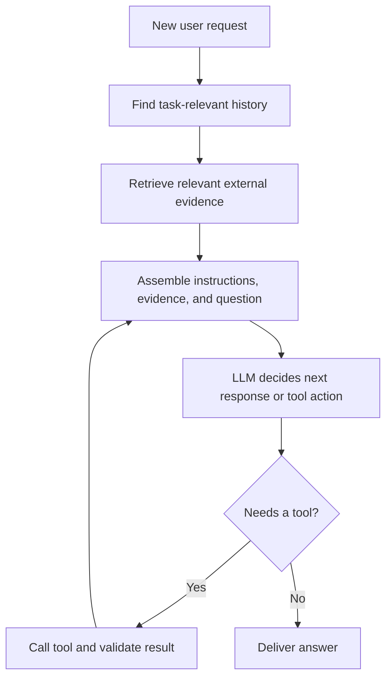

### 10.4 Context engineering is more than prompt wording

**Prompt engineering** focuses on how an instruction is written. **Context engineering** includes deciding **which information should reach the model**, **in what format**, and **at what time**.

For an enterprise agent, this may involve:

1. Defining concise system and task instructions.
2. Choosing a user-specific or business-specific source collection.
3. Retrieving only related passages.
4. Preserving source identifiers and timestamps.
5. Limiting repeated or irrelevant tool output.
6. Checking token budget and possible prompt-injection content.
7. Evaluating whether answers are grounded in evidence.

**Example:** If an agent answers a company leave-policy question, a current HR policy document should usually receive greater weight than unrelated chat history or an old public blog post.

---

## 11. The LLM Inference Pipeline

**Lecture anchor:** Chapter 11, **1:09:36–1:12:34**.

### 11.1 Inference defined

**Inference** is the runtime process that takes a request and generates a response using a trained model.

The lecture describes these stages:

1. **Tokenize** the input.
2. **Embed** input token IDs.
3. Run a transformer **forward pass**.
4. Produce next-token **logits**.
5. Apply a **selection/sampling strategy**.
6. Append the selected token and repeat until complete.

### 11.2 Prefill vs decode

Two frequently discussed phases are:

**Prefill**

- Processes input prompt tokens.
- Computes hidden representations for the existing context.
- Produces or populates cached information used during subsequent token generation.
- Makes substantial use of parallel processing across positions.

**Decode**

- Generates new tokens one at a time.
- Uses the existing context and previously generated tokens.
- Can reuse cached attention keys and values instead of recomputing the entire history in the same way for every token.

| Phase | Primary input | Primary output | Typical focus |
|---|---|---|---|
| Prefill | Prompt and supplied context | Model state and cache for subsequent generation | Prompt processing time |
| Decode | Previous context + latest generated tokens | Next output token | Token-by-token generation speed |

### 11.3 KV cache

**KV** means **Key** and **Value**. Transformer attention layers compute key and value representations for token positions. During autoregressive decoding, a **KV cache** can preserve previously computed keys and values so the model does not need to recompute those specific projections for the full previous sequence at every step.

**Important nuance:** A KV cache is **not the same as a conversation memory database**. It is a serving-time optimization for a running sequence, while persistent memory involves storing information across requests or sessions.

### 11.4 Logits and softmax

Suppose an LLM produces three invented logits for candidate tokens:

$$
\mathbf{z}=[2,1,0]
$$

These are **scores**, not probabilities.

Apply softmax:

$$
p_i=\frac{e^{z_i}}{\sum_j e^{z_j}}
$$

**Step 1 — Exponentials:**

$$
e^2\approx7.389,\quad e^1\approx2.718,\quad e^0=1
$$

**Step 2 — Denominator:**

$$
7.389+2.718+1=11.107
$$

**Step 3 — Normalized probabilities:**

$$
\begin{aligned}
p_1&=\frac{7.389}{11.107}\approx0.665\\
p_2&=\frac{2.718}{11.107}\approx0.245\\
p_3&=\frac{1}{11.107}\approx0.090
\end{aligned}
$$

**Step 4 — Check:**

$$
0.665+0.245+0.090=1.000
$$

A decoder can select a token using these probabilities, possibly after applying sampling controls.

### 11.5 Temperature

A simplified temperature-adjusted softmax is:

$$
p_i(T)=\frac{e^{z_i/T}}{\sum_j e^{z_j/T}}
$$

where $T>0$ is the **temperature**.

- **Lower temperature:** Tends to make the probability distribution more concentrated on high-logit tokens.
- **Higher temperature:** Tends to flatten the distribution and allow more diverse choices.
- **Very low or zero setting:** APIs may implement a near-greedy or deterministic decoding strategy; exact semantics depend on the provider.

**Worked example** with logits $[2,1]$ and $T=1$:

$$
p_1=\frac{e^2}{e^2+e^1}=\frac{7.389}{7.389+2.718}\approx0.731
$$

At $T=0.5$, divide each logit by $0.5$:

$$
[2,1]/0.5=[4,2]
$$

Then:

$$
p_1=\frac{e^4}{e^4+e^2}
=\frac{54.598}{54.598+7.389}\approx0.881
$$

The higher-scoring token's probability rose from approximately **73.1%** to **88.1%**. This is the sense in which lower temperature makes a distribution sharper.

### 11.6 Top-k and top-p

**Top-k sampling:** Retain only the $k$ highest-probability candidate tokens, renormalize their probabilities, and sample among them.

**Top-p (nucleus) sampling:** Sort tokens by probability and keep the smallest high-probability set whose cumulative probability reaches at least a chosen threshold $p$; then sample from that set.

Example candidates sorted by probability:

| Candidate | Probability | Cumulative probability |
|---|---:|---:|
| A | 0.50 | 0.50 |
| B | 0.25 | 0.75 |
| C | 0.15 | 0.90 |
| D | 0.10 | 1.00 |

- With **top-k = 2**, retain `A` and `B`.
- With **top-p = 0.90**, retain `A`, `B`, and `C`, because their cumulative probability reaches 0.90.

These strategies affect **which candidates are eligible for selection**, not the pretraining objective itself. Their exact interactions can be API-specific.

### 11.7 Termination

Generation typically stops when an end-of-sequence marker, stop condition, requested output limit, or other serving rule is reached.

### 11.8 Inference and application safeguards

The lecture notes that chat applications may wrap LLMs with system instructions, policies, and safety controls. Such features belong to the **application/model-serving system** and should not be confused with the core mathematical attention mechanism.

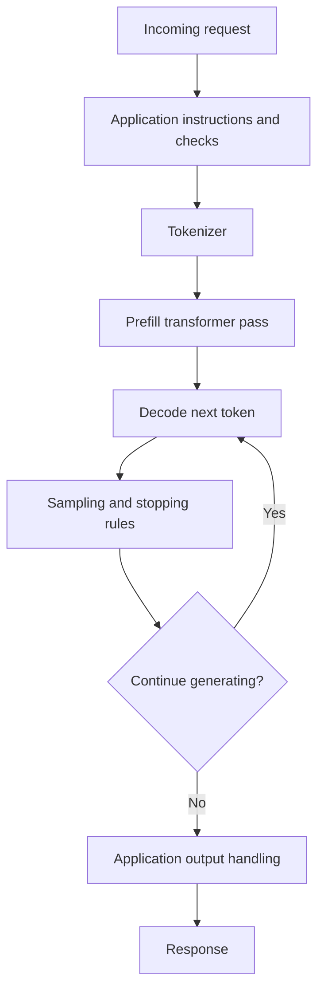

---

## 12. Reasoning Models

**Lecture anchor:** Chapter 12, **1:12:35–1:14:16**.

### 12.1 What is a reasoning model?

The lecture presents reasoning-oriented models as systems optimized to handle **multi-step problems** rather than immediately produce a short answer. The idea is to devote additional computation to breaking a complex task into parts, examining intermediate results, and improving the final answer.

Potential applications include:

- Mathematics and structured calculations.
- Code generation and debugging.
- Logical analysis and planning.
- Complex tool-using workflows.
- Problems requiring several dependent substeps.

### 12.2 Task decomposition

Suppose the user asks:

> Compute $(2+2)^3$.

The visible mathematical explanation can be written as:

**Step 1 — Resolve the parentheses:**

$$
2+2=4
$$

**Step 2 — Apply the exponent:**

$$
(2+2)^3=4^3
$$

**Step 3 — Expand the multiplication:**

$$
4^3=4\times4\times4
$$

**Step 4 — Calculate:**

$$
4\times4=16
$$

$$
16\times4=64
$$

**Final answer:**

$$
\boxed{64}
$$

This is an example of a **clear worked solution**. It does not reveal or describe any particular model's private internal reasoning trace.

### 12.3 Reasoning versus ordinary generation

| Aspect | Conventional response generation | Reasoning-oriented response generation |
|---|---|---|
| Objective | Produce a useful answer | Improve performance on more complex problems |
| Typical behavior | May respond directly | May use more internal computation before final response |
| Strong use cases | Simple questions, summaries, straightforward writing | Multi-step math, code, logic, analysis |
| Tradeoff | Often lower latency | Often higher latency or cost on hard tasks |

### 12.4 Hidden reasoning and visible explanation

The lecturer mentions **hidden reasoning tokens**. A reasoning-capable system may use internal computations that are **not supplied as a verbatim public chain of thought**. The useful artifact for a learner is a **checkable solution, concise rationale, and verifiable intermediate calculations**.

### 12.5 When to use more reasoning

Use deeper problem-solving when the task involves dependencies, constraints, difficult code, multi-step mathematics, or ambiguous evidence. For simple tasks, extra reasoning time may provide little benefit.

**Remember:** More reasoning does **not guarantee correctness**. Check outputs with tests, calculations, source documents, or tools when needed.

---

## 13. Mixture of Experts (MoE)

**Lecture anchor:** Chapter 13, **1:14:17–1:18:05**.

### 13.1 Definition

**Mixture of Experts (MoE)** is an architecture in which some model layers contain multiple specialized sub-networks called **experts**. A **router** determines which experts process each token's representation.

The lecture emphasizes an efficiency goal: a model can have a large total parameter capacity while activating only a **subset of experts** for a given token.

### 13.2 Simple MoE diagram

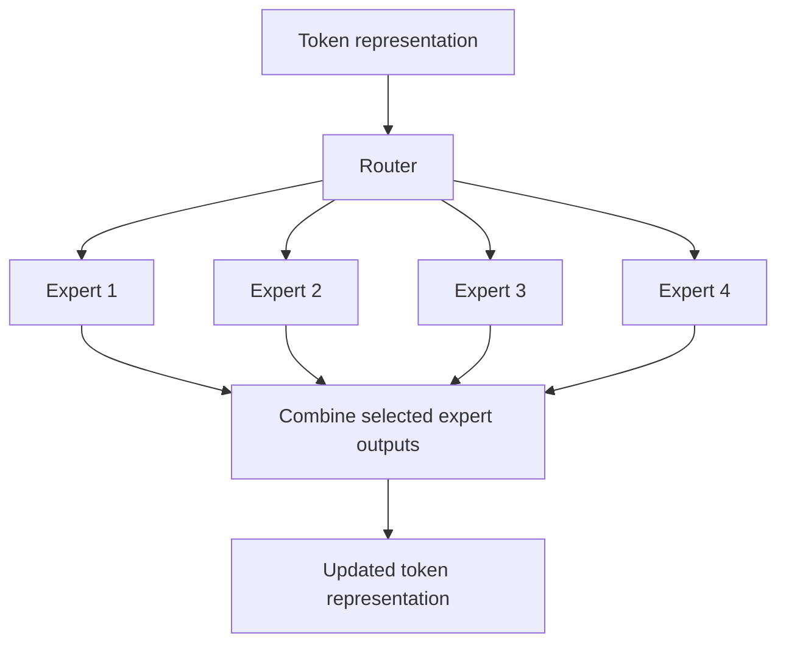

**Explanation:** The drawing shows all experts for clarity, but sparse MoE implementations may send any given token to only a few of them. The router produces selection scores or weights, then combines selected expert outputs according to the architecture.

### 13.3 Dense model vs sparse MoE

| Property | Dense transformer layer | Sparse MoE transformer layer |
|---|---|---|
| Main FFN computation | Uses a shared FFN for each token | May route tokens to selected expert FFNs |
| Parameters present | Dense layer parameters | Combined parameters of several experts plus routing |
| Parameters used for a token | The corresponding dense FFN | Only selected experts, plus shared network operations |
| Benefit | Simpler routing and implementation | More model capacity without proportional expert computation per token |
| Challenge | More compute as dense layers grow | Routing, load balancing, memory, communication overhead |

**Technical clarification:** MoE “experts” are usually **learned neural sub-networks**, not autonomous AI agents each assigned a human job title. MoE is also not necessarily the same thing as an application-level multi-agent system.

### 13.4 Top-k expert routing example

Suppose there are four experts with illustrative routing scores:

| Expert | Routing score |
|---|---:|
| E1 | 0.10 |
| E2 | 0.55 |
| E3 | 0.25 |
| E4 | 0.10 |

For **top-2 routing**, the router chooses:

1. **E2**, score 0.55.
2. **E3**, score 0.25.

A model-specific combination rule uses the selected expert outputs. The actual router may use logits, softmax, normalization, capacity constraints, and auxiliary training terms.

### 13.5 What MoE helps and does not help

MoE can increase **total model parameter capacity** while limiting the amount of expert-network computation per token. However, it does not make inference free: expert weights still need memory, routing creates overhead, and distributed serving can be complex.

The lecture mentions model families such as **Mixtral** and **DeepSeek** when discussing deployable or MoE-related models. Architectures and licenses differ by specific release; do not assume every model in a family uses MoE or permits the same kind of hosting.

---
## 14. Evolution of GPT and Model Deployment

**Lecture anchor:** Chapter 14, **1:18:06–1:20:24**; hosting discussion begins in Chapter 13, around **1:15:19**.

### 14.1 What does GPT stand for?

**GPT** stands for **Generative Pre-trained Transformer**.

- **Generative:** Produces new token sequences.
- **Pre-trained:** Learns broad patterns before being adapted to specific applications.
- **Transformer:** Uses transformer-based network components.

GPT-style language models are generally **decoder-only autoregressive** models.

### 14.2 High-level evolution described in the lecture

| Milestone | Main theme | What learners should remember |
|---|---|---|
| GPT and early transformer-based generation | General language modeling | Autoregressive token prediction |
| GPT-2 | More coherent text generation | Scaling improved generative fluency |
| GPT-3 | In-context and few-shot prompting | A prompt can include examples for a task |
| Instruction-tuned models / RLHF-era systems | Better instruction following | General models became easier to use through direct requests |
| ChatGPT-style products | Accessible conversational interface | Multi-turn chat became a prominent user experience |
| GPT-4-era systems | More capable general and multimodal applications | Models expanded beyond basic text-only workflows |
| Later frontier-model era mentioned by the speaker | Reasoning, tools, multimodality, high capability | Capabilities should be checked per specific release |

**Source note:** The speaker names later GPT releases and competitors when discussing the frontier-model era. Because those names and capabilities are date-sensitive, this table focuses on the **historical concepts** illustrated in the lecture rather than asserting a current product ranking.

### 14.3 What is RLHF?

**Reinforcement Learning from Human Feedback (RLHF)** is a family of methods used to improve model behavior using preference or feedback signals. In a simplified picture:

1. Start from a pretrained model.
2. Gather examples or human judgments about desirable responses.
3. Use those judgments to guide additional training.
4. Evaluate whether the adapted model follows instructions better and produces more useful answers.

RLHF is **not the only** approach to post-training or model alignment. The lecture mentions it primarily as part of the evolution toward chat-style assistants.

### 14.4 Hosted APIs vs self-hosted models

The lecture compares using provider-hosted models with deploying certain downloadable models on your own machines or cloud resources such as GPU-backed compute instances.

| Dimension | Hosted model API | Self-hosted compatible model |
|---|---|---|
| Hosting responsibility | Provider | Your team or infrastructure vendor |
| Hardware management | Usually abstracted away | Must provision and manage compute |
| Billing pattern | Often request/token-based | GPU, memory, infrastructure, staffing, and operation costs |
| Model control | Restricted by provider offerings | More control over supported model and serving stack |
| Data governance | Depends on provider terms, settings, and architecture | More direct infrastructure control, but you must secure it |
| Operational overhead | Lower | Higher |
| Suitable example | Fast implementation without managing GPUs | Specific deployment, customization, or control requirements |

### 14.5 Example deployment costs (symbolic, not real prices)

For a hypothetical hosted API, suppose:

- $N_{\text{in}}$ = number of input tokens.
- $N_{\text{out}}$ = number of output tokens.
- $r_{\text{in}}$ = price per one million input tokens.
- $r_{\text{out}}$ = price per one million output tokens.

Then the estimated request cost is:

$$
C_{\text{API}}=\frac{N_{\text{in}}}{10^6}r_{\text{in}}+\frac{N_{\text{out}}}{10^6}r_{\text{out}}
$$

**Illustrative arithmetic:** Assume 2 million input tokens at a fictional rate of $1 per million and 0.5 million output tokens at a fictional rate of $4 per million:

$$
C_{\text{input}}=\frac{2{,}000{,}000}{1{,}000{,}000}\times\$1=\$2
$$

$$
C_{\text{output}}=\frac{500{,}000}{1{,}000{,}000}\times\$4=\$2
$$

$$
C_{\text{API}}=\$2+\$2=\boxed{\$4}
$$

For a self-hosted GPU instance:

$$
C_{\text{compute}}=\text{GPU hours}\times\text{rate per GPU hour}
$$

If an imaginary instance costs $3 per hour and runs for 20 hours:

$$
C_{\text{compute}}=20\times\$3=\boxed{\$60}
$$

This estimate omits storage, networking, monitoring, engineering effort, scaling, and other expenses. **The prices are invented solely to explain the calculation**; they are not provider quotations.

### 14.6 How to choose a deployment approach

Consider **availability, license terms, quality, privacy requirements, latency, performance, workload volume, and operations capacity**. A self-hosted model can support tighter control over infrastructure, but self-hosting **does not automatically guarantee security, privacy, or low cost**. Hosted services also differ in data-use policies and security controls.

---

## 15. Prompting vs. RAG vs. Fine-Tuning

**Lecture anchor:** Chapter 15, **1:20:25–1:24:59**.

The lecturer introduces three ways to adapt an LLM to a real-world task:

1. **Prompting:** Change the instructions or examples.
2. **Retrieval-Augmented Generation (RAG):** Supply relevant external information at runtime.
3. **Fine-tuning:** Update some or all model weights using additional training.

### 15.1 Comparison table

| Question | Prompting | RAG | Fine-tuning |
|---|---|---|---|
| What changes? | Request/context instructions | Information supplied at runtime | Trained model parameters |
| Need to retrain model? | No | No | Yes |
| Good for consistent response format? | Often | Can complement prompting | Can help at scale |
| Good for private/current knowledge? | Only if small enough to supply directly | **Usually strong choice** | Not usually the best way to update changing facts |
| Good for task-specific behavior? | Yes, often the first choice | Yes, if evidence is needed | Useful for repeated specialized patterns |
| Main tradeoff | Prompt quality and context size | Retrieval quality and system complexity | Training data, cost, and ongoing evaluation |

### 15.2 Prompting

**Prompting** means guiding model behavior through the input rather than modifying model weights.

**Example:**

```text
Task: Summarize the following incident report.
Output format:
- Issue
- Customer impact
- Root cause
- Resolution
- Follow-up actions

Report:
[Incident text]
```

This approach can produce a structured summary without training a new model. A prompt can include **role instructions, task constraints, examples, output schemas, and relevant context**.

**When prompting is enough:** The task is straightforward and the model already possesses the underlying capabilities or is given the facts it needs.

### 15.3 What is RAG?

**RAG** stands for **Retrieval-Augmented Generation**. An application stores or indexes documents externally. When a user asks a question, the application retrieves relevant information and includes it in the request to the model.

The lecturer motivates RAG with two problems:

- A model may not have **new information** published after its training data.
- A model may not have access to **private company information**.

**RAG supplies evidence at query time** rather than attempting to store every fact in the model's weights.

### 15.4 Typical RAG architecture

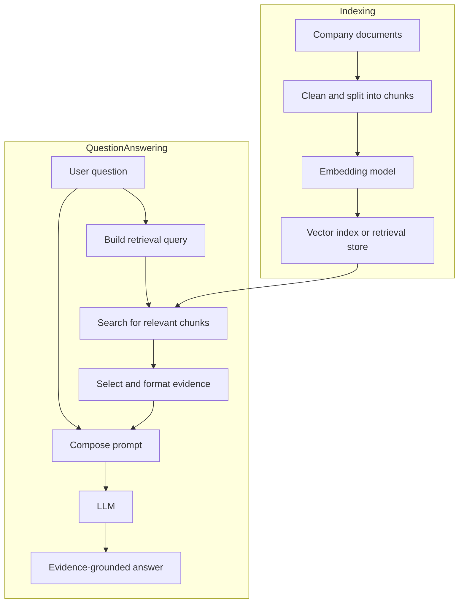

**Explanation:** The vector store helps **find useful passages**. Those passages are then provided to the LLM as text or other supported content. The vector database is **not literally the model's internal input embedding matrix**; it is an external retrieval system.

### 15.5 RAG step by step

**Step 1 — Collect source documents.** Examples: policy manuals, product documentation, invoices, internal FAQs, or knowledge articles.

**Step 2 — Prepare the documents.** Remove duplicates, preserve document IDs and dates, and split long texts into useful chunks.

**Step 3 — Build an index.** Use suitable embedding models, keyword search, or hybrid search; store vectors and source metadata when using a vector index.

**Step 4 — Receive the question.** For example: “What is the reimbursement limit for travel?”

**Step 5 — Retrieve the evidence.** Find the relevant policy sections.

**Step 6 — Build the model context.** Include the user question and the selected passages, preferably with source labels.

**Step 7 — Generate the answer.** Instruct the model to use the evidence, explain uncertainty, and cite the policy section when possible.

**Step 8 — Evaluate and maintain.** Check whether retrieval found the right content and whether the answer accurately used it.

### 15.6 Common RAG variants mentioned in the lecture

| Variant | General idea |
|---|---|
| Basic RAG | Retrieve relevant documents and generate an answer |
| Graph RAG | Use entity/relationship graphs, possibly along with other retrieval methods |
| Agentic RAG | Let an agent plan retrieval steps or use tools iteratively |
| Corrective RAG | Check whether retrieved evidence is adequate and attempt corrective retrieval when necessary |
| Adaptive RAG | Select retrieval or answer strategies based on the question and available evidence |

**Source scope:** The lecture **announces these variants as future course topics**, rather than explaining their full implementations. The table provides short orientation definitions, not a claim that the transcript covered those systems in depth.

### 15.7 What RAG cannot guarantee

RAG improves access to external evidence, but an answer can still be wrong if:

- The retrieved document is irrelevant or outdated.
- Search misses the correct passage.
- The source contains errors.
- The model misreads or combines evidence incorrectly.
- Retrieved material contains malicious instructions.

**Technical clarification:** RAG can **reduce certain hallucination risks**, but it does **not eliminate hallucinations**.

### 15.8 Fine-tuning

**Fine-tuning** means continuing model training for a particular goal using additional data. The model's learned parameters are updated, or a smaller set of adapter parameters is trained, depending on the method.

The lecture gives a financial-services-style application example: a company could adapt a model toward a specialized, repeated communication or recommendation workflow rather than relying on a purely general model.

**Good use cases for fine-tuning may include:**

- Consistent structured outputs or specialized writing patterns.
- Repeated task-specific transformations.
- Domain-specific classification behavior.
- Working with curated task examples at sufficient scale.

**Not an automatic outcome:** Fine-tuning does **not** guarantee faster inference, eliminate hallucinations, or make a model accurate on all domain facts. These outcomes depend on model size, implementation, data quality, and evaluation.

### 15.9 Choosing the right strategy

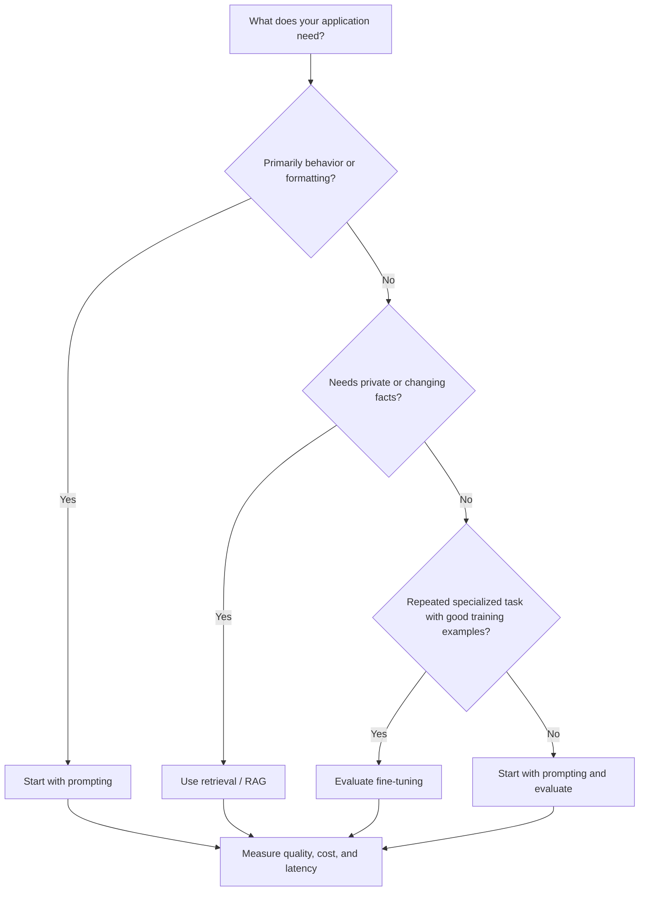

**Important:** These are **complementary** techniques. A production system can use prompting **and** RAG, and a fine-tuned model can also use RAG.

### 15.10 Three examples to remember

**Example A — Output format:** “Return every incident summary in this JSON schema.” Start with prompting and schema validation.

**Example B — Latest employee policy:** “Answer using the company's current policy repository.” Use RAG with authoritative, versioned documents.

**Example C — Thousands of repeated specialized outputs:** “Produce a specific task result that generic prompting performs inconsistently on.” Evaluate fine-tuning using representative training and test examples.

---

## 16. Model Comparison and Benchmarks

**Lecture anchor:** Chapter 16, **1:25:00–1:27:29**.

### 16.1 Why model selection matters

The lecture mentions model ecosystems such as **GPT, Claude, Gemini, Qwen, and Llama**. Each model or model family can differ in:

- Reasoning and task performance.
- Context-window size.
- Tool-calling capabilities.
- Text, image, audio, or other multimodal support.
- Latency and throughput.
- Input/output token pricing.
- Hosting availability and licenses.
- Accuracy, reliability, and operational behavior.

**Important:** A brand or family name is not enough for a technical comparison. Compare **specific versions** using **current documentation** and tests relevant to your application.

### 16.2 Practical model-selection matrix

| Evaluation dimension | Questions to ask |
|---|---|
| Quality | Does it solve our actual tasks correctly? |
| Reasoning | Can it handle multi-step tasks with verifiable results? |
| Tool use | Can it call the tools and follow their schemas reliably? |
| Context | Can it accommodate our typical request and source budget? |
| Input types | Does it support the required files or modalities? |
| Latency | Is response time acceptable at target concurrency? |
| Cost | What is total cost per successful task, not only per token? |
| Privacy/security | Do deployment and data-handling requirements match our policies? |
| Hosting | Is a hosted API sufficient, or do we require local deployment? |
| Stability | How often do outputs fail, time out, or violate the required format? |

### 16.3 What is a benchmark?

A **benchmark** is a standardized set of tasks and scoring rules used to compare systems. The speaker uses **Terminal-Bench** as an illustration of evaluating models or agents on terminal-based tasks.

The lecture mentions activities such as:

```bash
pwd
ls
cat README.md
cd project
git clone https://example.com/example-repository.git
```

These shell commands are **illustrative examples**, not an actual Terminal-Bench test specification. Real tasks may involve complex sequences of terminal operations, file edits, testing, and verification.

### 16.4 Useful benchmark measurements

A benchmark may report:

- **Task success rate:** Fraction of tasks successfully completed.
- **Accuracy:** Share of answers or outputs meeting correctness criteria.
- **Latency:** Wall-clock time to completion.
- **Token use:** Input and output token consumption.
- **Cost:** Estimated expense for successful tasks.
- **Reliability:** Variation across repeated attempts.

The exact metrics depend on the benchmark. A public leaderboard's score must be interpreted in the context of its **evaluation version, tool access, prompts, and test environment**.

### 16.5 Worked benchmark calculation

Suppose an agent correctly completes 72 of 100 test tasks.

$$
\text{Success rate}=\frac{\text{Successful tasks}}{\text{Total tasks}}\times100\%
$$

$$
=\frac{72}{100}\times100\%=\boxed{72\%}
$$

If another agent succeeds on 80 tasks, its success rate is:

$$
\frac{80}{100}\times100\%=80\%
$$

But if the second agent is much slower or much more expensive, the **best engineering choice** may depend on the task's business requirements. Accuracy alone is not always sufficient.

---

## 17. Complete Worked Example

This section **combines** the lecture concepts into one practical scenario. The question, document names, and numerical values are **hypothetical** and were not provided as real business records in the transcript.

### Scenario: A company knowledge-base assistant

**User:** “According to the updated travel policy, what is the daily meal allowance?”

The organization has a private policy document. The assistant is connected to a retrieval index containing that document.

### Stage 1 — User request becomes tokens

The tokenizer splits the question into text units and assigns token IDs. The precise IDs depend on the model's tokenizer.

### Stage 2 — The retrieval system searches externally

The application creates an appropriate search query and retrieves an excerpt from the travel policy. For example, imagine the result says:

> Travel policy, version 3: The daily meal allowance is $45 for eligible domestic travel.

This is **fictional sample evidence**, not an actual policy statement.

### Stage 3 — Build a grounded prompt

```text
System task: Answer company policy questions using supplied source text.
If evidence is missing, say what is unknown.

Source: Travel Policy v3
Eligible domestic travel meal allowance: $45 per day.

Question: According to the updated travel policy,
what is the daily meal allowance?
```

The system does not need to expose the entire database in the prompt—only the relevant source information.

### Stage 4 — The model processes its context

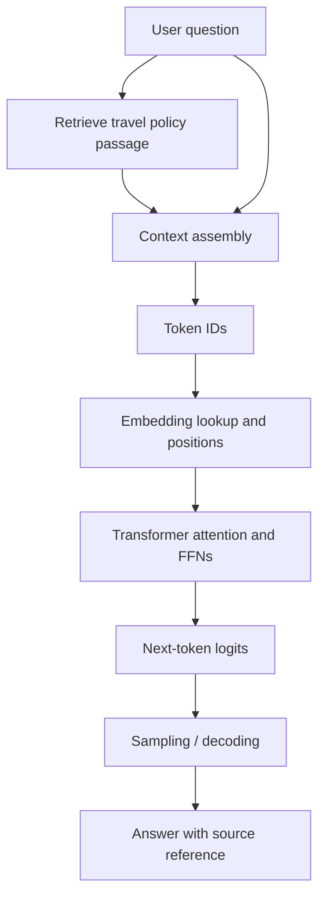

Attention helps the model relate **“daily meal allowance”** in the question to the corresponding policy phrase. Its final hidden representations are projected into candidate next-token scores, and decoding produces an answer.

### Stage 5 — Final response

```text
For eligible domestic travel, the daily meal allowance is
$45 per day under Travel Policy v3.
```

A more complete real implementation would attach a citation to the source, check the policy's effective date, and ensure the user is authorized to access the document.

### Stage 6 — Handle a follow-up question

**User:** “What about international travel?”

If the retrieved passage did not provide an international-travel rule, the agent should **not invent one**. It should retrieve more evidence or say the available passage does not contain the answer.

### Concepts demonstrated

| Step | Concept |
|---|---|
| Split incoming text | Tokenization |
| Convert IDs to learned vectors | Embeddings |
| Represent word order | Positional information |
| Relate question to evidence | Attention |
| Compute scores for answer tokens | Logits and decoding |
| Use private policy documents | RAG |
| Keep only relevant snippets | Context engineering |
| Preserve earlier topic for follow-up | Conversation context or external memory |
| Check accuracy and sources | Evaluation and grounding |

---

## 18. Key Formulas and Comparisons

### 18.1 Essential formulas

| Formula | What it represents |
|---|---|
| $E\in\mathbb{R}^{V\times d}$ | Embedding lookup matrix with vocabulary size $V$ and embedding dimension $d$ |
| $\mathbf{e}_t=E[t]$ | Embedding lookup for token ID $t$ |
| $\mathbf{q}\cdot\mathbf{k}=\sum_i q_i k_i$ | Query-key compatibility score before attention scaling |
| $\operatorname{Attention}(Q,K,V)=\operatorname{softmax}(QK^T/\sqrt{d_k}+M)V$ | Scaled dot-product attention, optionally masked |
| $p_i=e^{z_i}/\sum_j e^{z_j}$ | Softmax transformation of logits or scores |
| $p_i(T)=e^{z_i/T}/\sum_j e^{z_j/T}$ | Temperature-adjusted distribution |
| $p(y\mid x)=\prod_t p(y_t\mid x,y_{<t})$ | Autoregressive output probability factorization |
| $\text{Success rate}=\text{successes}/\text{total tasks}$ | Basic benchmark success ratio |

### 18.2 Related concepts that should not be confused

| Pair | Difference |
|---|---|
| Token vs word | A token can be a word, word fragment, whitespace-containing sequence, or punctuation |
| Token vs token ID | A text unit versus its integer identifier |
| Token ID vs embedding | Lookup index versus numerical feature representation |
| Embedding vs contextual hidden state | Initial learned vector versus context-updated representation |
| Model embedding table vs vector database | Internal model parameter table versus external retrieval index |
| Attention weight vs next-token probability | Weight for mixing allowed sequence information versus probability of generating a vocabulary token |
| FFN vs output head | Internal nonlinear transformation versus scoring vocabulary candidates |
| Prefill vs decode | Prompt processing versus token-by-token generation |
| KV cache vs long-term memory | Runtime acceleration cache versus durable stored information |
| MoE vs multi-agent system | Routed neural experts versus separate workflow agents/tools |
| Prompting vs fine-tuning | Change request instructions versus update learned parameters |
| RAG vs fine-tuning | Retrieve facts when needed versus adapt model behavior through training |
| Benchmark vs product performance | Controlled evaluation versus actual end-to-end application results |

### 18.3 Full conceptual recap

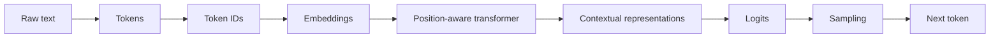

For an **agentic application**, place a broader layer around this core path:

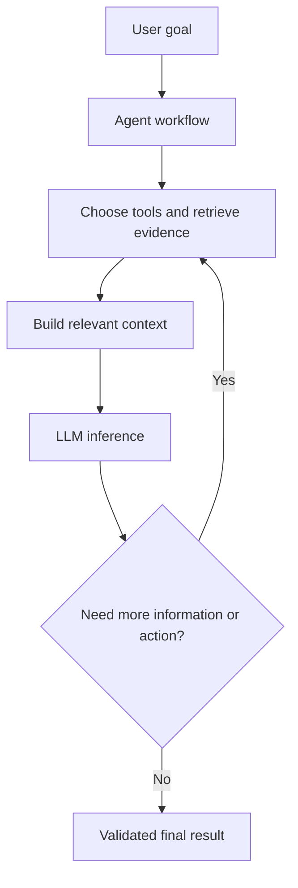

**Read the two diagrams together:** An agent coordinates information and actions. An LLM transforms the supplied token context into useful outputs. The agent's quality depends on both the model **and** the surrounding system.

---

## 19. Interview Questions and Answers

### Q1. What is a token in an LLM?

**Answer:** A token is a unit of text recognized by a tokenizer. It may be a full word, subword, punctuation, or whitespace-containing sequence. The model typically receives token IDs rather than raw words.

### Q2. What is byte-pair encoding?

**Answer:** BPE is a tokenization approach that learns frequent adjacent-unit merges from data. It builds reusable units so common sequences may become compact tokens while uncommon words can still be represented using smaller pieces.

### Q3. What is the difference between a token ID and embedding?

**Answer:** A token ID is an integer identifier for a vocabulary entry. An embedding is a learned vector associated with the token, used as a numerical representation for model computations. Numeric closeness of IDs does not imply semantic closeness.

### Q4. Why do embeddings have many dimensions?

**Answer:** Multiple dimensions allow a neural model to represent a rich set of learned patterns. The dimensions are learned jointly during training and usually cannot be interpreted as a fixed list of manually labeled semantic properties.

### Q5. What problem does self-attention solve?

**Answer:** It lets a token position incorporate information from other permitted positions according to learned, query-dependent weights. This helps the model form context-aware representations and capture relations such as pronoun references.

### Q6. What are Q, K, and V?

**Answer:** Query, key, and value are learned projections of token representations. Query-key interactions compute attention scores, normalized scores become weights, and the weighted sum of values forms the attention output.

### Q7. Why does positional information matter?

**Answer:** It helps distinguish token sequences with the same words but different order, such as “dog bites man” and “man bites dog.” Transformers need a position-aware mechanism to represent sequence order.

### Q8. What is the difference between transformer prefill and decoding?

**Answer:** Prefill processes the supplied prompt, often in parallel across token positions. Decoding generates new autoregressive tokens one by one, often using a KV cache to reuse previously calculated attention information.

### Q9. What is a context window?

**Answer:** It is the amount of tokenized information a model can process within its supported request context. Prompts, history, tool outputs, retrieved documents, and generation allowances must be managed within relevant model and API limits.

### Q10. Does an LLM remember previous API calls by itself?

**Answer:** Ordinarily, a stateless model call does not automatically receive earlier conversation content. Applications create continuity by providing history, summaries, stored memory, or retrieved data as part of subsequent calls.

### Q11. What is temperature?

**Answer:** Temperature controls how sharply logits are transformed into probabilities for token selection. Lower values generally concentrate probability on high-scoring candidates; higher values generally create a flatter distribution.

### Q12. What is Mixture of Experts?

**Answer:** MoE is an architecture containing multiple learned expert sub-networks and a router. Sparse designs route each token through only selected experts, providing more total parameter capacity without using every expert for every token.

### Q13. When should you use RAG rather than fine-tuning?

**Answer:** Prefer RAG when the application depends on current, changing, private, or source-verifiable facts. Fine-tuning is more suitable when task-specific behavior needs repeated improvement through curated training examples. The techniques can be combined.

### Q14. Does fine-tuning remove hallucinations?

**Answer:** No. Fine-tuning changes model behavior and may improve performance on well-represented tasks, but it does not guarantee factual correctness. Grounding and evaluation are still important.

### Q15. How should you compare LLMs for an agent application?

**Answer:** Use representative tasks and measure successful completion, reliability, tool use, cost per successful task, latency, context handling, security, and deployment requirements. Avoid selecting a model solely by its brand name or generic benchmark rank.

---

## 20. Practice Questions and Answers

### Short revision exercises

**1. A document has approximately 1,200 English characters. Using the lecture's rough rule, how many tokens might it contain?**

Using about four characters per token:

$$
\frac{1{,}200}{4}=\boxed{300\text{ tokens (approximately)}}
$$

This is only a rough estimate; a real tokenizer may produce a different count.

**2. Why is using integer 1 for cat and 2 for dog not an embedding?**

Because the integers are arbitrary labels with no learned semantic properties. Embeddings are vectors that support model computations and can encode useful relationships.

**3. What is the shape of an embedding table with 50,000 entries and 768 dimensions?**

$$
E\in\mathbb{R}^{50{,}000\times768}
$$

Each of the 50,000 token entries has a 768-dimensional vector.

**4. What do the attention weights for one query sum to after softmax?**

They sum to **1** across the permitted key positions (subject to the numerical and masking implementation).

**5. What is the main advantage of a KV cache?**

It reuses previously computed keys and values during decoding, reducing repeated computation for earlier positions.

**6. Does a larger context window guarantee a better answer?**

No. Quality depends on relevance, ordering, model capability, and how successfully the model uses the available information.

**7. Which technique is primarily suited to answering questions from new company policy documents?**

**RAG**, because it retrieves relevant current company documents at runtime.

**8. Which technique changes model parameters through further training?**

**Fine-tuning.**

**9. What is the difference between top-k and top-p?**

Top-k keeps a fixed number of high-probability candidates. Top-p keeps enough high-probability candidates to cross a cumulative-probability threshold.

**10. Why is a terminal benchmark not enough to pick a production model?**

Because benchmark success may not capture your workload, costs, latency, reliability under load, compliance rules, or real tool environment.

### Applied design exercises

**11. Design a response for a company-policy agent when no relevant source was retrieved.**

A strong answer is: “I couldn't find a reliable policy passage that answers this question. Please provide the relevant policy document or allow me to search an authoritative source.” The agent should not invent policy values.

**12. An agent has too much conversation history to fit the model's supported context. Name three possible remedies.**

Summarize earlier turns; retain only task-relevant history; retrieve archived details on demand from a memory or document store.

**13. Explain why two instances of the word 'bank' may have different contextual meanings.**

The base token vector may be reused, but the surrounding tokens and positional context modify its representation through transformer layers. “River bank” and “bank account” refer to different concepts.

**14. A model scores logits `[2, 1, 0]`. Approximately what is the probability of the first token after ordinary softmax?**

$$
\frac{e^2}{e^2+e^1+e^0}=\frac{7.389}{7.389+2.718+1}=\boxed{0.665}
$$

The token has approximately **66.5%** probability under this toy distribution.

**15. Name one misconception about Mixture of Experts.**

MoE experts are **not necessarily autonomous agents** that each have an explicit human-understandable role. They are learned sub-networks that are routed and combined within the model.

---

## 21. Glossary and Further Reading

### 21.1 Glossary

| Term | Easy definition |
|---|---|
| **AI agent** | A system that uses a model, instructions, state, and sometimes tools to carry out a goal |
| **Autoregressive** | Generating the next token conditioned on earlier tokens |
| **Backpropagation** | Training method for calculating how parameters affect loss and should be updated |
| **BPE** | Byte-Pair Encoding, a learned merging approach for text tokenization |
| **Context engineering** | Selecting and organizing the evidence, instructions, and history supplied to a model |
| **Context window** | Supported token budget for the model's working sequence |
| **Decoder** | Model component that generates a target sequence; GPT-style models are decoder-only |
| **Embedding** | Learned vector representation of a token or other content |
| **Embedding matrix** | Table of learned input token vectors within the model |
| **Fine-tuning** | Additional training that changes model or adapter parameters |
| **Forward pass** | Computing model output using existing parameter values |
| **Inference** | Running a trained model to produce a response |
| **KV cache** | Cache of attention key/value states used to accelerate sequential generation |
| **Latency** | Elapsed time experienced while processing or completing a request |
| **Logits** | Unnormalized scores that can be converted into candidate-token probabilities |
| **MoE** | Mixture of Experts, neural architecture with routed expert sub-networks |
| **Multi-head attention** | Multiple learned attention projections computed within a layer |
| **Positional encoding** | Mechanism for representing sequence order |
| **Prefill** | Processing the initial prompt and preparing state for generation |
| **Prompting** | Using instructions and examples within model input |
| **RAG** | Retrieval-Augmented Generation: obtaining relevant external evidence for an answer |
| **RLHF** | Reinforcement Learning from Human Feedback |
| **Self-attention** | Contextual mixing of representations among tokens within a sequence |
| **Softmax** | Converts scores into nonnegative weights that sum to one |
| **Temperature** | Parameter controlling probability-distribution sharpness in sampling |
| **Token** | Unit produced by a tokenizer |
| **Token ID** | Integer index corresponding to a tokenizer vocabulary entry |
| **Tokenizer** | Process/system mapping text into tokens and token IDs |
| **Top-k** | Candidate filtering by selecting a fixed number of top-scoring tokens |
| **Top-p** | Candidate filtering by cumulative probability threshold |
| **Transformer** | Attention-based neural network architecture using stacked layers |
| **Vector database** | External database or index that supports similarity-based retrieval of vectors |

### 21.2 Reading mentioned or suggested by the lecture

The transcript names or alludes to several papers and resources for further learning:

1. **Attention Is All You Need** — foundational transformer architecture and attention mechanisms.
2. **The Annotated Transformer** — educational walkthrough of the original architecture.
3. **Byte-Pair Encoding / subword tokenization literature** — deeper understanding of how vocabularies are built.
4. **Tokenizer inspection tools** — examine how a specific model splits a sample sentence into tokens.
5. **Lost in the Middle** — research on use of relevant information in long input contexts.
6. **Retrieval-Augmented Generation research** — foundations for grounding generation in retrieved external knowledge.
7. **Model documentation and benchmark task definitions** — verify current model capabilities, limits, pricing, and evaluation rules.

**Source scope:** These are reading directions, **not evidence that the full contents of these works were presented in the lecture**. The lecture's main goal is to build the foundations needed for later chapters on prompt engineering, LLM APIs, RAG systems, agents, tool integration, and production architecture.

### 21.3 Final revision checklist

- [ ] I can explain why tokens are not the same as words.
- [ ] I know what a token ID represents.
- [ ] I can describe BPE using a simple merging example.
- [ ] I can distinguish a learned embedding from an arbitrary numeric label.
- [ ] I can explain the shape of an embedding matrix.
- [ ] I know why positional information matters.
- [ ] I can explain Query, Key, Value, and softmax.
- [ ] I know that attention weights are not next-token probabilities.
- [ ] I understand why GPT-style models can be decoder-only.
- [ ] I can distinguish prefill from autoregressive decoding.
- [ ] I understand a context window and the tradeoffs of long contexts.
- [ ] I can explain the difference between a KV cache and persistent memory.
- [ ] I know why reasoning-oriented tasks may require more computation.
- [ ] I understand sparse expert routing in MoE.
- [ ] I can decide whether to start with prompting, RAG, or fine-tuning.
- [ ] I know how to evaluate a model for an actual agent use case.

---

## Final Takeaways

The entire lecture can be understood as a progression of **five layers**:

1. **Representation:** Text becomes tokens, token IDs, and learned vectors.
2. **Understanding context:** Position-aware transformer layers use attention and other transformations to represent relationships between tokens.
3. **Generation:** The model calculates next-token logits and repeatedly decodes output tokens.
4. **Application context:** Prompts, memory, retrieved documents, and tools determine what information the model receives for a task.
5. **Production engineering:** Developers choose models and architectures based on quality, cost, latency, security, and the ability to solve real-world problems reliably.

**The central lesson:** Building a useful AI agent requires understanding not only what an LLM can generate, but also **how text is represented, what information enters the context window, how inference works, and how external knowledge and tools are used responsibly**.

*End of study notes — based on the supplied lecture transcript, with marked technical clarifications and educational worked examples.*
