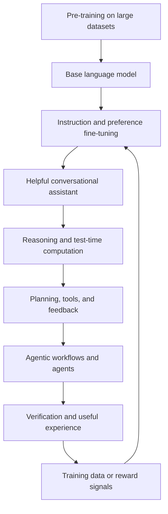
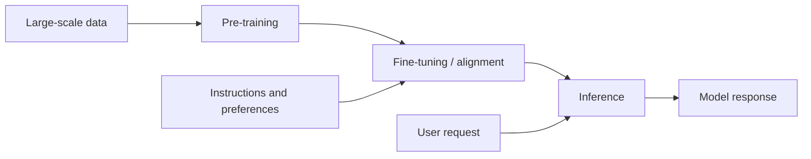
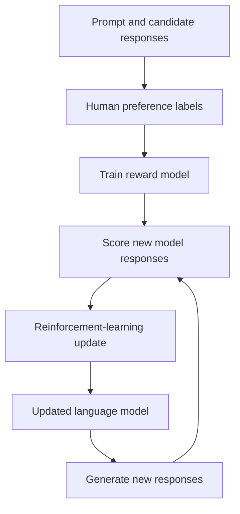
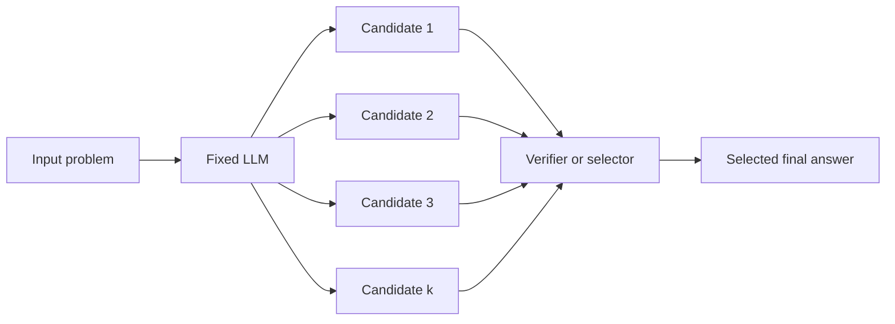
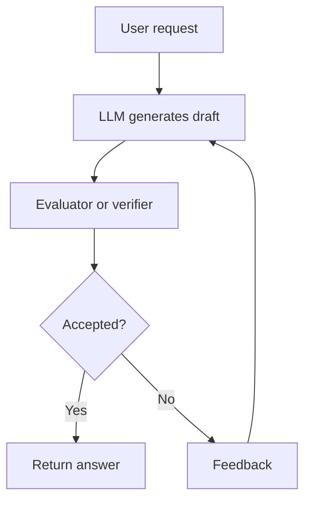
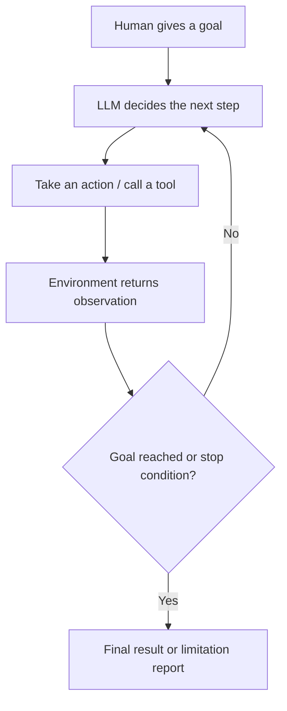
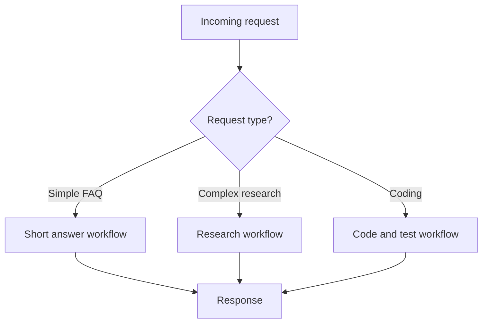
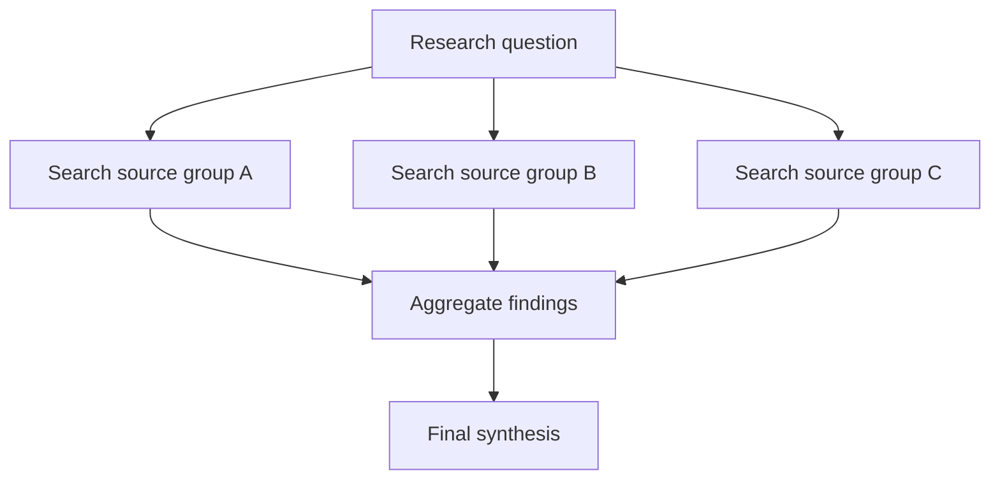
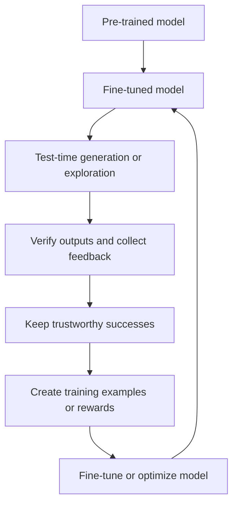
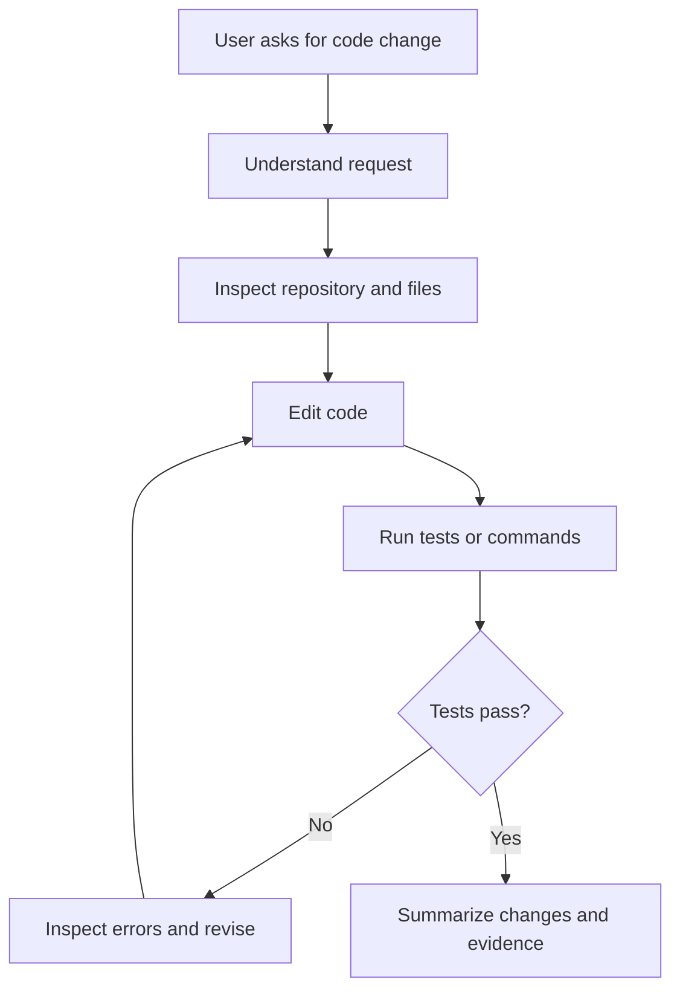

# Stanford CS329A — Lecture 1: From Large Language Models to Self-Improving AI Agents

> **Detailed study notes based on the supplied lecture slides and approximately 69-minute transcript.**  
> **Focus:** LLM scaling laws, in-context learning, emergent capabilities, chain-of-thought, fine-tuning, human preference alignment, inference-time scaling, reasoning models, agentic workflows, verification, and self-improving agents.
>
> **Reading convention:** The lecture's claims, historical charts, and terminology are summarized faithfully. **“Learning intuition”** and **“Worked example”** sections expand the lecture for clarity; they are explanations, not quotations from the instructor. Older model comparisons are **historical results**, not claims about the best models in 2026.

## Course and source information

| Item | Details |
|---|---|
| Course | **CS329A — Self-Improving AI Agents**, Stanford University |
| Instructors | **Prof. Aakanksha Chowdhery** and **Prof. Azalia Mirhoseini** |
| Course website | <https://cs329a.stanford.edu> |
| Prof. Chowdhery | <https://www.achowdhery.com> |
| Prof. Mirhoseini's group | <https://scalingintelligence.stanford.edu> |
| Lecture | **Lecture 1: Introduction and overview** |
| Main focus of these notes | Technical lecture content from approximately **01:58–58:00**; course logistics from approximately **60:38–69:28** |

**Source note:** The course website is shown as `cs329a.stanford.edu` on the supplied slide. One line of the automated transcript sounds like `cs239a.stanford.edu`; the slide's URL is used here.

---

## Table of contents

1. [The big picture: from LLMs to agents](#1-the-big-picture-from-llms-to-agents)
2. [Pre-training and scaling laws](#2-pre-training-and-scaling-laws)
3. [Exponential growth of language-model size](#3-exponential-growth-of-language-model-size)
4. [Zero-shot and few-shot learning](#4-zero-shot-and-few-shot-learning)
5. [Emergent behavior and chain-of-thought prompting](#5-emergent-behavior-and-chain-of-thought-prompting)
6. [ChatGPT, instruction tuning, and human alignment](#6-chatgpt-instruction-tuning-and-human-alignment)
7. [Training stages: next-token prediction, SFT, RLHF, and DPO](#7-training-stages-next-token-prediction-sft-rlhf-and-dpo)
8. [Inference-time scaling: Large Language Monkeys](#8-inference-time-scaling-large-language-monkeys)
9. [Reasoning models and self-correction](#9-reasoning-models-and-self-correction)
10. [From LLMs to agentic workflows and agents](#10-from-llms-to-agentic-workflows-and-agents)
11. [Common agentic workflow patterns](#11-common-agentic-workflow-patterns)
12. [Self-improving agents: closing the loop](#12-self-improving-agents-closing-the-loop)
13. [Real-world agent applications](#13-real-world-agent-applications)
14. [Key limitations, bottlenecks, and trade-offs](#14-key-limitations-bottlenecks-and-trade-offs)
15. [Course logistics and project expectations](#15-course-logistics-and-project-expectations)
16. [Comparison tables and glossary](#16-comparison-tables-and-glossary)
17. [Revision questions and answers](#17-revision-questions-and-answers)
18. [References and lecture navigation](#18-references-and-lecture-navigation)

---

# 1. The big picture: from LLMs to agents

The lecture tells a progression story: **models first became more capable through bigger pre-training runs**, then **more usable through fine-tuning**, then **better at hard problems through extra computation at inference time**, and finally **better at finishing real tasks through tool-using, feedback-driven agent systems**.



**How to read the diagram:**

- **Pre-training** learns broad statistical patterns and capabilities from large text/code datasets.
- **Fine-tuning** encourages models to respond to instructions and human preferences.
- **Reasoning and inference scaling** spend additional work on harder queries without necessarily changing model weights.
- **Agentic systems** connect models to tools, actions, goals, and feedback.
- **Self-improvement** occurs when feedback or verified experience is used to improve later outputs and, when fed into training, improve future versions of the model.

**Central lesson:** A capable language model is a foundation, but **reliable end-to-end task completion additionally requires planning, tool use, verification, and feedback**.

# 2. Pre-training and scaling laws

*Lecture coverage: approximately 01:58–04:04.*

## 2.1 What is pre-training?

In **pre-training**, a large language model is trained on large collections of text and other tokenized data. A common objective is **next-token prediction**: given an initial sequence, predict the token that comes next.

For example:

```text
Input context:  Machine learning models learn from
Target token:   data
```

By repeating this process across a large dataset, the model learns representations useful for language, facts, coding, patterns, and later tasks. The lecture refers to this initial result as a **pre-trained base model**.

## 2.2 Three axes of scaling

The slides emphasize three variables that historically correlate with lower language-model test loss:

| Variable | Symbol used in these notes | Meaning | What scaling it up usually changes |
|---|---:|---|---|
| Model parameters | $N$ | Number of learned weights | Model capacity and computation per token |
| Training dataset size | $D$ | Number of training tokens | Amount of data available for learning |
| Training compute | $C$ | Computational work used to train | Budget for model size, tokens, and optimization |
| Test loss | $L$ | Measure of predictive error on held-out data | **Lower is generally better** on that metric |

The lecture's three plots show **test loss decreasing** as training compute, dataset size, or parameter count increases in the studied regimes.

### What is test loss?

A simple interpretation: test loss measures how much the model's probability predictions disagree with the tokens in held-out text. If the model predicts the correct next token with higher probability, its loss becomes lower.

**Important distinction:** Lower language-model loss is a useful training signal, but it does **not** directly guarantee better safety, truthfulness, planning, tool use, or every benchmark result.

## 2.3 Power-law scaling

The central scaling-law idea is that language-model loss can often be approximated using a **power law** over certain ranges:

$$
L(X) \approx A X^{-\alpha}
$$

Where:

- $L(X)$ is the measured loss;
- $X$ can denote model parameters $N$, data tokens $D$, or training compute $C$;
- $A$ is a positive scaling constant;
- $\alpha > 0$ is the scaling exponent.

Because the exponent is negative, larger $X$ leads to smaller predicted $L$.

**Learning intuition:** A scaling law is not “twice the parameters gives twice the intelligence.” It says that **predictive error often improves in a regular, measurable way as resources grow**.

### Worked example: what happens if compute doubles?

Suppose a simplified compute scaling law is:

$$
L(C)=A C^{-0.05}
$$

After doubling compute:

$$
L(2C)=A(2C)^{-0.05}
$$

Use the exponent rule $(ab)^r=a^rb^r$:

$$
L(2C)=A\cdot 2^{-0.05}\cdot C^{-0.05}
$$

Since $L(C)=AC^{-0.05}$:

$$
\frac{L(2C)}{L(C)}=2^{-0.05}\approx 0.966
$$

Therefore the predicted reduction is:

$$
(1-0.966)\times100\% \approx 3.4\%
$$

**Interpretation:** Under this *illustrative* power law, doubling compute corresponds to about a **3.4% decrease in this particular loss quantity**. The actual result depends on the model, data, compute allocation, and valid range of the fitted law. The slide cites **Kaplan et al. (2020)** for early empirical scaling-law results.

### Why do plots often use logarithmic axes?

A power law becomes a straight-line relationship when the logarithm is taken:

$$
L=AX^{-\alpha}
$$

Take logarithms of both sides:

$$
\log L=\log A+\log(X^{-\alpha})
$$

Apply the logarithm exponent rule:

$$
\boxed{\log L=\log A-\alpha\log X}
$$

This has the same form as a straight line:

$$
y=b+mx
$$

with slope $m=-\alpha$. That is why a roughly straight, downward-sloping line on a **log-log plot** is evidence for a power-law relationship.

## 2.4 Why three scaling variables matter together

You cannot assume that simply maximizing the number of parameters is always the best way to use a fixed compute budget. Training more parameters usually requires more computation, and training on more tokens also costs compute.

**Practical lesson:** Good scaling is an optimization problem involving **model size, data quantity/quality, and compute**. The lecture focuses on the historical empirical relationship rather than a complete recipe for optimal compute allocation.

# 3. Exponential growth of language-model size

*Lecture coverage: approximately 04:04–05:08.*

The supplied slide illustrates rapid historical growth in parameter counts from 2018 onward.

| Model shown in the lecture | Approximate parameter count |
|---|---:|
| ELMo | 94 million |
| BERT-Large | 340 million |
| GPT-2 | 1.5 billion |
| Megatron-LM | 8.3 billion |
| T5 | 11 billion |
| Turing-NLG | 17.2 billion |
| GPT-3 | 175 billion |
| Megatron-Turing NLG | 530 billion |
| PaLM | 540 billion |

The slide includes an **estimated** GPT-4 position at a very large scale. **This was a conjectural annotation on an older chart, not a verified public GPT-4 parameter count**. It should not be repeated as a confirmed specification.

## 3.1 Why did researchers keep scaling LLMs?

The slides give three motivations:

1. **Continuous improvement with scaling:** Larger models frequently improve on language and other benchmarks.
2. **Few-shot learning:** Models can adapt their output behavior using examples in the prompt, rather than receiving additional weight updates.
3. **Emergent behavior:** Some capabilities became much more noticeable as model scale increased in the experiments discussed.

## 3.2 A useful distinction: model size versus model capability

Parameters are **not** an all-purpose measure of intelligence. Two models with the same number of parameters can differ greatly because of data quality, architecture, training methods, post-training, inference compute, and tool access.

The lecture's historical argument is **“scaling was a powerful driver of progress”**, not **“the largest parameter count always wins.”**

# 4. Zero-shot and few-shot learning

*Lecture coverage: approximately 05:39–06:33.*

## 4.1 Zero-shot prompting

In **zero-shot prompting**, the model receives a task description and the actual problem, but **no examples of that particular task inside the prompt**.

```text
Translate English to French:

cheese =>
```

Expected answer:

```text
fromage
```

The model relies on what it previously learned during training.

## 4.2 Few-shot prompting

In **few-shot prompting**, the prompt contains a few demonstrations before the new query.

```text
Translate English to French:

sea otter => loutre de mer
peppermint => menthe poivrée
plush giraffe => girafe peluche
cheese =>
```

Expected answer:

```text
fromage
```

Those examples help the model infer the **task format, language direction, and desired style**.

## 4.3 Zero-shot vs. one-shot vs. few-shot

| Method | Examples in prompt | What the model receives | Weight updates during prompting? |
|---|---:|---|---|
| Zero-shot | 0 | Instruction + query | **No** |
| One-shot | 1 | Instruction + one example + query | **No** |
| Few-shot | A few | Instruction + several examples + query | **No** |
| Fine-tuning | Training examples | Training procedure updates model weights | **Yes** |

**Very important:** Few-shot prompting is often called **in-context learning**. It changes the model's behavior using **context**, not by changing its stored parameters.

### Learning intuition

Think of the model as a student:

- Zero-shot: “Translate this word.”
- Few-shot: “Here are three example translations. Now translate the next word.”
- Fine-tuning: “Practice on a training dataset, adjust what you have learned, and then attempt new problems.”

# 5. Emergent behavior and chain-of-thought prompting

*Lecture coverage: approximately 06:33–10:49.*

## 5.1 What does emergent behavior mean in the lecture?

The lecture uses **emergent behavior** for capabilities that seem weak or absent at smaller scales but become noticeable at larger scales. The slides illustrate this with:

- Better results on middle-school math word problems.
- More effective use of **chain-of-thought** examples.
- Improved performance on tasks such as modular arithmetic, word unscrambling, and some question-answering benchmarks.

The course shows results for families such as **LaMDA, GPT, and PaLM** and discusses how performance with chain-of-thought prompting increases at larger scales.

> **Interpretation caution:** A sharp increase on a benchmark can depend on the evaluation method, thresholds, and scoring. Therefore, the historical term “emergent” should not be interpreted as proof that a new ability literally appears at one exact parameter count.

## 5.2 Standard prompting vs. chain-of-thought prompting

**Standard prompting** often includes a sample problem and the final answer, without an intermediate explanation.

**Chain-of-thought (CoT) prompting**, as demonstrated in the slides, includes examples with **intermediate reasoning steps** before the final answer.

### Worked example A: tennis balls

**Question:** Roger has 5 tennis balls. He buys 2 more cans, each containing 3 tennis balls. How many tennis balls does he have?

Step 1 — Find the number of balls in the new cans:

$$
2\times3=6
$$

Step 2 — Add those balls to the original 5:

$$
5+6=11
$$

**Answer: 11 tennis balls.**

### Worked example B: cafeteria apples

**Question:** The cafeteria starts with 23 apples, uses 20 for lunch, and purchases 6 more. How many apples remain?

Step 1 — Subtract the apples used:

$$
23-20=3
$$

Step 2 — Add the purchased apples:

$$
3+6=9
$$

**Answer: 9 apples.**

The slide contrasts a **wrong direct answer** with a **correct, step-by-step example**. Its teaching point is that example reasoning can guide a model to the right sequence of operations.

## 5.3 Why chain-of-thought examples can help

They can demonstrate:

1. How to interpret the problem.
2. How to break the problem into steps.
3. Which operations are appropriate.
4. How intermediate results lead to a final answer.

**Important limitation:** A plausible-looking explanation is not proof that the answer is correct. The arithmetic, code, or evidence still needs verification.

## 5.4 Historical experimental observation

The supplied GSM8K figure compares **standard prompting** and **chain-of-thought prompting** for different model sizes. In the lecture's explanation, **small models gained little from CoT demonstrations**, while **large models showed much larger gains**.

This finding motivated later work on **reasoning-oriented post-training and inference-time computation**.

# 6. ChatGPT, instruction tuning, and human alignment

*Lecture coverage: approximately 10:49–14:26.*

## 6.1 ChatGPT's November 2022 launch

The lecture highlights the **November 2022 launch of ChatGPT** as an important shift in how people interacted with LLMs: a user could have a **dialogue**, ask follow-up questions, and give instructions in natural language.

A historical slide quotes a figure of approximately **five days to reach one million users**. Treat this as a historical adoption statistic used in the lecture, not a universal measure comparable across every product or platform.

According to the lecture, a major difference from earlier base models involved **post-training**:

- **Instruction tuning:** train on examples of instructions and appropriate answers.
- **Human-feedback-based alignment:** shape responses toward preferences such as helpfulness, sensibleness, and safety.

## 6.2 What is AI alignment?

The lecture defines **AI alignment** as steering an AI system toward **human goals, values, and preferences**.

For example, an aligned assistant should not merely generate plausible text; it should try to:

- Follow the requested task accurately.
- Give useful, specific responses.
- Handle uncertain information appropriately.
- Avoid unsafe or otherwise unacceptable behavior.

The lecture explicitly states that alignment **remains a difficult, unresolved problem**.

## 6.3 Why isn't pre-training sufficient by itself?

A base model has learned broad patterns from data. But learning to predict a next token is **not exactly the same objective** as learning to:

- Obey a user's instruction.
- Prefer a correct answer over an incorrect one.
- Decline harmful requests.
- Continue a coherent back-and-forth conversation.

This motivates **additional training on curated data and preferences**.

## 6.4 The three broad stages



**Pre-training:** builds a general-purpose base model.  
**Fine-tuning:** adapts the model's behavior to targeted tasks and preferences.  
**Inference:** runs the trained model to produce responses; additional inference-time techniques may be applied here.

# 7. Training stages: next-token prediction, SFT, RLHF, and DPO

*Lecture coverage: approximately 14:26–19:22.*

## 7.1 Stage A: next-token prediction on high-quality data

The slides call this the **first stop for LLM fine-tuning**. The model continues learning to predict the next token, but on more focused or higher-quality text, such as:

- Code.
- Mathematics.
- Creative or specialized writing.
- Curated examples of good instructions and answers.

### The next-token objective

For a sequence of tokens:

$$
x_1,x_2,\ldots,x_T
$$

A language model estimates:

$$
p_\theta(x_t\mid x_1,\ldots,x_{t-1})
$$

where $\theta$ denotes the model's parameters.

A commonly used average negative log-likelihood objective is:

$$
\boxed{\mathcal{L}(\theta)=-\frac{1}{T}\sum_{t=1}^{T}\log p_\theta(x_t\mid x_{<t})}
$$

Here $x_{<t}$ means all tokens before position $t$. During training, the optimizer adjusts $\theta$ to **reduce** this loss.

### Worked example: why assigning higher probability lowers loss

For one correct target token, the loss contribution is:

$$
\ell=-\ln p
$$

Case 1 — The model assigns the correct token probability $p=0.1$:

$$
\ell_1=-\ln(0.1)\approx2.303
$$

Case 2 — After training, it assigns probability $p=0.8$:

$$
\ell_2=-\ln(0.8)\approx0.223
$$

Difference:

$$
\ell_1-\ell_2=2.303-0.223=2.080
$$

The loss is much smaller in Case 2 because the model gave the correct token a higher probability.

> **Note:** This numerical example is a teaching aid. It illustrates the general loss function; it is not a numeric result from the slides.

## 7.2 Stage B: supervised fine-tuning (SFT) / instruction tuning

A dataset contains **input instructions and desired output responses**.

```text
Instruction: Answer this question.
Question: What is the boiling point of nitrogen at 1 atm?
Desired answer: Approximately −195.8 °C (−320.4 °F).
```

The lecture's slide uses the nitrogen boiling-point question as a simple example of task-specific instruction-following data.

The model learns patterns such as:

- Recognizing which text is the user's task.
- Following requested formats.
- Giving relevant answers rather than simply continuing arbitrary text.
- Generalizing from many fine-tuning tasks to new tasks.

The lecture also shows **chain-of-thought fine-tuning**, where examples contain intermediate explanatory steps along with final answers. The cited **Chung et al. (2022)** slide emphasizes multi-task instruction tuning and generalization to previously unseen tasks.

### SFT vs. few-shot prompting

Both use examples, but in completely different ways:

- **Few-shot:** examples are in the current **prompt**; model parameters stay fixed.
- **SFT:** examples are used during **training**; model parameters change.

## 7.3 Stage C: preference-based fine-tuning

The goal is not only to produce a valid-looking answer, but to produce an answer that **humans tend to prefer**.

The slide names criteria such as:

- **Correctness:** Is the answer factually or mathematically right?
- **Helpfulness:** Does it address the user's actual need?
- **Specificity:** Does it provide relevant detail rather than vague statements?
- The transcript also mentions **harmlessness/safety**.

### How preference data can be collected

For the same user prompt, a model may produce two candidate responses:

```text
User: Explain how to reset my application password.

Response A: Check the account settings.
Response B: Open account settings, choose Security, and select
            Reset Password. Follow the verification prompt.
```

A human evaluator may prefer **B** for its specificity and helpfulness, assuming the steps are actually correct for that application.

Preference data can be represented as:

$$
(x, y_{\text{preferred}}, y_{\text{rejected}})
$$

where $x$ is the prompt and the two $y$ values are ranked responses.

## 7.4 Reinforcement Learning from Human Feedback (RLHF)

The lecture describes an RLHF pipeline:

1. Ask humans to compare or rank model responses.
2. Train a **reward model** to predict which responses are preferable.
3. Generate new responses with the language model.
4. Use the reward signal in a reinforcement-learning step to improve the language model's policy.
5. Repeat as needed, checking whether useful behavior actually improves.



### What is a reward model?

A **reward model** estimates a score for a response under learned human preferences. Conceptually:

$$
r_\phi(x,y)\rightarrow\text{preference score}
$$

where $\phi$ are the reward model's parameters, $x$ is the prompt, and $y$ is the generated response.

A high reward score means **the model predicts the response is preferred**, not that the response is guaranteed correct or safe.

## 7.5 Direct Preference Optimization (DPO)

The slide contrasts **RLHF** and **DPO**.

**High-level difference:**

- **RLHF** commonly learns an explicit reward model, then uses a reinforcement-learning procedure to improve the policy.
- **DPO** directly optimizes the language model using **preferred vs. rejected response pairs**, without the separate reward-model-plus-RL loop shown in the slide.

| Feature | RLHF, as illustrated | DPO, as illustrated |
|---|---|---|
| Training signal | Human-ranked responses | Human-ranked responses |
| Explicit learned reward model | **Yes** in the shown pipeline | **Not required** in the shown pipeline |
| Policy optimization | Reinforcement-learning update | Direct preference-based optimization |
| Main purpose | Align model outputs with preferences | Align model outputs with preferences |
| Practical concern | Reward-model reliability and RL complexity | Preference-data reliability and optimization choices |

**Remember:** RLHF and DPO are **post-training strategies**, not separate replacements for pre-training.

# 8. Inference-time scaling: Large Language Monkeys

*Lecture coverage: approximately 19:22–28:09.*

## 8.1 Why inference is another scaling dimension

The lecture shifts from increasing **training resources** to increasing **compute at the moment the model answers a problem**.

This is called **inference-time scaling**, **test-time scaling**, or **test-time compute**.

**Key property:** Inference-time scaling can improve outcomes **while keeping the model weights fixed**.

## 8.2 The “Large Language Monkeys” idea

The lab's **Large Language Monkeys: Scaling Inference Compute with Repeated Sampling (2024)** is inspired by the infinite monkey theorem.

Its two main steps are:

1. **Generate many candidate solutions** to one input problem.
2. **Use a verifier or selector** to identify a correct solution.



### Example: code generation

Suppose the task is to write a function that parses a special input format.

- Candidate 1 has a syntax error.
- Candidate 2 runs but fails an edge case.
- Candidate 3 passes all available unit tests.
- Candidate 4 returns the wrong output shape.

If the **unit tests** are sufficiently good, the verifier can select Candidate 3.

**Two distinct problems:**

- **Coverage:** Did the LLM generate *at least one* correct response?
- **Precision/selection:** Can the verifier reliably pick a correct response from the candidates?

Good generation without good selection is insufficient for dependable results.

## 8.3 What is pass@k / coverage?

In the slides, **coverage (pass@k)** measures the fraction of tasks for which **at least one among $k$ generated candidates is correct**.

In contrast, **pass@1** concerns correctness on a single attempt.

### Worked probability example

Assume, purely for illustration:

- Each independent attempt has probability $p$ of being correct.
- We generate $k$ attempts.

Step 1 — Probability one attempt is wrong:

$$
P(\text{wrong on one attempt})=1-p
$$

Step 2 — Probability all $k$ independent attempts are wrong:

$$
P(\text{all wrong})=(1-p)^k
$$

Step 3 — Probability **at least one** attempt is correct:

$$
\boxed{P(\text{at least one correct})=1-(1-p)^k}
$$

Step 4 — Suppose $p=0.02$ and $k=50$:

$$
P(\text{at least one correct})=1-(1-0.02)^{50}
$$

$$
=1-(0.98)^{50}
$$

$$
\approx1-0.364=0.636
$$

So the probability is approximately:

$$
\boxed{63.6\%}
$$

**Interpretation:** Even if one independent attempt succeeds only 2% of the time, multiple attempts create a much better chance of obtaining *at least one* correct candidate.

**Crucial assumptions:** The formula assumes independent, identically distributed attempts. Actual model outputs are often correlated; a good verifier is also required to recognize the correct result. **Coverage is not the same as the user-visible final-answer accuracy.**

## 8.4 What the lecture's benchmark plots show

The repeated-sampling slides compare **Llama-3-8B-Instruct**, **Llama-3-70B-Instruct**, and a **GPT-4o single-attempt reference line** on benchmarks such as:

- **MiniF2F-MATH** (formal proof problems).
- **CodeContests** (competitive programming).
- **MATH** (with an oracle verifier).
- **GSM8K** (with an oracle verifier).

The historical plots indicate that increasing the number of samples can greatly increase **coverage**, and smaller models can surpass the single-attempt reference **on selected benchmarks under the evaluation setup shown**.

**Do not overgeneralize:** The slide does not establish that a small model with repeated sampling universally outperforms a larger model on all tasks, at equal cost, or using a practical imperfect verifier. Some panels use an **oracle verifier**, and the slide notes computational constraints and evaluated subsets.

## 8.5 The role of sampling temperature

The transcript discusses **temperature** as a control that can affect diversity in generated outputs.

- Very low diversity can generate many nearly identical attempts.
- More diversity can explore alternative solutions.
- Excessive randomness can degrade output quality and produce nonsense.

**The objective is useful diversity, not maximum randomness.**

## 8.6 Compute and latency trade-offs

Generating $k$ answers instead of one usually consumes more total inference compute. However, independent candidates may be generated **in parallel**, which can reduce the wall-clock latency compared with sequential generation, if enough hardware is available.

| Question | Practical implication |
|---|---|
| How many samples? | Higher $k$ can improve coverage, but with diminishing returns and rising compute cost. |
| How much diversity? | Too little gives repetitive outputs; too much gives lower-quality outputs. |
| Can outputs be verified? | Math, code, and formal proofs are easier to check than subjective writing. |
| Can sampling be parallelized? | Often yes, reducing latency but not eliminating total compute costs. |
| When should the system stop? | A correct verified answer, an exhausted budget, or another termination rule. |

# 9. Reasoning models and self-correction

*Lecture coverage: approximately 28:09–40:49.*

## 9.1 From sampling to trained reasoning models

The lecture connects **test-time scaling** to **reasoning models**, referencing historical examples including **DeepSeek-R1, OpenAI's o-series, and Gemini thinking models**.

The high-level idea is to combine:

- **Training-time improvement:** update model parameters using useful examples or reward signals.
- **Test-time improvement:** spend more compute on hard problems to generate, evaluate, revise, or explore solutions.
- **Feedback from verifiable outcomes:** use successful solutions as a source of better training examples.

This begins to form a self-improvement process.

## 9.2 Five capabilities emphasized in the slides

### 1. Problem analysis

Determine what the user is requesting, what the inputs mean, and what a correct output should look like.

### 2. Task decomposition

Divide a complicated task into smaller operations that can be solved and checked separately.

### 3. Self-evaluation

Assess a proposed solution using a tool, test, reward signal, or other evidence.

### 4. Self-correction

Recognize errors and revise the approach when new information or verification shows a problem.

### 5. Alternative proposals

Try a different strategy if the current method fails.

These are desirable **problem-solving behaviors**, not a guarantee that a model can reliably inspect or correct every error.

## 9.3 Worked example: matrix transpose

The lecture uses a coding request about transposing a matrix written as a string.

Input:

```text
[1,2],[3,4],[5,6]
```

This represents the matrix:

$$
A=\begin{bmatrix}
1 & 2\\
3 & 4\\
5 & 6
\end{bmatrix}
$$

It has **3 rows and 2 columns**.

The **transpose** swaps rows with columns:

$$
(A^\mathsf{T})_{ij}=A_{ji}
$$

Therefore:

$$
A^\mathsf{T}=\begin{bmatrix}
1 & 3 & 5\\
2 & 4 & 6
\end{bmatrix}
$$

Output in the requested string format:

```text
[1,3,5],[2,4,6]
```

### Task decomposition for this request

1. **Parse the input string** into rows and numbers.
2. **Construct a matrix representation.**
3. **Swap the row/column indices.**
4. **Format the resulting matrix back into the requested string.**
5. **Verify the output**, including rectangular and single-row cases.

Notice that this breakdown is useful even before writing any Bash code. The purpose of the slide was to explain the **analysis and decomposition process**, not to present a complete implementation.

## 9.4 Self-correction example from the slides

The slides show a model working on an acid/base chemistry problem, noticing that an equation or constant was being used incorrectly, and reconsidering which equilibrium constants apply.

The general lesson is:

```text
Initial attempt
    ↓
Detect possible mistake
    ↓
Recheck assumptions and formula
    ↓
Revise computation
    ↓
Verify final answer
```

The supplied chemistry excerpt is partially garbled in the screenshots/transcript, so these notes **do not reconstruct a numerical pH solution from unsupported values**.

## 9.5 Pass@1 versus pass@k

This distinction is central to the lecture's comparison of reasoning models and repeated sampling.

| Metric | Meaning | Illustrates |
|---|---|---|
| **pass@1** | Success with a single attempt | Quality of the next generated answer |
| **pass@k** | At least one success across $k$ attempts | Coverage of possible correct solutions |

A model might have low **pass@1** but reasonable **pass@k**: it can sometimes produce the right answer, but it does not reliably do so on the first attempt.

A successful post-training procedure may increase **pass@1** by making the model more likely to produce a high-quality solution directly.

## 9.6 Historical reasoning-model performance

The lecture describes a comparison in which **o1-preview** performed better than **GPT-4o** on a number of reasoning-intensive tasks such as mathematics, data analysis, and programming. It also notes that stronger reasoning did **not necessarily** yield a win on all writing or text-editing preferences.

**General lesson:** Model quality is task-dependent. Evaluate the specific job rather than assuming one model is best at everything.

# 10. From LLMs to agentic workflows and agents

*Lecture coverage: approximately 40:49–45:03.*

## 10.1 What is missing from a chatbot?

A chatbot can answer a question or hold a conversation. But a real task may require actions outside the model:

- Searching multiple websites.
- Reading and editing files.
- Running code and observing errors.
- Testing changes.
- Gathering evidence.
- Replanning after failure.

The lecture argues that **agents and agentic workflows** are the systems that connect LLM reasoning to these actions.

## 10.2 Agentic workflow: a mostly predetermined process

A **workflow** uses **predefined code or an orchestrated graph** to decide which LLM and tool steps happen.

Example:



The workflow's structure is largely fixed in advance, even if LLM outputs vary during execution.

## 10.3 Agent: dynamic control of the process

The lecture draws on Anthropic's **Building Effective Agents** distinction: **agents dynamically direct their own processes and tool usage**, whereas workflows route execution through predefined paths.

An agent can:

1. Receive a goal.
2. Analyze the current situation.
3. Decide which step or tool to use.
4. Act on the environment.
5. Observe feedback.
6. Update its plan.
7. Continue or stop based on progress.



**The critical differentiator is control:** The agent can dynamically decide **what to do next** based on what happened, rather than only following one predetermined chain.

## 10.4 Agent vs. workflow vs. chatbot

| System | Main behavior | Controls the sequence? | Typical example |
|---|---|---|---|
| Basic chatbot | Responds to user messages | Mostly user/turn structure | Question-answer conversation |
| Agentic workflow | Runs a predesigned chain, branch, or graph | Developer-defined orchestration | Generate → test → revise |
| Agent | Selects and revises actions toward a goal | LLM plus tool/runtime constraints | Coding assistant inspecting and modifying a repo |

**Terminology note:** Real products often mix workflows and agentic loops. The boundary is a helpful **design distinction**, not an absolute product label.

# 11. Common agentic workflow patterns

*Lecture coverage: approximately 44:50–47:55.*

The lecture lists: **prompt chaining, routing, parallelization, orchestrators, evaluator/judges, and verifiers**.

## 11.1 Prompt chaining

Split one larger job into an ordered series of subtasks.

Example:

```text
Research topic
  → Collect information
  → Create outline
  → Draft report
  → Check report
```

**When useful:** The work has a natural sequence, and each step produces an output used by the next step.

## 11.2 Routing

Choose a pathway according to the user's task or its apparent difficulty.



**When useful:** Different tasks require different models, tools, compute budgets, or validation rules.

## 11.3 Parallelization

Run independent tasks at the same time and then combine their results.



**When useful:** Subtasks do not need to wait for each other. The lecture gives **deep research** as an example.

## 11.4 Orchestrator / workers

A central **orchestrator** or “LLM manager” analyzes the goal and decides which subtasks should be assigned to workers.

Example:

```text
Orchestrator: Build a market research report.
Worker A: Gather industry statistics.
Worker B: Compare competitor offerings.
Worker C: Summarize relevant publications.
Orchestrator: Combine results, check gaps, and deliver report.
```

**Difference from basic parallelization:** The orchestrator may decide **which tasks need to exist**, not merely execute a predetermined list.

## 11.5 Evaluator or judge

An evaluator assesses the quality of a generated response and can provide revision feedback.

```text
Generator → Draft → LLM Judge → Feedback → Generator
```

**When useful:** A rule-based answer key is unavailable, but qualitative review can still improve writing or task completion.

**Limitation:** A judge model can also be mistaken, biased, inconsistent, or persuaded by an incorrect but fluent response.

## 11.6 Verifiers

A verifier checks output against a more concrete criterion.

Examples:

- **Code:** unit tests and integration tests.
- **Mathematics:** checking a derived result or formal proof.
- **Structured data:** schema validation.
- **File edits:** whether the expected files exist and tests still pass.

**When useful:** The system has a clearly testable correctness condition.

### Evaluator vs. verifier

| Aspect | Evaluator / LLM judge | Verifier |
|---|---|---|
| Often based on | Learned qualitative judgment | Explicit test, rule, execution, or proof |
| Output | Score, critique, preference | Pass/fail or measured property |
| Strength | Works for less easily formalized tasks | More objective for well-specified conditions |
| Weakness | May misjudge or hallucinate | Tests can be incomplete or incorrect |

**Design principle:** Prefer strong, independent checks where possible. For open-ended tasks, combine an LLM evaluator with source checking or human review.

# 12. Self-improving agents: closing the loop

*Lecture coverage: approximately 28:42–30:17 and 45:44–53:00.*

## 12.1 What does “self-improving” mean?

The course's main theme is that a system can **use its own attempts and feedback to improve its behavior**.

There are **two related but distinct improvement loops**:

1. **Within-task improvement:** Try, receive feedback, and revise the current solution. Model parameters may remain unchanged.
2. **Across-task/training improvement:** Collect high-quality verified examples or rewards and use them in a later training or fine-tuning step. Model parameters may change.

**Do not confuse revising an answer with updating weights.** A chatbot correcting an answer inside a conversation does not necessarily mean the model has learned new parameters.

## 12.2 Test-time to training-time feedback loop



This is the connection the lecture makes between **repeated sampling**, **synthetic reasoning traces**, and **reasoning-model training**.

### Step-by-step coding illustration

Suppose an agent must fix a failing function:

1. Read the failing task and relevant repository files.
2. Propose a patch.
3. Run tests.
4. If a test fails, inspect the error and revise.
5. If the patch passes, record the patch and evaluation result.
6. If a future training pipeline carefully validates these examples, successful experiences may support further fine-tuning.

The first five steps are an **inference-time agent workflow**. Step six is a **separate training process**, which must be explicitly implemented; it is not automatic.

## 12.3 Why synthetic data helps

A capable model can generate many attempts for problems where a correct result can be checked. This can yield:

- Candidate solution traces.
- Successful code patches.
- Verified mathematical solutions.
- Examples of mistakes and corrections.

These can become potential learning signals, especially if their quality is independently verified.

## 12.4 Why verification is central

Without reliable verification, the system may reward an incorrect solution or feed faulty examples back into training.

The lecture calls out the **generator–verifier gap**:

- A model may generate plausible-looking answers easily.
- It may be much harder to **know which answers are actually correct**.

That gap is a major limit on self-improvement, particularly for creative or open-ended tasks where there is no clear answer key.

# 13. Real-world agent applications

*Lecture coverage: approximately 48:04–57:58.*

## 13.1 Coding agents

The lecture discusses coding agents that can interact with a repository and command-line tools.

A typical loop is:



The lecture gives examples such as:

- Code migrations and version upgrades.
- Repository restructuring.
- Test generation and execution.
- Data cleaning and data engineering.

**Why an agent matters:** The exact sequence of file reads, edits, commands, and retries depends on feedback from the repository and tools.

## 13.2 Customer-support systems

The lecture mentions several levels of AI assistance:

| Use case | What the system helps do |
|---|---|
| Live transcription | Convert conversations or calls into searchable text |
| Knowledge assist | Retrieve helpful documentation for a support representative |
| Smart replies | Suggest relevant responses to a customer |
| Call summarization | Produce a concise record of a support interaction |
| End-to-end support | Resolve an issue using multiple steps, tools, and permitted actions |

These applications can range from **simple model-assisted features** to **fully orchestrated workflows**; not every AI-supported customer-service feature is an autonomous agent.

## 13.3 Deep research agents

For a research question, an agent may:

1. Interpret and scope the question.
2. Identify relevant topics and sources.
3. Search and read multiple documents.
4. Extract and compare claims.
5. Create an outline.
6. Synthesize an answer with evidence.

The lecture uses broad research and source synthesis as examples of work that previously required multiple manual stages.

## 13.4 AI-assisted scientific research

The lecture also describes systems that may help with:

- Generating research ideas.
- Designing or iterating experiments.
- Interpreting outcomes.
- Drafting or improving technical reports.

**Qualification:** These tools can assist scientists and suggest new directions, but generated ideas, calculations, experiments, and citations must still be checked. A plausible write-up alone is not a scientific result.

# 14. Key limitations, bottlenecks, and trade-offs

The following points consolidate the lecture's discussion and add clearly labeled practical interpretation.

## 14.1 Scaling is expensive and not unlimited

The lecture explains that larger training runs led to major improvements, while also motivating alternative improvement paths once further pre-training scale becomes costly or less efficient.

## 14.2 More samples require more compute

Inference-time sampling may raise success coverage but can greatly increase total token generation, verifier calls, and system cost. Parallel execution can reduce elapsed time but **does not make the work free**.

## 14.3 The final answer needs reliable selection

With large $k$, the system might generate one correct answer among thousands of incorrect ones. Without a good selector, higher **pass@k** may not translate into higher final-answer quality.

## 14.4 Testing is easier in some domains than others

| Domain | Can correctness be checked reliably? | Why it matters |
|---|---|---|
| Formal proof | Often, with a trusted proof checker | Strong binary correctness signal |
| Code | Partially, using unit tests or execution | Tests may miss edge cases |
| Arithmetic | Usually, with exact computation | Strong and inexpensive feedback |
| Research synthesis | Partially, through cited-source checks | Claims, relevance, and interpretation require judgment |
| Creative writing | Often subjective | Preference signals may disagree |

## 14.5 Generated verification can also be wrong

The transcript notes that an LLM might generate its own unit tests. This is promising, but circular verification can be dangerous: a faulty test may incorrectly approve faulty code.

**Practical interpretation:** Strong evaluation should use independent test cases, known specifications, deterministic checks where available, and human review for higher-stakes outcomes.

## 14.6 Planning and memory matter for longer tasks

A multi-step agent may need to retain:

- The original goal.
- Important context and assumptions.
- Completed and pending subtasks.
- Tool outputs and failures.
- A clear stop condition.

The lecture highlights keeping track of progress and remaining on task as important for longer agentic systems.

## 14.7 Self-improvement is still an active research area

The instructors note open questions about exactly how much capability comes from **pre-training**, **post-training/RL**, **reasoning traces**, and **feedback**. The course presents a research frontier, not a fully solved theory.

# 15. Course logistics and project expectations

*Lecture coverage: approximately 60:38–69:28. These details describe the specific course offering discussed in the recording; confirm current requirements on the course site and learning platform.*

## 15.1 Course format

The instructors describe:

- Regular lectures and guest lectures from AI researchers and practitioners.
- Readings and research papers.
- **Three homework assignments.**
- A substantial **course project**.
- Project proposals, progress/midterm presentations, and a final report/poster.

The transcript says to check **Canvas** for current announcements and materials, with course-related questions and submissions handled through the announced class platforms.

## 15.2 Grading discussed in the lecture

| Assessment | Proportion mentioned |
|---|---:|
| Three homeworks collectively | **50%** |
| Course project collectively | **50%** |

The lecture reports a final **poster presentation on December 12, 4:00–6:00 p.m.** for its original course offering. This is **not presented as a current future deadline**; consult the course site for dates applicable to your enrollment.

## 15.3 Project-team guidance

The instructors encouraged collaboration, with teams of **up to four people** and individual work also possible.

## 15.4 What counts as a good project?

The course emphasizes **research questions and evidence**, not simply assembling a demo application.

Examples mentioned:

- Constructing an **evaluation dataset** or benchmark.
- Studying and improving the **reliability** of an agentic system.
- Testing an approach for improving a benchmark.
- Reproducing and extending a research result.
- Investigating a training, planning, verification, or evaluation design choice.

The instructors discourage **survey-only projects** or **app-only projects without a substantial hypothesis and experiments**.

### Example of a research-oriented project plan

**Question:** Does adding independent generated unit tests improve the reliability of a coding agent?

**Hypothesis:** A coding agent with better test-based feedback will pass more hidden tests than one relying only on its initial answer.

**Experiment:**

1. Select a defined coding benchmark.
2. Run a baseline agent.
3. Run the same agent with an added verifier/test-generation procedure.
4. Measure hidden-test accuracy, number of attempts, latency, and compute cost.
5. Analyze failures and limitations.

**Deliverable:** Results and an evidence-based conclusion, including situations where the method did **not** improve performance.

> This example is an instructional project sketch derived from the course's project criteria, **not** an official assignment prompt.

# 16. Comparison tables and glossary

## 16.1 The four different kinds of scaling/improvement

| Method | What increases or changes? | Are model weights updated? | Main benefit | Main cost or limitation |
|---|---|---|---|---|
| Parameter scaling | Model size $N$ | During model training, yes | Potential capacity gains | More training/inference resources |
| Data scaling | Number/quality of training tokens $D$ | During training, yes | Broader/better learned patterns | Data acquisition/quality and training cost |
| Post-training | SFT, preference optimization, RL | **Yes** | Better task-following and preferred behavior | Curated labels, feedback, optimization |
| Test-time scaling | Samples, reasoning/search, verification | **Not necessarily** | Better output for hard problems | More inference compute and selection challenges |

## 16.2 Key definitions

| Term | Easy definition |
|---|---|
| **LLM** | A large neural language model trained to predict or generate tokens. |
| **Parameter** | A learned number/weight inside the model. |
| **Token** | A unit of text or other representation processed by the model. |
| **Pre-training** | Large-scale initial training to learn general capabilities. |
| **Fine-tuning** | Additional training to adapt a model's behavior or capabilities. |
| **SFT** | Supervised fine-tuning on examples of desired responses. |
| **Scaling law** | Empirical relationship between resources and a model metric such as loss. |
| **In-context learning** | Adapting behavior from examples in a prompt without weight updates. |
| **Zero-shot** | Performing a task without task examples in the prompt. |
| **Few-shot** | Performing a task with several demonstrations in the prompt. |
| **Chain-of-thought prompting** | Showing intermediate solution steps as examples to encourage multi-step solving. |
| **RLHF** | Using human preference feedback, often via a reward model and RL, to improve model behavior. |
| **DPO** | A method that directly uses preference pairs to optimize a language model. |
| **Reward model** | Model that predicts the quality/preference score of an output. |
| **Inference-time scaling** | Using more computation while answering, without necessarily retraining. |
| **pass@1** | Success rate with one generated attempt. |
| **pass@k** | Fraction of tasks solved by at least one of $k$ generated attempts. |
| **Verifier** | Mechanism for checking output against explicit correctness criteria. |
| **LLM-as-judge** | An LLM that evaluates another output. |
| **Agentic workflow** | A designed flow of LLM, tool, and evaluation steps. |
| **Agent** | System that dynamically plans and chooses actions/tools toward a goal. |
| **Self-correction** | Revising an attempted solution using detected errors or feedback. |
| **Self-improving agent** | Agent/system using feedback to improve current work or to support future model training. |

## 16.3 Common misconceptions

| Misconception | Better understanding |
|---|---|
| “A bigger model always performs better.” | Training, data, post-training, task, and inference techniques also matter. |
| “Few-shot learning updates the model.” | Examples in a prompt do **not** update model weights. |
| “An explanation proves the answer is correct.” | Reasoning-looking text can still contain errors; verify outcomes. |
| “pass@k is the accuracy of the selected answer.” | It measures whether **any** candidate is correct; selection is a separate challenge. |
| “More test-time sampling is free.” | It consumes extra inference compute and verifier work. |
| “Every multi-step LLM application is an autonomous agent.” | Many are predefined **workflows** rather than dynamic agents. |
| “An agent fixing its response means the model has been retrained.” | Current-task revision and weight updates are separate processes. |
| “Unit tests guarantee program correctness.” | Tests only check the behaviors they cover. |
| “A judge model is equivalent to a formal verifier.” | Judges and verifiers provide different kinds of confidence. |

# 17. Revision questions and answers

## Questions

1. What three factors are shown in the lecture's pre-training scaling-law plots?
2. Why does a negative power-law exponent correspond to lower loss as resources increase?
3. What is the difference between zero-shot and few-shot prompting?
4. What is the key difference between few-shot prompting and supervised fine-tuning?
5. How did the lecture use chain-of-thought examples to explain better problem-solving behavior?
6. Why was instruction tuning significant to conversational models?
7. What is the role of a reward model in RLHF?
8. How does DPO differ from the RLHF pipeline shown in the slides?
9. What are the two stages of the Large Language Monkeys approach?
10. What is the difference between **pass@1** and **pass@k**?
11. Why does a verifier matter more as more candidates are generated?
12. What is the distinction between inference-time improvement and model fine-tuning?
13. What capabilities does the lecture associate with reasoning models?
14. What distinguishes an agent from an agentic workflow?
15. Name three common workflow patterns discussed in the lecture.
16. Why are coding tasks particularly suitable for verification-based agent loops?
17. What is the generator–verifier gap?
18. What makes a course project research-oriented rather than only a demo?

## Short answer key

1. **Training compute, training dataset size, and model parameter count.**
2. With $L=AX^{-\alpha}$ and $\alpha>0$, larger $X$ makes $X^{-\alpha}$ smaller.
3. **Zero-shot** includes no task demonstrations; **few-shot** includes a few.
4. Few-shot changes only the **prompt context**; SFT changes the **model parameters**.
5. Worked intermediate steps demonstrated how to break down arithmetic and choose operations, helping models on the illustrated tasks.
6. It taught models to **recognize and follow instructions**, rather than only predict likely text continuations.
7. It predicts a **preference-based score** used to guide the model's optimization.
8. The illustrated DPO approach directly optimizes on **preferred/rejected pairs**, avoiding the separate reward-model-plus-RL loop shown.
9. **Generate many candidates** and **select a correct candidate using a verifier**.
10. **pass@1** tests one attempt; **pass@k** checks whether at least one of $k$ attempts is correct.
11. Many candidates create a larger search space; the system still needs to identify the good one correctly.
12. Inference-time improvement generally keeps **weights fixed**; fine-tuning **updates weights**.
13. **Problem analysis, task decomposition, self-evaluation, self-correction, and alternative proposals.**
14. An agent **dynamically chooses actions and tools**; a workflow largely follows a **predefined process**.
15. For example, **prompt chaining, routing, parallelization, orchestrator/worker, evaluator, or verifier** patterns.
16. Compiled/runnable programs and **unit tests** provide relatively concrete feedback.
17. **Generating possible answers** can be easier than **reliably checking which are correct**.
18. A project should state a **question or hypothesis**, run experiments, measure results, and analyze evidence and limitations.

# 18. References and lecture navigation

## Sources explicitly named or linked in the supplied slides

1. **Stanford CS329A course website:** <https://cs329a.stanford.edu>
2. **Kaplan et al. (2020), _Scaling Laws for Neural Language Models_** — cited for pre-training scaling trends.
3. **Brown et al. (2020), _Language Models are Few-Shot Learners_** — cited for GPT-3 and zero/few-shot prompting.
4. **Wei et al. (2022), _Chain-of-Thought Prompting Elicits Reasoning in Large Language Models_** — cited for CoT prompting and scaling observations.
5. **Nye et al. (2021), _Show Your Work: Scratchpads for Intermediate Computation with Language Models_** — cited in the CoT slide.
6. **Thoppilan et al. (2022), _LaMDA: Language Models for Dialog Applications_** — cited for dialogue quality/alignment plots.
7. **Chung et al. (2022), _Scaling Instruction-Finetuned Language Models_** — cited for multi-task instruction fine-tuning.
8. **Brown et al. (2024), _Large Language Monkeys: Scaling Inference Compute with Repeated Sampling_** — cited for multi-sample inference scaling. The supplied slide lists Bradley Brown, Jordan Juravsky, Ryan Ehrlich, Ronnie Clark, Quoc Le, Chris Ré, and Azalia Mirhoseini.
9. **Anthropic, _Building Effective Agents_:** <https://www.anthropic.com/research/building-effective-agents> — cited for the workflow-versus-agent distinction and workflow patterns.
10. **Hugging Face blog on large language models:** <https://huggingface.co/blog/large-language-models> — cited on the historical size chart.
11. **Hugging Face blog on RLHF:** <https://huggingface.co/blog/rlhf> — cited on the fine-tuning slide.

## Timestamp navigation into the supplied lecture transcript

| Approximate time | Topic |
|---|---|
| **00:00–01:58** | Instructor introductions and overview |
| **01:58–04:04** | Pre-training scaling laws |
| **04:04–06:33** | Model growth, few-shot and zero-shot learning |
| **06:33–10:49** | Emergent behavior and chain-of-thought prompting |
| **10:49–14:26** | ChatGPT and alignment |
| **14:26–19:22** | High-quality data, instruction tuning, human preference feedback |
| **19:22–28:09** | Inference-time scaling and Large Language Monkeys |
| **28:09–40:49** | Reasoning models, training/test-time loops, self-correction |
| **40:49–47:55** | Agents, workflows, and orchestration patterns |
| **47:55–57:58** | Coding agents, customer support, research, verifiers |
| **57:58–60:38** | Discussion of reasoning and emergence |
| **60:38–69:28** | Course logistics, assignments, projects, grading |

---

## Final one-page mental model

**Train the base model** to predict tokens on broad datasets.  
**Scale training** using more parameters, higher-quality/more data, and compute.  
**Fine-tune the model** to follow instructions and produce preferred responses.  
**Spend inference compute** to explore multiple candidate solutions or perform additional reasoning.  
**Verify outputs** using objective checks where possible.  
**Wrap the model in tools and feedback loops** to perform real multi-step tasks.  
**Improve future behavior** by using trustworthy feedback within the task and, where a separate training pipeline exists, turning verified experience into training signals.

> **Most important takeaway:** The lecture's trajectory is **pre-training scale → alignment/post-training → inference-time reasoning → tool-using agents → verification-driven self-improvement**. The next research challenge is not only generating plausible actions, but making these systems **reliable, verifiable, and able to learn from useful feedback**.
