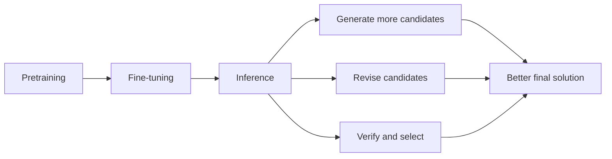
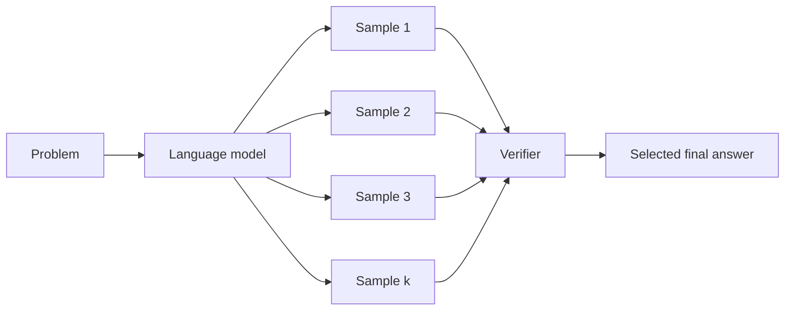
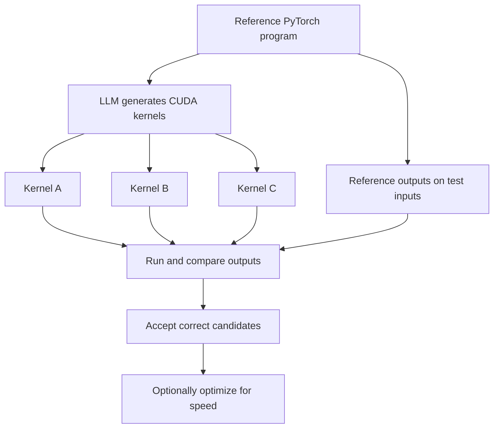
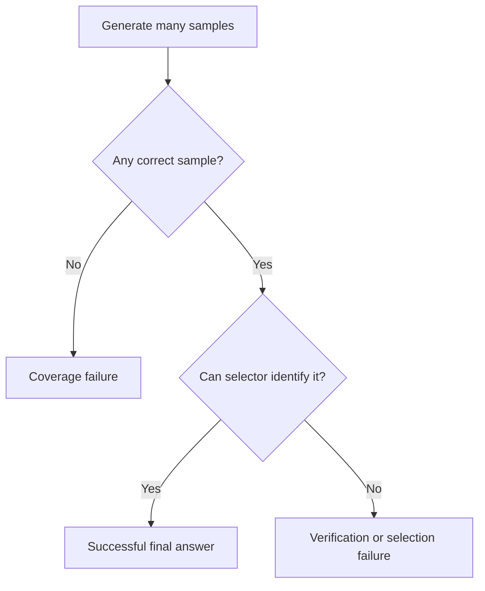
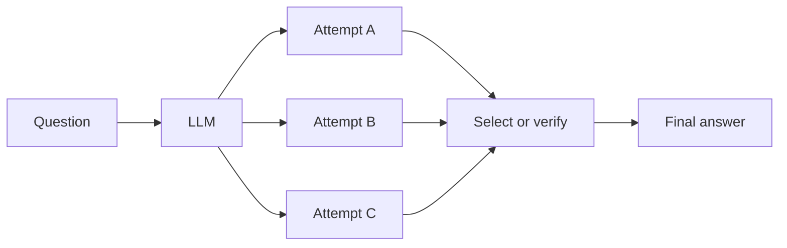
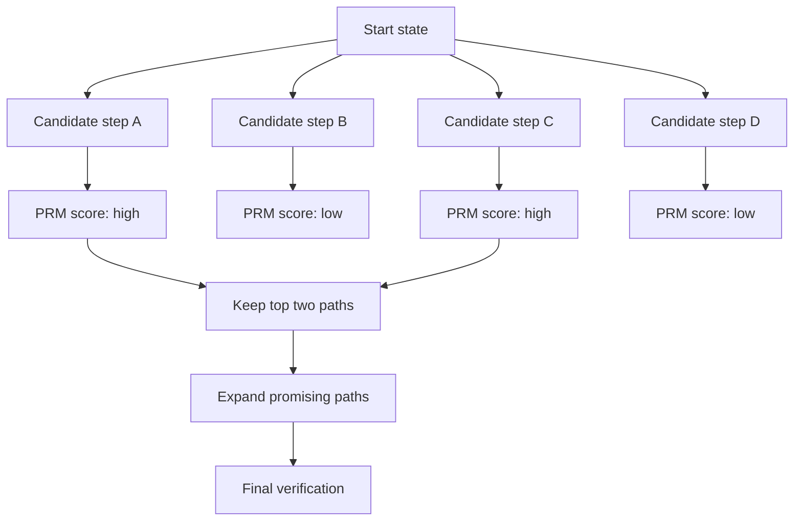
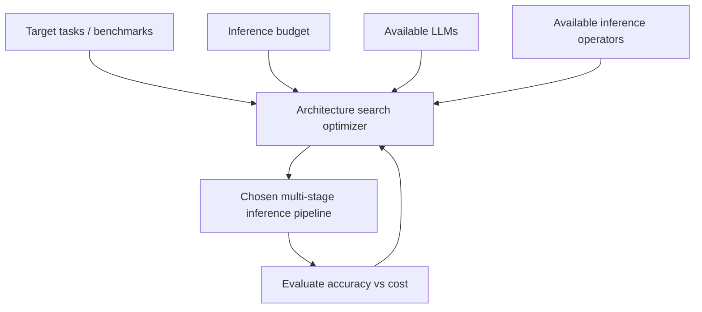
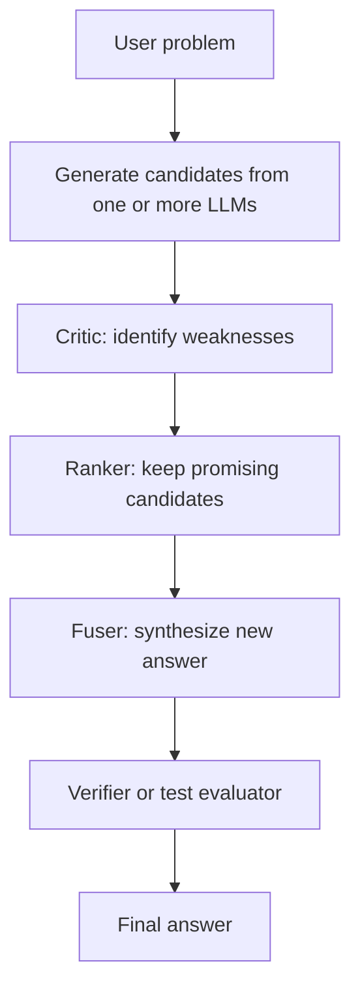
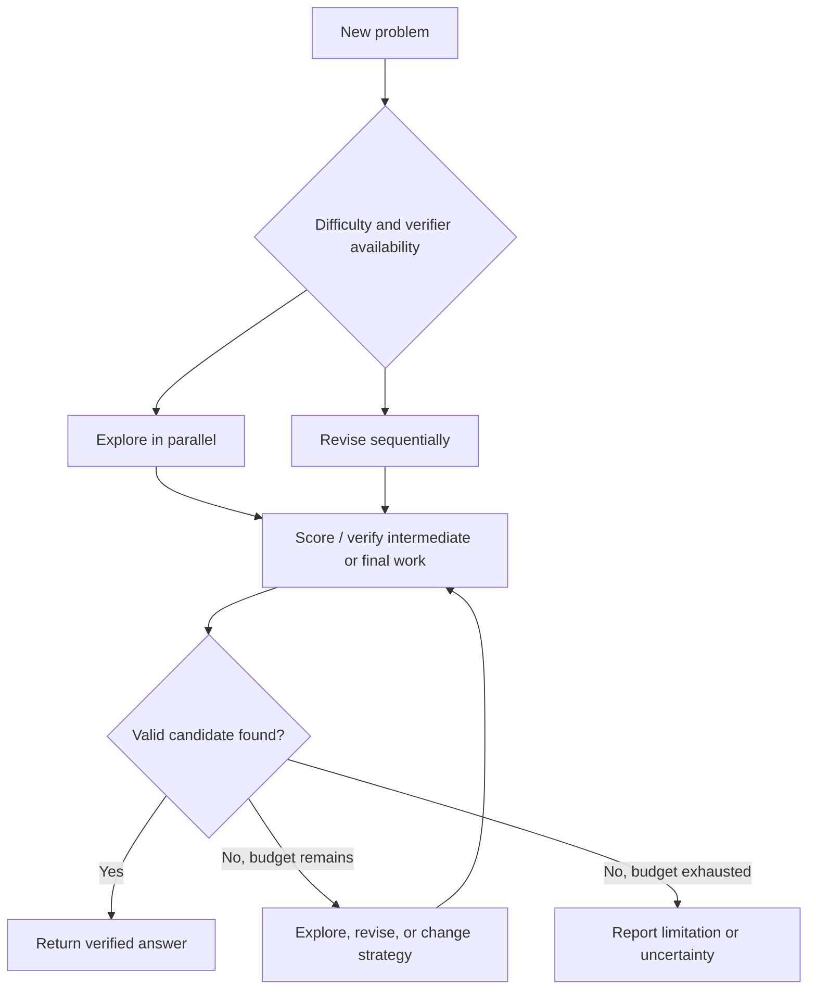

# Inference-Time Scaling in Large Language Models — Complete Study Notes

**Topics:** Inference scaling, repeated sampling, Large Language Monkeys, pass@k, scaling laws, long-tail difficulty, automated verification, parallel sampling, sequential revisions, reward models, compute-optimal inference, and Archon architecture search.

**Based on:** The uploaded lecture transcript (approximately 63 minutes) and accompanying lecture-slide screenshots. These notes follow the lecture's sequence and retain its benchmark examples and historical experimental findings. Worked calculations, implementation sketches, and interpretive clarifications are added for learning; they are **not additional results claimed by the lecture**.

> **One-sentence summary:** A language model can solve more problems **without updating its weights** by spending additional computation at inference time to generate, revise, compare, and verify candidate solutions. The benefit depends not only on generating a correct candidate but also on **finding and selecting** it efficiently.

---

## Table of Contents

1. [The Big Picture: What Is Inference-Time Scaling?](#1-the-big-picture-what-is-inference-time-scaling)
2. [Large Language Monkeys: Repeated Sampling](#2-large-language-monkeys-repeated-sampling)
3. [Understanding pass@1, pass@k, Coverage, and Accuracy](#3-understanding-pass1-passk-coverage-and-accuracy)
4. [Evidence from SWE-bench, MATH, CodeContests, and KernelBench](#4-evidence-from-swe-bench-math-codecontests-and-kernelbench)
5. [Empirical Scaling Laws for Inference](#5-empirical-scaling-laws-for-inference)
6. [Why Power Laws Emerge: The Long Tail of Hard Problems](#6-why-power-laws-emerge-the-long-tail-of-hard-problems)
7. [Automated Verification: Why It Matters](#7-automated-verification-why-it-matters)
8. [The Generation–Verification Gap](#8-the-generationverification-gap)
9. [Parallel Sampling vs. Sequential Revisions](#9-parallel-sampling-vs-sequential-revisions)
10. [Outcome and Process Reward Models](#10-outcome-and-process-reward-models)
11. [Compute-Optimal Test-Time Scaling](#11-compute-optimal-test-time-scaling)
12. [Inference Compute vs. Pretraining Compute](#12-inference-compute-vs-pretraining-compute)
13. [Archon: Architecture Search for Inference-Time Techniques](#13-archon-architecture-search-for-inference-time-techniques)
14. [Designing an Inference-Scaling System](#14-designing-an-inference-scaling-system)
15. [Verification Reliability and Common Failure Modes](#15-verification-reliability-and-common-failure-modes)
16. [Worked Numerical Examples](#16-worked-numerical-examples)
17. [Discussion Questions and Research Directions](#17-discussion-questions-and-research-directions)
18. [Glossary and Comparisons](#18-glossary-and-comparisons)
19. [Revision Questions with Answers](#19-revision-questions-with-answers)
20. [Final Takeaways and Source Guide](#20-final-takeaways-and-source-guide)

---

## 1. The Big Picture: What Is Inference-Time Scaling?

### 1.1 The three stages of LLM development

The lecture begins by identifying three stages in the life of a large language model (LLM):

| Stage | What happens? | What changes? | Typical goal |
|---|---|---|---|
| **Pretraining** | The model learns general patterns from very large amounts of data. | The model's parameters are learned/updated. | Develop broad language, code, and reasoning capabilities. |
| **Fine-tuning** | The pretrained model is adapted with smaller and more focused datasets. | The model's parameters may be updated. | Improve instruction following, specialization, or task behavior. |
| **Inference** | The trained model is asked to solve a new problem or generate an answer. | The model's weights normally stay fixed. | Produce a useful result for a particular request. |

Historically, much of the compute spending happened before deployment, especially in pretraining. The lecture argues that **inference itself is a new frontier for scaling**: we can spend more computation on an individual task after the model has been trained.



**Diagram explanation:** Pretraining and fine-tuning produce a usable model. At inference time, additional compute can be invested in exploring alternatives, revising a partial solution, or selecting a strong response. These inference steps do not inherently require retraining the base model.

### 1.2 Definition

**Inference-time scaling** (also called **test-time scaling** or **test-time compute scaling**) is the practice of increasing computation **while answering a question** to improve the system's performance.

Instead of the conventional process:

```text
Question → LLM → One answer
```

the system may use:

```text
Question → LLM → Many answers → Verification → Selected answer
```

or:

```text
Question → Initial attempt → Critique → Revision → Verification → Final answer
```

or a combination of both.

### 1.3 What are the available compute knobs?

The lecture discusses several ways to spend additional inference computation:

- **Number of independent samples:** Ask the same model for multiple candidate answers.
- **Number of sequential revisions:** Allow the model to reconsider or improve an existing attempt.
- **Search width and depth:** Explore multiple promising partial solutions and continue them over several steps.
- **Verifier computation:** Run tests, proof checkers, reward models, or other tools to evaluate candidates.
- **Number of models:** Combine outputs from several models rather than using only one.
- **Fusion and critique steps:** Synthesize multiple candidates and critique them before delivering one answer.

A key theme of the lecture is that **more computation is not automatically the same as more usable accuracy**. The computation must be allocated in a productive way, and the system must determine which candidate is actually good.

### 1.4 An everyday analogy

Imagine a student solving a difficult math question:

- **More pretraining:** The student spends another year studying mathematics.
- **Fine-tuning:** The student takes a focused class on that exact topic.
- **Inference-time scaling:** During the exam, the student tries several methods, checks the calculations, and compares the answers before submitting one.

The third method can help even when the student's underlying knowledge is unchanged.

**Important limitation:** Repeating an approach is not guaranteed to fix a problem if the model cannot generate a correct solution at all, or if the correct solution cannot be identified reliably.

---

## 2. Large Language Monkeys: Repeated Sampling

**Lecture:** approximately 1:11–4:39.

### 2.1 The infinite monkey theorem analogy

The slides refer to the **infinite monkey theorem**: under a suitable random-typing process, every particular finite text eventually appears with probability one if typing continues indefinitely.

The paper **“Large Language Monkeys: Scaling Inference Compute with Repeated Sampling” (2024)** uses this analogy to motivate repeatedly sampling from a language model.

The analogy is not meant to say that language models behave as uniformly random keyboards. LLM samples are structured by their learned distributions, and finite compute budgets matter.

### 2.2 The core repeated-sampling method

For a given problem:

1. Give the problem to a language model.
2. Generate many candidate solutions to that **same** problem.
3. Pass the candidates to a verifier or selector.
4. Return one candidate judged correct or best.



**Diagram explanation:** Each branch represents another attempt at the same task. The verifier's purpose is to identify the valuable attempt among all generated attempts. This is the defining **generate-then-verify** architecture.

### 2.3 Why can a smaller model benefit?

A small model may have a low probability of giving the correct answer **on its first attempt** but a nonzero probability of producing it eventually.

For example, if a model solves a problem correctly only 1% of the time, one attempt is unlikely to succeed. Hundreds of varied attempts can substantially increase the chance that at least one answer is correct.

This can sometimes allow a smaller, open model with many attempts to outperform a stronger model used only once **on a given benchmark and under particular selection assumptions**.

**Do not confuse this with proving the smaller model is universally smarter.** The comparisons in the lecture are task-specific and often measure *coverage* (whether any attempt succeeds), not the quality of an automatically selected single answer.

### 2.4 Two problems must be solved

The slides divide the problem into two separate questions:

| Subproblem | Meaning | Core question |
|---|---|---|
| **Coverage / generation** | Producing at least one correct candidate | *Can the model generate a correct solution somewhere in its samples?* |
| **Precision / verification** | Finding a correct candidate among many outputs | *Can the verifier recognize and select the correct solution?* |

For example, generating 1,000 code patches may be excellent for coverage, but it is not enough if the selection method picks a broken patch.

### 2.5 What repeated sampling is—and is not

**It is:** An inference-time technique that explores the model's output distribution repeatedly.

**It is not:** A guarantee that the model can solve every problem, a replacement for pretraining, or proof that any untested sample is correct.

---

## 3. Understanding pass@1, pass@k, Coverage, and Accuracy

These terms are central to almost every graph in the lecture.

### 3.1 pass@1

**pass@1** is the probability or empirical rate of solving a problem with **one generated attempt**.

For problem $i$, define:

$$
p_i = \operatorname{pass}_i@1.
$$

If $p_i = 0.20$, one independently generated attempt has a 20% probability of being correct for that problem under the selected sampling setup.

### 3.2 pass@k

**pass@k** measures whether **at least one** of $k$ generated attempts solves the problem.

Under the assumption that the attempts are independent and have a constant success probability $p_i$, we can derive it exactly:

**Step 1: Probability that one attempt fails**

$$
P(\text{failure in one attempt}) = 1-p_i.
$$

**Step 2: Probability that all $k$ attempts fail**

$$
P(\text{all }k\text{ attempts fail}) = (1-p_i)^k.
$$

**Step 3: Take the complement**

$$
\boxed{\operatorname{pass}_i@k = 1-(1-p_i)^k.}
$$

In words: the chance of finding **at least one** correct solution is one minus the chance that **all** attempts are wrong.

> **Assumption note:** The formula is exact for independent Bernoulli attempts with a fixed per-attempt success probability. Real samples may be correlated, and different prompts or settings can produce different success probabilities.

### 3.3 Numeric example: a problem with 20% success per sample

Let $p_i=0.2$ and $k=5$.

$$
\begin{aligned}
\operatorname{pass}_i@5
&=1-(1-0.2)^5\\
&=1-(0.8)^5\\
&=1-0.32768\\
&=0.67232.
\end{aligned}
$$

**Result:** The chance of generating at least one correct answer rises from **20%** with one attempt to **67.232%** with five independent attempts.

### 3.4 Coverage across a dataset

Suppose a benchmark has $N$ problems. A useful definition of **expected coverage** is:

$$
\boxed{C(k)=\frac{1}{N}\sum_{i=1}^{N}\operatorname{pass}_i@k.}
$$

Using the formula above:

$$
\boxed{C(k)=\frac{1}{N}\sum_{i=1}^{N}\left[1-(1-p_i)^k\right].}
$$

Alternatively, the measured benchmark coverage after generating $k$ responses for each problem is the fraction of benchmark problems for which at least one response passed the correctness criterion.

### 3.5 pass@k versus final-answer accuracy

| Quantity | What it measures | Does it require a selector? |
|---|---|---|
| **pass@1** | One candidate is correct. | No, beyond a way to evaluate correctness. |
| **pass@k / coverage@k** | At least one of $k$ candidates is correct. | Usually assessed with ground-truth checking; does **not** prove a deployed selector finds it. |
| **Oracle best-of-k accuracy** | A hypothetical perfect selector chooses a correct candidate whenever one exists. | Yes, an ideal selector. |
| **Actual best-of-k accuracy** | A real ranking or verification method chooses one final candidate. | Yes, a practical selector. |
| **Majority-vote accuracy** | The most frequent answer is selected. | Yes, frequency-based selection. |

This distinction explains why an attractive coverage curve does **not automatically** imply equal real-world single-answer accuracy.

### 3.6 A useful bound

If the selector can only choose among the original $k$ candidates and correctness is checked against the same definition:

$$
\boxed{\text{Actual selection accuracy}\leq\text{Oracle coverage@}k.}
$$

A **fusion model**, however, may generate a **new candidate** from several inputs. Therefore fusion's accuracy can exceed the oracle selection accuracy **among the original candidates** without breaking the bound: it is not merely selecting from the original set.

---

## 4. Evidence from SWE-bench, MATH, CodeContests, and KernelBench

**Lecture:** approximately 3:13–7:26 and 12:48–15:13.

### 4.1 SWE-bench Verified: software-engineering agents

**SWE-bench Verified** evaluates systems on real software-engineering tasks, such as modifying a repository and producing a patch that addresses an issue.

The slide plots **coverage / pass@k** against the **number of samples** (about 1 to 1,000) for repeated sampling with an open-model setup.

The lecture-slide labels report the following **historical benchmark comparisons**:

| Slide annotation | Number shown | How to read it |
|---|---:|---|
| Repeated open-model sampling | **70%+ coverage** | At least one of many generated attempts was correct on more than 70% of the benchmark problems in the reported setup. |
| Aide + Claude 3.5 Sonnet (then-record) | **62.2%** | Historical single-system benchmark result labeled state-of-the-art as of **December 13, 2024**. |
| o1 Preview | **38.4%** | Another historical comparison displayed on the slide. |

**Critical comparison warning:** The 70%+ value is a **coverage / oracle-availability** figure. The other listed percentages are reported benchmark system results. They should not be interpreted as equivalent evidence that an end-to-end deployed selector achieves 70%+ final-answer accuracy. All labels reflect the slide's **2024 context**, not current rankings.

**Takeaway:** Additional candidates dramatically expand the set of problems a system *could* solve if its verification and selection are strong enough.

### 4.2 MATH: mathematical problem solving

The lecture shows experiments on **MATH**, a set of challenging mathematics problems.

- More independent attempts generally increase the probability that at least one solution is correct.
- In the slide labelled **MATH (Oracle Verifier)**, coverage is evaluated as though correctness can be identified perfectly.
- This is helpful for studying how much potential capability the model already has, independent of selection errors.

### 4.3 CodeContests: competitive programming

**CodeContests** presents more difficult programming problems. The shown curves rise as the number of samples increases, but the improvement for a given sample budget may be much smaller than on the MATH graph.

**Interpretation:** The usefulness of inference scaling depends on the task domain and on the model's base success probability for each problem.

### 4.4 Across model sizes

The slide illustrates inference scaling for models ranging from about **70 million** to **70 billion** parameters, including models in the **Pythia**, **Llama 3**, and **Gemma** families.

A noteworthy observation is that **even small models can show increasing coverage as more samples are drawn**. Their starting accuracy and achievable coverage may still differ greatly from those of larger models.

### 4.5 KernelBench: generating CUDA kernels

The lecture also describes applying repeated sampling to **CUDA code generation**:

1. Start with a function expressed in **PyTorch**.
2. Ask a model to generate optimized **CUDA** code implementing the same computation.
3. Generate multiple candidate kernels.
4. Test candidates against the PyTorch reference implementation.
5. Keep a kernel that passes correctness checks, then potentially evaluate its speed.



**Diagram explanation:** The original PyTorch computation acts as an executable reference. Candidate CUDA implementations are tested by comparing their outputs with that reference on selected inputs.

The lecture reports coverage improving **approximately linearly with the logarithm of the number of samples** over the observed experimental range. This is an empirical trend over that range, **not** a law guaranteeing unlimited linear improvement.

**Practical caveat:** Matching a reference on a finite test suite is not a mathematical guarantee of equivalence for *every possible input*. Test quality and input coverage remain important.

---

## 5. Empirical Scaling Laws for Inference

**Lecture:** approximately 4:39–7:26.

### 5.1 Why do we need scaling laws?

A scaling law describes how performance changes as a resource changes. In **pretraining**, the resource might be training tokens, model parameters, or training compute. Here, the resource is the **number of inference samples**.

Inference scaling laws let researchers estimate questions such as:

- How many samples should we generate to reach a target coverage?
- How much more compute is needed to improve coverage from one level to another?
- At what point are additional samples yielding too little benefit?

### 5.2 The slide's exponentiated power-law model

The lecture shows the fitted relationship:

$$
\boxed{c=\exp(a k^b)}
$$

where:

| Symbol | Meaning |
|---|---|
| $c$ | Coverage, or fraction of problems solved by **at least one** sample. |
| $k$ | Number of samples per problem. |
| $a$ | A fitted coefficient controlling curve scale. |
| $b$ | A fitted exponent controlling how coverage scales with $k$. |

The coefficients are **empirically fitted** to experimental measurements; they are not universal constants.

For a typical increasing curve that approaches coverage 1 as $k$ grows, a compatible parameter setting is $a<0$ and $b<0$. In that case, $a k^b$ is negative and approaches zero as $k$ increases.

### 5.3 Understanding the equation step by step

Start with:

$$
c(k)=\exp(a k^b).
$$

Take the natural logarithm of both sides:

$$
\ln c(k)=a k^b.
$$

When $a<0$ and $b<0$:

- Increasing $k$ makes $k^b$ **smaller**.
- Therefore $a k^b$ becomes **less negative**.
- Consequently $\exp(a k^b)$ **increases** toward 1.

For example, if $a=-1$ and $b=-\frac12$:

$$
c(k)=\exp\left(-\frac{1}{\sqrt{k}}\right).
$$

At $k=1$:

$$
c(1)=e^{-1}\approx0.3679.
$$

At $k=100$:

$$
c(100)=e^{-0.1}\approx0.9048.
$$

So the fitted coverage rises from about **36.8%** to **90.5%** as the sample count increases from 1 to 100 in this **illustrative mathematical curve**. These coefficients are **not** fitted values from the lecture's actual benchmark.

### 5.4 Solving the scaling law for a desired coverage

Suppose we know the fitted values of $a$ and $b$ and want to estimate the sample budget needed for a target coverage $c_*$.

**Step 1:** Start with the model.

$$
c_*=e^{a k^b}.
$$

**Step 2:** Take logarithms.

$$
\ln(c_*)=a k^b.
$$

**Step 3:** Divide by $a$.

$$
k^b=\frac{\ln(c_*)}{a}.
$$

**Step 4:** Raise both sides to $1/b$.

$$
\boxed{k=\left(\frac{\ln(c_*)}{a}\right)^{1/b}.}
$$

The expression requires parameter choices and targets for which the right-hand side is meaningful and positive. Round **up** to the next whole sample when planning a budget.

### 5.5 A useful view of diminishing returns

If $a<0$ and $b<0$, the derivative is:

$$
\frac{dc}{dk}
=\exp(a k^b)\,a b k^{b-1}.
$$

Because $ab>0$, the derivative is positive. As coverage gets high, the gains from additional samples often become smaller. This is why a system should consider **marginal improvement per added unit of compute**, not only absolute coverage.

### 5.6 What the fitted curves do and do not establish

**What they establish in the lecture's experiments:** A fitted exponentiated power law closely tracks the observed increase in coverage for several tasks and model sizes over measured ranges.

**What they do not establish:** That every future model and domain follows exactly the same coefficients, that unlimited sampling reaches 100% correctness, or that an imperfect verifier can recover all correct generations.

---

## 6. Why Power Laws Emerge: The Long Tail of Hard Problems

**Lecture:** approximately 7:33–11:20. Related slides cite **“How Do Large Language Monkeys Get Their Power (Laws)?”** (ICML 2025).

This section explains one of the most important mathematical insights in the lecture.

### 6.1 The apparent contradiction

For one specific problem $i$, we derived:

$$
\operatorname{pass}_i@k=1-(1-p_i)^k.
$$

The **failure probability** is exactly:

$$
\boxed{F_i(k)=1-\operatorname{pass}_i@k=(1-p_i)^k.}
$$

For any fixed $0<p_i<1$, the failure probability decreases **exponentially** with $k$:

$$
F_i(k)=e^{k\ln(1-p_i)}.
$$

Yet across an entire benchmark, the lecture observes approximately **power-law** improvement. How can the two behaviors be consistent?

**Answer:** The benchmark contains problems with *different* single-attempt success probabilities, including a **long tail of extremely hard problems** whose $p_i$ values are very close to zero.

### 6.2 Difference between per-problem and dataset behavior

| Level | Mathematical object | Typical behavior |
|---|---|---|
| Individual problem $i$ | $(1-p_i)^k$ | Exponential decrease in failure for fixed $p_i>0$. |
| Entire distribution of problems | $\mathbb{E}[(1-p)^k]$ | Can decrease as a power law when the difficulty distribution has a suitable long tail near $p=0$. |

At modest $k$, easy problems are solved quickly. After many attempts, the remaining failures are disproportionately from extremely difficult problems. As more compute is added, the benchmark's *effective remaining difficulty* shifts to harder and harder problems.

### 6.3 An exact expression for average failure

Let $P$ be a random variable representing the pass@1 success probability of a randomly chosen problem. Then expected benchmark coverage is:

$$
C(k)=\mathbb{E}\left[1-(1-P)^k\right].
$$

Therefore:

$$
\begin{aligned}
1-C(k)
&=1-\mathbb{E}\left[1-(1-P)^k\right]\\
&=\mathbb{E}\left[(1-P)^k\right].
\end{aligned}
$$

So:

$$
\boxed{1-C(k)=\mathbb{E}[(1-P)^k].}
$$

This is the **average probability of failure after $k$ attempts**.

### 6.4 Why tiny success probabilities dominate at large $k$

For a very hard problem, $p$ is small. We may use:

$$
\ln(1-p)\approx-p \quad\text{for small }p.
$$

Then:

$$
\begin{aligned}
(1-p)^k
&=\exp\left(k\ln(1-p)\right)\\
&\approx\exp(-kp).
\end{aligned}
$$

Hence:

$$
1-C(k)\approx\mathbb{E}[e^{-kP}].
$$

For large $k$, a problem with a moderate $p$ contributes almost nothing to the remaining failure. But a problem with $p$ near zero can still fail repeatedly.

### 6.5 How a power-law tail creates power-law scaling

The slide illustrates a distribution over problem difficulties with a left tail approximately of the form:

$$
\boxed{f(p)\propto p^{b-1}\quad\text{as }p\to0^+,}
$$

where $f(p)$ is the density of problems with single-attempt success probability $p$, and here we use $b>0$ as a **positive tail exponent**.

> **Notation clarification:** The slide also uses $b$ as a fitted exponent in $c=\exp(a k^b)$. To avoid confusing signs, here $b>0$ denotes the *tail exponent*; it corresponds to a **negative** exponent $-b$ in asymptotic scaling of remaining failure.

Suppose more specifically that the density near zero is:

$$
f(p)\approx A p^{b-1},\qquad A>0,\quad b>0.
$$

Then for large $k$, the dominant contribution to failure is approximately:

$$
1-C(k)\approx\int_0^\infty e^{-kp}A p^{b-1}\,dp.
$$

**Step 1: Substitute $u=kp$.**

$$
u=kp,\qquad p=\frac{u}{k},\qquad dp=\frac{du}{k}.
$$

**Step 2: Insert the substitution.**

$$
\begin{aligned}
1-C(k)
&\approx A\int_0^\infty e^{-u}
\left(\frac{u}{k}\right)^{b-1}\frac{du}{k}\\
&=A k^{-(b-1)}k^{-1}
\int_0^\infty e^{-u}u^{b-1}\,du\\
&=A k^{-b}\int_0^\infty e^{-u}u^{b-1}\,du.
\end{aligned}
$$

**Step 3: Recognize the gamma function.**

By definition:

$$
\Gamma(b)=\int_0^\infty e^{-u}u^{b-1}\,du.
$$

Therefore:

$$
\boxed{1-C(k)\approx A\Gamma(b)\,k^{-b}.}
$$

**Result:** Even though every individual problem's failure probability falls exponentially in $k$, the **average failure probability** can fall as a **power law** because the data contains increasingly rare, extremely hard cases.

This derivation provides intuition for the lecture's theorem. Formal necessary-and-sufficient statements depend on the exact mathematical assumptions and asymptotic conditions; the simple density argument here demonstrates the main mechanism rather than reproducing the full paper's theorem.

### 6.6 Connecting this to the slide's $-\log(\mathrm{pass}@k)$ notation

The slide plots $-\log(\operatorname{pass}@k)$, rather than failure directly.

When a success probability $s$ is close to 1, write $s=1-\varepsilon$ with small $\varepsilon$. A Taylor expansion gives:

$$
\begin{aligned}
-\ln(s)
&=-\ln(1-\varepsilon)\\
&=\varepsilon+\frac{\varepsilon^2}{2}+\frac{\varepsilon^3}{3}+\cdots\\
&\approx\varepsilon\\
&=1-s.
\end{aligned}
$$

Thus, for **high coverage**:

$$
-\ln C(k)\approx1-C(k)\propto k^{-b}.
$$

And for a **single problem**:

$$
-\ln(\operatorname{pass}_i@k)
\approx1-\operatorname{pass}_i@k
=(1-p_i)^k.
$$

This resolves the lecture's central puzzle:

- **Individual high-success curves:** $-\log(\operatorname{pass}_i@k)$ falls approximately exponentially with $k$.
- **Average high-success curve:** $-\log(C(k))$ can fall polynomially in $k$ because of the hard-problem tail.

### 6.7 Example: easy problems vanish from the failure pool first

Consider three problems:

| Problem | Success probability $p_i$ on one sample | Probability of still failing after 100 samples |
|---|---:|---:|
| Easy | $0.5$ | $(0.5)^{100}$, essentially zero |
| Medium | $0.05$ | $(0.95)^{100}\approx0.00592$ |
| Very hard | $0.0001$ | $(0.9999)^{100}\approx0.99005$ |

After 100 attempts, the easy and medium problems are often solved, while the very hard problem is still overwhelmingly likely to remain unsolved. Datasets with **many such very hard problems at progressively lower $p$ values** can sustain slow aggregate scaling.

### 6.8 Empirical support from the Pythia histograms

The slides show histograms of estimated **pass@1 across problems** for Pythia models of different sizes (70M, 160M, 410M, 1B, 2.8B, 6.9B, and 12B).

The key observation is that the histograms include a substantial population of problems with **very low success probabilities**, together with many easier problems.

The lecture notes that analyzing the **left tail** of estimated pass@1 probabilities can help predict the large-$k$ scaling exponent using far fewer samples than exhaustive high-$k$ coverage evaluation. The slide quotes an approximate **2–4 orders of magnitude** reduction in the required inference computation for that prediction.

**Caution:** A histogram is evidence of the observed distribution for a particular benchmark and model; it does not by itself prove an exact asymptotic law for all models or domains.

### 6.9 What if some problems are impossible for the model?

The power-law reasoning above assumes appropriately nonzero probabilities near zero. If a positive fraction $q$ of problems has **exactly $p=0$**, repeated sampling from that fixed distribution can never solve those problems. In that case:

$$
\lim_{k\to\infty}C(k)\leq1-q.
$$

This is a useful practical limitation: **sampling cannot extract an answer that the model never generates**.

---
## 7. Automated Verification: Why It Matters

**Lecture:** approximately 11:20–15:28.

### 7.1 The practical problem

Suppose the model generates 1,000 answers. If 999 are incorrect and one is correct, the system has excellent **potential** on that particular problem—but it still needs to identify the one correct answer.

This makes the verifier a crucial component of an inference-scaling pipeline.

A **verifier** assesses whether a proposed solution satisfies the task's requirements. Depending on the domain, it may return:

- A binary decision: **pass / fail**.
- A score ranking the quality of candidates.
- A detailed explanation of why a candidate fails.
- A structured proof or test result.

### 7.2 Verification-friendly domains

The lecture emphasizes domains where an output can be checked more reliably than it can be generated.

| Domain | Model-generated candidate | Verification mechanism | Important caveat |
|---|---|---|---|
| **Formal mathematics** | A proof | Proof assistant or formal proof checker | The formal statement must match the intended problem; informal reasoning is not automatically a formal proof. |
| **Programming** | A program or patch | Unit tests, integration tests, execution checks | Passing available tests may not imply correctness on all inputs. |
| **CUDA kernel generation** | GPU kernel replacing PyTorch code | Run both versions on the same inputs and compare outputs | Numerical tolerances, data types, shapes, and edge cases matter. |
| **Language translation / code porting** | Code in another programming language | Behavioral equivalence tests | A small set of tests cannot prove universal equivalence. |
| **Agentic software tasks** | Repository modifications | Relevant build, test, and regression suite | Tests can be incomplete or flaky, and patches can alter unintended behavior. |

### 7.3 Verification can be easier than generation

The lecture gives a practical example: writing a complete program that solves a difficult problem may be hard, but writing some tests of the expected behavior may be relatively straightforward.

That asymmetry creates a useful pipeline:

```text
Hard task: Construct a valid solution.
Easier task: Check whether a proposed solution behaves correctly.
```

Repeated sampling uses the generative model for the hard task and the verifier for the easier task.

### 7.4 Verifier types

**Executable verifier:** Runs code or compares outputs against a reference. Often best for computational tasks with a clear expected behavior.

**Formal verifier:** Checks logical or mathematical proof obligations against a precisely defined specification.

**Model-based verifier:** Uses an LLM or reward model to assign scores or judgments. More flexible, but subject to reasoning errors, bias, and distribution shift.

**Human verifier:** An expert inspects the candidate. Often strong for nuanced evaluations, but slow and expensive for large-scale generation.

### 7.5 Why verifier quality becomes increasingly important

When $k$ grows, the number of incorrect candidates generally also grows. An imperfect verifier may encounter more misleading candidates, including wrong answers that look convincing or happen to pass weak tests.

**Example extension:** Suppose a verifier incorrectly accepts a wrong candidate with probability $\alpha=0.01$, independently per tested wrong candidate. If it examines $k=100$ wrong candidates, the probability that **at least one** gets falsely accepted is:

$$
\begin{aligned}
P(\text{at least one false acceptance})
&=1-(1-\alpha)^{100}\\
&=1-0.99^{100}\\
&\approx0.634.
\end{aligned}
$$

That is about **63.4%** in this simplified illustrative scenario. It does **not** mean a real system's final false-answer rate must be 63.4%: whether an incorrectly accepted answer is actually selected depends on the complete selection policy. The example shows why verifier error can matter more as candidate counts increase.

### 7.6 Practical verification hierarchy

For tasks with executable specifications, a robust workflow is:

1. Check whether the candidate is well-formed and executes safely in a sandbox.
2. Run basic known examples.
3. Run challenging edge cases and randomized tests.
4. Compare against an independent reference when possible.
5. Run additional regression or integration tests.
6. Select only from candidates meeting the required quality threshold.
7. If several pass, rank them using secondary objectives such as performance, readability, or resource consumption.

The exact checks depend on the domain, but the principle is constant: **spending more compute on candidate generation makes reliable selection more valuable**.

---

## 8. The Generation–Verification Gap

**Lecture:** approximately 15:28–19:22.

### 8.1 Definition

The **generation–verification gap** is the difference between:

1. The best success rate that could be achieved if a correct candidate were always identified whenever one existed; and
2. The success rate achieved by a real selection mechanism, such as majority voting or a model-based ranker.

Conceptually:

$$
\boxed{\text{Gap}(k)=\text{Oracle coverage@}k-\text{Actual selected-answer accuracy@}k.}
$$

This is a helpful educational definition of the gap, not a claim that the paper uses this exact notation.

### 8.2 Why majority voting can fail

**Majority voting** chooses the most commonly generated final answer.

For example:

```text
Candidate 1: A
Candidate 2: A
Candidate 3: A
Candidate 4: B
Candidate 5: C   ← actually correct
```

Majority voting picks **A**, even though **C** is correct. If the correct answer appears only once in thousands of attempts, its frequency may be far below the frequency of plausible incorrect answers.

The lecture observes that this problem becomes especially serious on **hard problems**, where the model may generate a correct answer only once or twice across very large numbers of samples.

### 8.3 Comparing selection methods

| Method | Basic idea | Strength | Weakness |
|---|---|---|---|
| **Random selection** | Pick a candidate at random. | Very cheap. | Wastes the benefit of additional candidates. |
| **Majority voting** | Pick the most common answer. | Simple; can work when correct answers occur frequently. | Rare correct answers are ignored. |
| **Model-based ranking** | Score each response with an LLM or reward model. | May consider deeper quality signals. | Scores can be wrong or poorly calibrated. |
| **Executable / formal verification** | Check candidates against tests or proofs. | Can provide stronger task-specific evidence. | Requires reliable specifications and verification infrastructure. |
| **Oracle selection** | Choose a correct response whenever one exists. | Measures maximum potential of selection from the existing samples. | Hypothetical; usually not available in deployment. |

### 8.4 Why the gap widens on difficult tasks

Harder problems generally have a lower $p_i$ for a given model. Therefore, even if repeated sampling eventually generates a valid solution, that valid solution can be an extremely rare event.



**Diagram explanation:** A system can fail at two distinct stages: not generating a correct solution (**coverage failure**) or generating one but not recognizing it (**selection failure**). Better generation addresses the first; better verifiers address the second.

### 8.5 Reading the lecture's comparison plots

The lecture contrasts:

- A high **coverage** curve associated with an oracle verifier.
- A **majority-voting** curve that can plateau with surprisingly few samples.
- One or more **reward-model / ranking** methods that improve selection but still fall short of oracle coverage.

The difference is particularly pronounced on the **MATH** dataset compared with simpler arithmetic-style problems such as **GSM8K**.

**Core takeaway:** The field needs progress in **both generating correct answers and finding them reliably**. Improving only the generator leaves significant potential unexploited.

---

## 9. Parallel Sampling vs. Sequential Revisions

**Lecture:** approximately 26:55–28:35.

Repeated independent samples are not the only way to use inference computation. The lecture introduces two complementary strategies.

### 9.1 Parallel sampling

**Parallel sampling** produces several candidate answers independently or with limited dependence between attempts.



**Diagram explanation:** The model explores different complete answers. The candidates can often be generated concurrently, which helps wall-clock latency when enough hardware is available.

**Benefits:**

- Wider exploration of solution space.
- Independent candidates can pursue different ideas.
- Straightforward to parallelize on multiple workers.
- Works especially well with a robust verifier.

**Limitations:**

- Many attempts can repeat the same mistakes.
- A large set of outputs requires a strong selection method.
- Generating many complete answers can be compute-intensive.

### 9.2 Sequential revisions

**Sequential revision** starts with an initial candidate, then uses later inference steps to improve or correct it.


**Diagram explanation:** Each revision is conditioned on previous work. Rather than starting over, the model can inspect errors, refine assumptions, and improve the solution path.

**Benefits:**

- Allows targeted correction and refinement.
- Reuses information from earlier attempts.
- Well-suited to multi-step reasoning or code debugging.

**Limitations:**

- Errors can persist across revisions.
- One early bad approach can anchor subsequent work.
- Sequential dependencies increase latency.
- More revision steps do not guarantee improvement.

### 9.3 Side-by-side comparison

| Feature | Parallel sampling | Sequential revision |
|---|---|---|
| Main idea | Generate different answers. | Improve an existing answer. |
| Dependencies | Samples can be largely independent. | Later steps depend on earlier steps. |
| Main strength | Exploration / diversity. | Exploitation / refinement. |
| Main risk | Many incorrect alternatives. | Getting stuck in one wrong approach. |
| Typical control parameter | Number of samples $k$. | Number of revision steps or tokens. |
| Resource considerations | Potentially high throughput with parallel workers. | Often less parallelizable. |

### 9.4 Worked example from the slide: daps, yaps, and baps

The slide asks:

> If 4 daps = 7 yaps and 5 yaps = 3 baps, how many daps equal 42 baps?

We will solve this as a unit-conversion chain.

**Given:**

$$
4\ \text{daps}=7\ \text{yaps},
\qquad5\ \text{yaps}=3\ \text{baps}.
$$

**Step 1: Convert 42 baps to yaps.**

From $5\ \text{yaps}=3\ \text{baps}$:

$$
42\ \text{baps}\times\frac{5\ \text{yaps}}{3\ \text{baps}}
=70\ \text{yaps}.
$$

**Step 2: Convert 70 yaps to daps.**

From $4\ \text{daps}=7\ \text{yaps}$:

$$
70\ \text{yaps}\times\frac{4\ \text{daps}}{7\ \text{yaps}}
=40\ \text{daps}.
$$

**Answer:**

$$
\boxed{42\ \text{baps}=40\ \text{daps}.}
$$

**Lesson:** In parallel sampling, several attempts might independently discover or miss the correct conversion chain. In sequential revision, the model can inspect an incorrect conversion, identify where units were inverted, and repair that specific mistake.

### 9.5 Hybrid approaches

The lecture suggests that combining exploration and revision often gives better results than using either method alone:

```text
Question
   ├─ Candidate A → revise → revise → final A
   ├─ Candidate B → revise → revise → final B
   └─ Candidate C → revise → revise → final C
                                    ↓
                              Verify / select
```

Possible extensions include **tree search**, **beam search**, and **process-reward-guided pruning**, discussed next.

---

## 10. Outcome and Process Reward Models

**Lecture:** approximately 28:35–34:36.

### 10.1 What is a reward model?

A **reward model** is trained or configured to assign a score to an LLM-generated answer or to intermediate reasoning steps. The system can use scores to rank candidates or steer search.

The lecture distinguishes two types:

1. **Outcome Reward Model (ORM)**
2. **Process Reward Model (PRM)**

### 10.2 Outcome Reward Model (ORM)

An **ORM** evaluates the **final outcome** of a candidate.

For example:

```text
Question → Candidate answer A → ORM score: 0.25
Question → Candidate answer B → ORM score: 0.91
Question → Candidate answer C → ORM score: 0.42

Select candidate B.
```

The score is a model-generated quality estimate; it need not be a perfectly calibrated probability of correctness.

**Typical usage:** **Best-of-N selection**. Generate $N$ complete answers, score them, then select the highest-scoring answer.

### 10.3 Process Reward Model (PRM)

A **PRM** evaluates a candidate's **intermediate steps** rather than merely judging the final answer.

Consider a math solution with three steps:

```text
Step 1: Interpret the equation.  → PRM score: high
Step 2: Apply a transformation.  → PRM score: low
Step 3: Compute the answer.     → PRM score: uncertain
```

The system may detect that the solution becomes unreliable at Step 2 and branch from an earlier, more promising state.

The lecture explicitly explains that a PRM score is usually associated with a **reasoning step or meaningful segment**, **not necessarily an individual token**.

### 10.4 Comparison

| Aspect | Outcome Reward Model (ORM) | Process Reward Model (PRM) |
|---|---|---|
| What is scored? | The final answer or outcome. | Intermediate steps or partial solutions. |
| Main use | Select the best completed candidate. | Guide search, revision, and early pruning. |
| Example | “How correct is this final program?” | “Is the next step in this proof valid?” |
| Advantage | Simple integration into best-of-N pipelines. | Can stop wasting compute on weak branches. |
| Limitation | May miss errors until the whole answer is generated. | May assign poor scores to valid intermediate steps or prefer locally plausible but globally wrong paths. |

### 10.5 PRM-guided beam search

**Beam search** is a search strategy that keeps only a limited number of promising partial solutions at each step. The lecture illustrates using a PRM to decide which branches survive.

Example: **Generate four candidate next steps; keep the top two.**



**Diagram explanation:** A PRM judges partial work before complete answers are produced. The system invests its remaining budget in the two paths with stronger intermediate scores, reducing wasted search.

A typical algorithm:

1. Begin with a question and an empty solution.
2. Generate several candidate next steps.
3. Score each candidate using a PRM.
4. Keep the highest-scoring few branches.
5. Expand those branches with further steps.
6. Continue until a complete solution is found or the compute budget is exhausted.
7. Verify the finished candidates with a final-answer checker or ORM.

**Important:** PRM scores can be misleading; aggressive pruning may eliminate a path that would eventually lead to a correct answer.

### 10.6 Combining ORM, PRM, and revisions

A more powerful architecture can:

- Use a **PRM** to identify promising partial reasoning paths.
- Use **sequential revisions** to repair errors within paths.
- Maintain **multiple parallel branches** for exploration.
- Use an **ORM or executable verifier** to select the final output.

The lecture describes this combination as an active research area rather than presenting a universally optimal recipe.

### 10.7 Training and generalization

The lecture explains that PRMs can be fine-tuned with annotations of intermediate-step quality. A model trained on similar tasks may perform better in that domain, while generalization to unfamiliar problem types can be weaker.

Two practical choices are:

- Reuse an existing PRM suited to the task.
- Train a custom PRM/ORM on domain-specific data.

In both cases, **evaluate the reward model separately from the generator** so that a high reward does not get mistaken for verified correctness.

---

## 11. Compute-Optimal Test-Time Scaling

**Lecture:** approximately 34:36–38:53. This part discusses **compute-optimal LLM test-time scaling research**, emphasizing that well-allocated test-time computation can sometimes be more effective than increasing model scale.

### 11.1 The new optimization question

Instead of asking only:

> “Will more inference tokens increase performance?”

we ask:

> “**How should a fixed inference budget be distributed** across parallel exploration, sequential revision, and verification to produce the most accurate final answer?”

### 11.2 Experimental setup described in the lecture

| Component | Reported setup |
|---|---|
| **Task domain** | High-school competition mathematics problems from the **MATH** benchmark. |
| **Base model** | **PaLM 2-S\*** (**Codey**). |
| **Training/test sizes mentioned on slide** | Approximately **12k training questions** and **500 test questions** in the described setup. The 500 figure should not be read as the full benchmark's official test split. |
| **Difficulty measure** | Estimate each question's pass@1 using **2,048 generated samples**. |
| **Difficulty grouping** | Divide questions into **five quantiles**, ordered from easier to harder. |
| **PRM training** | A process reward model following an approach related to **MATH-Shepherd**. |
| **Revision model** | Fine-tuned on trajectories containing incorrect attempts followed by a correct answer. |

The five groups are important because the best inference strategy depends on **problem difficulty**.

### 11.3 What does “difficulty” mean in this experiment?

Rather than using only human labels, the setup uses the model's estimated success probability on a given question.

- **Easy question:** The model answers correctly fairly often.
- **Hard question:** The model rarely produces a correct answer.

A simple interpretation is:

$$
\text{Higher estimated pass@1}\Rightarrow\text{easier for this model},
$$

$$
\text{Lower estimated pass@1}\Rightarrow\text{harder for this model}.
$$

**Caveat:** This is *model-relative difficulty*, not necessarily a universal ranking of mathematical difficulty. Another model can find a different subset of questions easy.

### 11.4 Sequential-to-parallel ratio

The slide titled **“Revisions@128, Varying the Sequential to Parallel Ratio”** compares different allocations of a fixed compute budget between revising paths and sampling independent solutions.

The lecture's observations are:

- **Easier questions:** Strong performance was observed with a relatively **sequential-heavy** allocation.
- **Harder questions:** A **nontrivial balance** of sequential and parallel compute can be better than either extreme.
- **No universal fixed ratio:** The favorable balance changes with question difficulty and the evaluation setup.

**Intuition:**

For easier problems, an initial plan is often promising, so revising it can be efficient. For harder problems, an initial plan is more likely to miss a crucial insight, so exploring several distinct plans may help. But the hardest problems can also be so difficult that neither repeated revisions nor many samples produce a solution reliably.

### 11.5 The compute-allocation principle

Suppose we have a budget of $B$ generated tokens. The allocation could be written conceptually as:

$$
B=B_{\text{parallel}}+B_{\text{revision}}+B_{\text{verification}}.
$$

The engineering task is to choose a strategy that maximizes:

$$
\boxed{\text{Expected final-answer accuracy}\quad\text{subject to compute budget }B.}
$$

An optimal allocation should account for the **marginal value** of one more sample, one more revision, or one more verification step.

### 11.6 Dynamic allocation: an extension of the lecture's research questions

A practical scheduler might:

1. Generate a small initial set of candidates.
2. Estimate candidate quality, uncertainty, diversity, and verification results.
3. If a promising path exists, invest more in revision.
4. If the attempts look similar and weak, sample new diverse strategies.
5. Stop early once a sufficiently reliable answer is verified.
6. Avoid spending the entire budget on a question that appears to have little prospect of improvement.

This is a **proposed design pattern** consistent with the lecture's discussion, not an exact algorithm reported as experimentally optimal by the source.

---

## 12. Inference Compute vs. Pretraining Compute

**Lecture:** approximately 38:02–41:07.

### 12.1 The central tradeoff

Pretraining and inference-time scaling both consume computation, but they have different economic and practical roles:

| Question | More pretraining | More inference-time compute |
|---|---|---|
| When is compute spent? | Before serving tasks. | When answering a task. |
| Does it change weights? | Yes. | Usually no. |
| How many tasks benefit? | Potentially many future requests. | Primarily the particular request or workload. |
| Does cost repeat per question? | Training cost is incurred upfront, then amortized across usage. | Extra inference compute is typically incurred again for each new question. |
| What can it improve? | Broad underlying ability and knowledge. | Use of existing ability through exploration, reasoning, revision, and selection. |

### 12.2 Experimental conclusions from the lecture

The lecture reports that:

- On **easy and medium** math questions, spending extra inference compute can be more cost-effective than increasing pretraining compute under the study's matched-compute comparisons.
- On the **hardest** questions, larger or more-capably pretrained models can still offer significant advantages.
- Therefore inference scaling should be viewed as a **complement**, not a complete replacement, for training better models.

The slide's matched-FLOPs comparison displays relative differences including **+27.8%, +16.7%, +5.4%, +3.5%, and −24.3%** across its displayed conditions. Without the full graph labels reconstructed from the source image, these values should **not** be assigned one-to-one to specific question bins or interpreted as universal gains.

### 12.3 Why easy/medium and very hard questions differ

**Easy or medium:** The model already has a useful solution pathway. More attempts or more revisions may reveal it reliably.

**Very hard:** The model may lack a suitable solution pathway entirely, or assign it vanishingly low probability. Sampling repeatedly from the same distribution can become inefficient, and a stronger pretrained model may be needed.

### 12.4 An economic note

The slide contrasts extremely expensive pretraining and fine-tuning with what had historically been very low per-answer inference cost, and illustrates an alternative of spending substantial compute **on a single problem**, potentially offline. These cost figures are **illustrative historical lecture examples**, not price forecasts or generally applicable required budgets.

Offline inference is useful for problems where long completion times are acceptable—for example, an agent writing and testing code in the background of a computational workflow. The lecture is describing a possible **system design**, not claiming that every user-facing query should be expensive.

**Bottom line:** Choose where to spend compute based on **task difficulty, number of future queries, available latency, cost, and verification reliability**.

---

## 13. Archon: Architecture Search for Inference-Time Techniques

**Lecture:** approximately 45:38–1:03:00.

### 13.1 The motivation

After discussing repeated sampling, revision, reward models, and search, the lecture asks a broader question:

> Why manually pick one fixed inference strategy when we can **search for an effective combination** of multiple strategies and models under a compute budget?

The lecture introduces **Archon**, described as an **architecture-search framework for inference-time scaling**.

Rather than optimizing a model's weights, Archon optimizes the **structure of the inference pipeline**.

### 13.2 Inputs and outputs of Archon

According to the lecture, Archon considers:

1. **Target benchmarks/tasks:** What performance are we trying to improve?
2. **Inference cost budget:** How much computation may the pipeline use?
3. **Available language models:** Which base models can be called?
4. **Available inference techniques:** Which operators can be combined?
5. **Optimization procedure:** How should candidate pipelines be compared and chosen?

The output is an **inference architecture** that orchestrates models and operations for strong accuracy relative to its cost.



**Diagram explanation:** The architecture optimizer searches over ways to combine different models and inference operations. The objective is not simply to maximize the number of model calls, but to find a configuration that delivers high-quality answers within a defined resource budget.

### 13.3 The inference-time operators

The lecture presents several reusable operations:

| Operator | What it does | Example |
|---|---|---|
| **Generation** | Produces one or more candidate answers. | Ask a model for eight code solutions. |
| **Fusion** | Synthesizes a new answer using several candidates as input. | Combine the strongest arguments from four explanations. |
| **Critic** | Identifies strengths, mistakes, or omissions in a candidate. | Point out edge cases missing from a program. |
| **Ranker** | Orders candidates by predicted quality. | Rank five proposed patches from strongest to weakest. |
| **Verifier** | Assesses validity or correctness and may explain its assessment. | Evaluate whether a math solution meets the problem statement. |
| **Unit-test generation** | Produces tests or behavioral checks. | Generate boundary cases for a string-processing function. |
| **Unit-test evaluation** | Checks a response against generated or given tests. | Execute a test, or in the lecture's alternative, ask a model to reason about whether a candidate passes it. |

### 13.4 Why fusion is different from ranking

**Ranking** chooses one candidate from a set. **Fusion** generates a new candidate after reading multiple candidates.

Suppose three model outputs each have a useful part:

```text
Answer A: Correct setup, wrong final calculation.
Answer B: Wrong setup, correct observation about an edge case.
Answer C: Correct test strategy, incomplete implementation.
```

A fusion model can potentially produce an answer that has:

- The setup from A,
- The edge-case insight from B,
- The test strategy from C,
- And a newly corrected final implementation.

The lecture reports that in some experiments **fusion outperformed oracle selection among the original candidates**. This is possible because fusion creates a **new response**; it is not restricted to selecting a previously generated response.

### 13.5 Example: a multi-stage Archon pipeline



**Diagram explanation:** Generation creates alternatives, critique exposes weaknesses, ranking concentrates effort on stronger candidates, fusion combines their useful information, and final verification attempts to ensure that the delivered result satisfies the task.

The lecture also describes *deeper* pipelines with multiple rounds of critique, ranking, and fusion. It reports that carefully chosen additional stages improved performance on several experimental tasks.

### 13.6 Automatic architecture optimization

Archon uses **Bayesian optimization** over a constrained architecture search space rather than testing every possible pipeline.

Bayesian optimization is useful because evaluating one architecture may require many expensive LLM calls. It aims to select informative new configurations without exhaustively testing the entire search space.

The lecture mentions search-space simplifications such as:

- The **first layer** must generate candidates.
- The search is constrained to a limited set of allowed operations at each layer.
- A **critic** can be required to precede a ranker or fuser, based on preliminary experiments.
- **Unit-test generation** should be followed by an evaluation operation.
- Search can optimize for **quality at a given inference cost**.

These are described as practical constraints used to make architecture search manageable, not universal laws of inference system design.

### 13.7 Why the architecture can matter more than a simple large sample count

Consider two ways to spend 20 model calls:

**Simple strategy:** Generate 20 answers and select one.

**Structured strategy:** Generate 8 candidates, critique and rank, fuse promising solutions, revise the result, then check it.

The structured architecture may use fewer independent samples but more varied operations. The lecture's central suggestion is that such orchestrated stages can outperform naive scaling for some tasks.

### 13.8 Combining different models

The framework can use an **ensemble**, where different models produce candidate outputs. This can improve diversity of approaches and reduce reliance on one model's characteristic mistakes.

But more models also add cost, and model diversity alone does not ensure correctness. Fusion and ranking need to be effective.

### 13.9 Results highlighted in the lecture

The lecture reports that Archon-based systems built from open models could, **on the evaluated tasks and at the time of the study**, match or outperform some closed-model baselines.

One historical figure quoted is an approximately **14.1% average improvement in pass@1** relative to specific then-frontier comparison systems across an evaluated mix of **instruction following, reasoning, mathematics, and coding** tasks.

**Interpretation cautions:**

- This is a **reported experimental comparison**, not a statement about present-day models.
- It does not mean every Archon architecture improves every task by 14.1%.
- The result depends on benchmark selection, compute budget, implementation, and baseline choices.
- Here **pass@1** refers to the correctness of the architecture's **one final produced output**, even if many internal model calls were made.

### 13.10 Task-specific versus general-purpose optimization

The lecture contrasts two search objectives:

- **Task-specific architecture:** Optimize a pipeline on one benchmark or narrow task family.
- **General-purpose architecture:** Optimize a pipeline to perform reasonably well across several task families.

The reported general-purpose architectures also performed well in the evaluated setup. This suggests that some effective combinations of inference operators can transfer across multiple domains, while still requiring validation on new tasks.

---
## 14. Designing an Inference-Scaling System

This section turns the lecture's concepts into a practical design workflow. The steps below are **educational implementation guidance** based on the techniques discussed, not a reproduction of a particular paper's official implementation.

### 14.1 Start by identifying the type of task

Before increasing the number of samples, ask:

1. **Can correctness be checked automatically?**
2. **Can the model generate diverse candidate solutions?**
3. **How expensive is one attempt?**
4. **Can attempts run in parallel?**
5. **Is the problem easy, medium, or very hard for this model?**
6. **What are the latency and compute constraints?**

The answers determine which inference strategy is likely to be suitable.

### 14.2 A simple decision table

| Situation | Reasonable starting strategy | Why? |
|---|---|---|
| Correctness can be checked with strong executable tests | Parallel sampling + executable verification | The system can cheaply filter incorrect candidates. |
| The first solution is promising but contains fixable errors | Sequential revision + rerun tests | Focuses compute on targeted improvements. |
| Many different approaches are plausible | Parallel exploration + ranking | Preserves diversity across solution ideas. |
| Intermediate steps are assessable | PRM-guided beam search | Can prune bad branches before full completion. |
| Several candidates contain complementary useful insights | Rank + fusion + final verification | Synthesizes a response better than any one candidate. |
| One fixed strategy performs differently across tasks | Adaptive scheduling / architecture search | Changes compute allocation based on task and budget. |
| Verifier is weak or absent | Improve verifier and calibration before increasing $k$ dramatically | More candidates do not help if good ones cannot be selected. |

### 14.3 Basic repeated-sampling pseudocode

The following pseudocode captures the lecture's fundamental algorithm:

```python
# Pseudocode: functions such as model_generate and verify are supplied
# by the application. Do not treat this as a complete production system.

def repeated_sampling(problem, k, model_generate, verify):
    candidates = []

    for _ in range(k):
        candidate = model_generate(problem)
        candidates.append(candidate)

    verified = []
    for candidate in candidates:
        result = verify(problem, candidate)
        if result.is_valid:
            verified.append(candidate)

    if verified:
        return choose_best_valid(verified)  # e.g., fastest passing program

    return None  # No verified candidate found in this budget
```

**Important distinction:** The function above gives up if no candidate passes. A production service should define a safe fallback or uncertainty policy, rather than presenting an unverified response as certainly correct.

### 14.4 A hybrid search-and-revise algorithm

```text
INPUT:
    question
    compute_budget
    generator
    process_scorer
    final_verifier

1. Generate several distinct initial approaches.
2. Score intermediate reasoning steps.
3. Retain a limited set of promising approaches.
4. Revise each retained approach.
5. Verify completed candidates.
6. If a reliable candidate passes, return it.
7. Otherwise, if budget remains:
       - either explore a new independent approach,
       - or deepen an existing promising approach.
8. Stop at budget limit and report verification status.
```

This combines the lecture's concepts of **parallel samples**, **sequential revisions**, **PRM-guided search**, and **final verification**.

### 14.5 A useful cost model

Suppose:

- $k$ = number of initial complete candidates,
- $g$ = average generation cost per candidate,
- $r$ = total compute spent revising candidates,
- $v$ = total compute spent checking candidates,
- $f$ = compute spent fusing or ranking outputs.

Then the total inference cost can be approximated as:

$$
\boxed{B\approx kg+r+v+f.}
$$

The term $v$ may include tool execution or external resources rather than just LLM tokens. The same total compute budget can produce very different outcomes depending on how it is divided among terms.

### 14.6 Throughput versus latency

**Total compute** and **time until the answer arrives** are different measures.

- Parallel samples may consume lots of aggregate compute but finish quickly when enough independent workers exist.
- Sequential revision may use similar aggregate compute but have a longer critical path because each step waits for the previous one.
- Verification can add latency, particularly when tests or simulations are expensive.

For example, if four candidate generations each require roughly 10 seconds:

- With **one** worker, generation may take roughly 40 seconds in total.
- With **four** available workers, generation might finish in roughly 10 seconds, ignoring scheduling overhead and differences in runtimes.

This example illustrates wall-clock parallelism, **not** a measured benchmark speedup.

### 14.7 Cost-aware early stopping

If a strong executable verifier confirms a candidate as correct, the system may not need to generate the remaining budgeted attempts.

A practical stopping policy can depend on:

- A formal proof checker accepting the completed proof.
- All mandatory tests passing with sufficient coverage.
- A verified result meeting a target speed or resource threshold.
- A confidence or cost threshold set by the application.

For high-stakes uses, do not substitute a model-generated confidence score for independent evidence of correctness.

### 14.8 Why measuring diversity matters

Generating more samples does not necessarily produce many **different** ideas. If 100 candidates are near-duplicates, a smaller number of diverse alternatives may be more useful.

Possible design ideas include varying the initial strategy instruction, allowing distinct methods, or distributing candidates among different models. However, **diversity itself is not correctness** and can create more output to evaluate.

### 14.9 A good measurement dashboard

For any implementation, track at least:

| Metric | What it tells you |
|---|---|
| **pass@1** | Baseline quality of the generator. |
| **Oracle coverage@k** | Whether a correct candidate exists among the samples. |
| **Actual final accuracy@k** | Whether the system delivers a correct result. |
| **Generation–verification gap** | How much potential correctness the selector leaves behind. |
| **Total tokens / FLOPs / model calls** | Compute expenditure. |
| **Wall-clock latency** | Time until the final result. |
| **Verifier precision and recall** | Reliability of accepting valid solutions and rejecting invalid ones. |
| **Candidate diversity** | Whether additional samples explore new solutions. |
| **Accuracy per budget** | Performance efficiency, not just absolute performance. |

---

## 15. Verification Reliability and Common Failure Modes

**Lecture discussion:** approximately 19:22–26:45, with later discussion of model-generated tests around 55:01–56:15.

### 15.1 Flaky tests

A **flaky test** may pass or fail unpredictably even when the candidate program does not change.

Possible reasons include concurrency, timing, nondeterministic outputs, environmental dependencies, floating-point variation, or external services.

**Mitigations:**

- Run flaky-looking tests multiple times in a controlled environment.
- Record random seeds, package versions, and environment settings.
- Distinguish flaky infrastructure failures from genuine solution failures.
- Prefer deterministic checks where possible.

### 15.2 False positives and false negatives

For a verifier:

- **False positive:** An incorrect solution is accepted as correct.
- **False negative:** A correct solution is rejected as incorrect.

A common terminology confusion is to mix these up with standard classifier labels. Define the positive class explicitly as **“solution is valid”** when building a verifier evaluation.

| Actual solution | Verifier accepts | Verifier rejects |
|---|---|---|
| Correct | True positive | **False negative** |
| Incorrect | **False positive** | True negative |

An inference-scaling system may experience both problems:

- **False positives** lead to incorrect final answers.
- **False negatives** throw away good candidates and exaggerate the apparent difficulty of the task.

### 15.3 Weak test coverage

A candidate can pass every available test while still failing for an unseen case.

Example: a program checking whether parentheses are balanced.

**Valid cases to test:**

```text
""         → balanced
"()"       → balanced
"(())"     → balanced
"()()"     → balanced
"(()"      → not balanced
")("       → not balanced
"())("     → not balanced
```

The slide's example emphasizes checking cases such as an odd number of brackets and ensuring closing brackets match previously opened brackets in the right order.

**A subtle point:** The statement “odd number of parentheses implies unbalanced” is a valid **necessary rejection rule** for strings containing only parentheses, but it is not a complete balancing algorithm. Even numbers of parentheses can still be unbalanced, as in `")("`.

### 15.4 A reliable test construction strategy

Use several complementary testing methods:

1. **Reference examples:** Test all examples from the task specification.
2. **Boundary cases:** Empty inputs, extremes, repeated symbols, zeros, negative values where relevant.
3. **Property-based testing:** Generate many inputs and check broad invariants.
4. **Differential testing:** Compare candidate behavior to a trusted reference implementation.
5. **Metamorphic testing:** Apply input transformations with known relationships to output changes.
6. **Regression testing:** Ensure new patches preserve existing behavior.
7. **Independent test generation:** Avoid writing tests that merely encode the same mistake as the proposed solution.

These techniques are general best practices added to make the lecture's verification discussion actionable.

### 15.5 Problems with LLM-generated tests

Archon includes **unit-test generation** and even model-based **unit-test evaluation**. These can be useful when trusted executable tests are unavailable, but introduce additional uncertainty:

- The generated test may encode the wrong specification.
- The expected output may be wrong.
- The test may be too easy or redundant.
- A model may incorrectly predict whether a candidate would pass a test.
- A candidate might overfit the visible tests without implementing the intended general behavior.

**Preferred principle:** When code can be executed safely, actual execution against a trustworthy oracle generally provides stronger evidence than an LLM merely guessing what execution would do.

### 15.6 Why “matching PyTorch outputs” needs care

For a CUDA kernel generated from a PyTorch function, equality checks should account for:

- Numerical precision and floating-point tolerance.
- Shape, broadcasting, and dtype behavior.
- Zero-sized or unusual input dimensions.
- Different GPU devices and layouts.
- Noncontiguous tensors and memory boundaries.
- Correctness under concurrent execution.

The lecture's key insight remains valid: **the source implementation gives us a valuable test oracle**. The additional checks are needed because finite testing cannot establish equivalence for every possible input.

### 15.7 A research insight from the lecture Q&A

One student asks whether it may be easier to recognize **wrong answers** than to verify correct ones definitively. This suggests a two-stage verifier:

```text
Generate candidates
      ↓
Fast rejection of clearly wrong answers
      ↓
More expensive validation of survivors
      ↓
Final selection
```

Another proposed direction is using **multiple verifiers** or an ensemble of weak judges. Both directions could improve reliability, but their costs and error correlations must be measured.

---

## 16. Worked Numerical Examples

These are **teaching examples** derived from the formulas in the lecture, not additional experimental measurements.

### Example 1: How many samples for at least 95% chance of success?

**Problem:** A model has a 10% chance of solving a particular question on any independent attempt. How many attempts are needed for at least 95% probability of having at least one correct solution?

**Given:**

$$
p=0.10,\qquad \operatorname{pass}@k\geq0.95.
$$

**Step 1: Start with pass@k.**

$$
1-(1-p)^k\geq0.95.
$$

**Step 2: Substitute $p=0.1$.**

$$
1-(0.9)^k\geq0.95.
$$

**Step 3: Rearrange.**

$$
(0.9)^k\leq0.05.
$$

**Step 4: Take natural logs.**

$$
k\ln(0.9)\leq\ln(0.05).
$$

**Step 5: Divide by $\ln(0.9)<0$; reverse the inequality.**

$$
k\geq\frac{\ln(0.05)}{\ln(0.9)}.
$$

Numerically:

$$
k\geq\frac{-2.995732}{-0.105361}\approx28.43.
$$

Because the number of attempts must be an integer:

$$
\boxed{k=29\text{ attempts}.}
$$

**Interpretation:** For independent attempts with a fixed 10% success probability, 29 attempts suffice for at least a 95% chance that *some* response is correct. To **deliver** that correct response, a suitable selector is still required.

### Example 2: When success is very rare

**Problem:** A difficult question has $p=0.001$. What is the chance of at least one correct solution after 1,000 independent attempts?

$$
\begin{aligned}
\operatorname{pass}@1000
&=1-(1-0.001)^{1000}\\
&=1-(0.999)^{1000}\\
&\approx1-0.367695\\
&\approx0.632305.
\end{aligned}
$$

**Answer:** About **63.23%**.

This is much better than 0.1%, but there is still a **36.77% chance of failure** even after 1,000 attempts. Very difficult problems can remain costly to solve.

### Example 3: A mixed-difficulty benchmark

**Problem:** A dataset has three equally weighted problems, with single-sample success probabilities:

$$
p_1=0.5,\quad p_2=0.1,\quad p_3=0.001.
$$

What is expected coverage after $k=10$ independent attempts per problem?

**Step 1: Compute success for each problem.**

$$
\begin{aligned}
\operatorname{pass}_1@10&=1-(0.5)^{10}=0.9990234375,\\
\operatorname{pass}_2@10&=1-(0.9)^{10}\approx0.65132156,\\
\operatorname{pass}_3@10&=1-(0.999)^{10}\approx0.00995512.
\end{aligned}
$$

**Step 2: Average.**

$$
\begin{aligned}
C(10)
&=\frac{0.99902344+0.65132156+0.00995512}{3}\\
&\approx\frac{1.66030012}{3}\\
&\approx0.55343337.
\end{aligned}
$$

**Answer:** Expected coverage is about **55.34%**.

**Interpretation:** After 10 attempts, the easy question is almost certainly solved, the medium question often is, and the very hard question almost always remains unsolved. This illustrates the long-tail bottleneck.

### Example 4: Using the fitted scaling law to plan samples

**Problem:** An illustrative fitted law is:

$$
c(k)=\exp(-1.6k^{-1/2}).
$$

How many samples would the fit predict for a target coverage $c_*=0.80$?

**Step 1: Substitute into the inversion formula.**

$$
k=\left(\frac{\ln(0.80)}{-1.6}\right)^{-2}.
$$

**Step 2: Evaluate the ratio.**

$$
\frac{\ln(0.80)}{-1.6}
\approx\frac{-0.223144}{-1.6}
\approx0.139465.
$$

**Step 3: Raise to $-2$.**

$$
\begin{aligned}
k
&\approx(0.139465)^{-2}\\
&=\frac{1}{(0.139465)^2}\\
&\approx51.4.
\end{aligned}
$$

**Answer:** Roughly **52 samples** after rounding up.

This is an extrapolation from an assumed empirical fit. Real planning should include confidence intervals and direct measurements, especially outside the measured sample range.

### Example 5: Why a perfect candidate set does not guarantee correct selection

**Problem:** A model produces 100 candidates, and exactly one is correct. A selector chooses one candidate uniformly at random.

The generation stage has achieved **coverage = 100% for that problem**, since a correct candidate exists.

But the probability the random selector returns the correct candidate is:

$$
P(\text{correct final answer})=\frac{1}{100}=0.01.
$$

**Answer:** The final answer is correct only **1%** of the time under random selection, even though the candidate set contains a correct solution.

**Lesson:** Increasing $k$ without improving selection can create an enormous gap between **potential** and **actual** performance.

### Example 6: Marginal improvement becomes small

If $p=0.1$, compare coverage at $k=10$ and $k=20$:

$$
\operatorname{pass}@10=1-(0.9)^{10}\approx0.651322.
$$

$$
\operatorname{pass}@20=1-(0.9)^{20}\approx0.878423.
$$

The extra ten attempts improve the chance of at least one success by:

$$
0.878423-0.651322\approx0.227101.
$$

Now compare $k=100$ and $k=110$:

$$
\operatorname{pass}@100=1-(0.9)^{100}\approx0.99997344.
$$

$$
\operatorname{pass}@110=1-(0.9)^{110}\approx0.99999074.
$$

So the improvement from ten further attempts is only:

$$
0.99999074-0.99997344\approx0.00001730.
$$

**Lesson:** Once an individual problem is very likely to be solved, more samples contribute little additional coverage. A cost-aware system should consider redirecting resources to harder problems or improving verification.

---

## 17. Discussion Questions and Research Directions

The lecture ends several sections with open-ended research questions. These are valuable for assignments, independent projects, and future work.

### 17.1 How can we close the generation–verification gap?

**Problem:** The model may generate correct answers, but existing selectors cannot reliably identify them.

Potential directions:

- Learn better verifier models from success/failure labels.
- Combine an executable test suite with a model-based critic.
- Use agreement among genuinely independent verifiers.
- Build uncertainty-aware selectors that abstain when evidence is weak.
- Evaluate how false positives and false negatives change as $k$ grows.

**Useful evaluation:** Plot both **oracle coverage@k** and **actual accuracy@k** for the same candidate sets.

### 17.2 Can sampling adapt to the quality of partial generations?

**Problem:** Fixed sampling budgets waste effort on unpromising branches and easy questions.

Potential directions:

- PRM-guided beam search.
- Early stopping when a verified solution is found.
- Increase search width when diverse approaches appear necessary.
- Increase revision depth when the current path looks promising.
- Allocate per-problem compute using difficulty estimates.

**Challenge:** A model-based quality estimate may be wrong, especially on unfamiliar hard problems.

### 17.3 How can we reduce incorrect verification from flaky tests?

**Problem:** Tests may be incomplete or nondeterministic.

Potential directions:

- Repeat suspect tests under controlled seeds and environments.
- Use differential testing against trustworthy implementations.
- Design independent test generators that target edge cases.
- Measure real test coverage, not only the number of passing tests.
- Separate infrastructure instability from model correctness.

**Challenge:** More expensive verification can make the overall inference system slower and less cost-effective.

### 17.4 Can filtering incorrect solutions be easier than proving correctness?

**Problem:** Definitive verification may be expensive or unavailable, but blatant mistakes might be easy to detect.

Potential directions:

- Use low-cost negative filters before expensive checks.
- Reject candidates violating known invariants.
- Apply physical or logical consistency tests.
- Use simulation when a complete analytic verifier is unavailable.

**Challenge:** An overaggressive negative filter can reject the rare correct candidate.

### 17.5 Can we learn how to combine parallel and sequential compute?

**Problem:** Different question difficulties favor different compute allocations.

Potential directions:

- Develop difficulty-aware compute schedulers.
- Use online measurements of pass@1 and verifier confidence.
- Optimize accuracy–cost tradeoffs with architecture search.
- Compare fixed strategies with adaptive ones under matched compute.

**Challenge:** The most difficult problems may provide the least reliable data for estimating their own success probability.

### 17.6 Can a small model discover new capabilities using tools?

The lecture mentions potential improvements beyond repeated sampling through **search**, **self-study**, **retrieval**, and **tool use**.

Research questions include:

- Does gathering relevant information before sampling increase pass@1?
- How should the system decide whether to retrieve, generate, revise, or test next?
- Can execution feedback from a program or simulator guide future generations?
- When does a more powerful base model remain necessary even with large inference budgets?

### 17.7 Research mini-project proposal

**Project title:** *Difficulty-Aware Inference Budget Allocation with Reliable Verification*

**Research question:** For a fixed compute budget, does dynamically choosing among fresh samples, revisions, and verification improve final-answer accuracy over a fixed best-of-N baseline?

**Suggested plan:**

1. Choose a verifiable coding or mathematics dataset.
2. Establish pass@1 and oracle coverage@k for a base model.
3. Evaluate a baseline best-of-N selector.
4. Add a revision mechanism.
5. Add a difficulty or PRM-based scheduler.
6. Compare final accuracy, compute, latency, and verification errors.
7. Analyze which difficulty bins benefit from each allocation.

**Expected contribution:** Better understanding of how to spend test-time computation effectively rather than simply spending more.

---

## 18. Glossary and Comparisons

### 18.1 Key terminology

| Term | Easy explanation |
|---|---|
| **Inference** | Using an already trained model to produce an answer. |
| **Test-time compute** | Computation used while solving a given problem. |
| **Inference-time scaling** | Increasing or reorganizing computation during inference to improve results. |
| **Repeated sampling** | Generating many possible solutions to the same question. |
| **pass@1** | Chance or rate of a correct solution in one attempt. |
| **pass@k** | Chance or rate that at least one of $k$ attempts is correct. |
| **Coverage** | Fraction of benchmark problems with at least one correct generated answer. |
| **Oracle verifier** | A hypothetical perfect correctness checker or selector. |
| **Best-of-N** | Generate $N$ candidates and choose one using a ranking mechanism. |
| **Majority voting** | Pick the answer generated most frequently. |
| **Generation–verification gap** | Potential coverage not captured by the actual selection mechanism. |
| **Long tail of hard problems** | Many problems with increasingly tiny probabilities of being solved on one attempt. |
| **Scaling law** | An empirical or theoretical relationship between compute and performance. |
| **Parallel sampling** | Explore different full answers or branches independently. |
| **Sequential revision** | Iteratively improve an existing answer. |
| **ORM** | Outcome Reward Model; scores completed answers. |
| **PRM** | Process Reward Model; scores intermediate steps. |
| **Beam search** | Retain and expand a limited number of promising partial solutions. |
| **Critic** | Model or operator that comments on solution strengths and weaknesses. |
| **Ranker** | Operator that orders candidate responses by estimated quality. |
| **Fusion** | Generating a new response by synthesizing several candidate responses. |
| **Architecture search** | Automatically choosing a combination of inference operators/models. |
| **Archon** | Framework discussed in the lecture for architecture search over inference-time strategies. |
| **Flaky test** | A test that inconsistently passes or fails due to nondeterminism or environment effects. |
| **Differential testing** | Comparing candidate behavior with an independently implemented reference. |
| **CUDA** | NVIDIA's GPU-computing programming platform used in the lecture's kernel-generation examples. |
| **KernelBench** | Benchmark discussed for LLM-generated GPU/CUDA kernels. |

### 18.2 Important distinctions to memorize

| Do not confuse... | With... | The distinction |
|---|---|---|
| **Coverage** | **Deployed accuracy** | A correct candidate may exist without being selected. |
| **More generation** | **Better verification** | Generating correct candidates and identifying them are separate problems. |
| **Parallel samples** | **Sequential revisions** | Independent exploration versus iterative refinement. |
| **ORM** | **PRM** | Final-answer scoring versus step-level scoring. |
| **Oracle selection** | **Fusion** | Oracle picks from existing candidates; fusion creates a new one. |
| **Pretraining scaling** | **Inference scaling** | Changing the model's learned parameters versus spending more compute while using it. |
| **Empirical fit** | **Universal law** | A fit may generalize only over the studied domains and sample ranges. |
| **Passing unit tests** | **Proven correctness** | Tests sample behavior; formal proof checks a specified logical claim. |
| **Model-relative difficulty** | **Absolute difficulty** | A question may be hard for one model but easier for another. |

---

## 19. Revision Questions with Answers

### Q1. What is inference-time scaling?

**Answer:** Increasing or reorganizing computation while a trained model is answering a particular question, without necessarily changing the model's weights. Examples include repeated sampling, revisions, PRM-guided search, and multi-model fusion.

### Q2. What are the two major stages in the Large Language Monkeys approach?

**Answer:** (1) Generate many candidates to improve coverage; (2) use a verifier to select a correct or strong candidate. The first is a **generation problem**, the second a **precision/verification problem**.

### Q3. Derive pass@k from pass@1.

**Answer:** If the per-attempt success probability is $p$ and attempts are independent, failure on one attempt has probability $1-p$, failure on all $k$ has probability $(1-p)^k$, so:

$$
\operatorname{pass}@k=1-(1-p)^k.
$$

### Q4. Why can average benchmark scaling follow a power law although per-problem failure is exponential?

**Answer:** Different questions have different success probabilities. If the dataset contains a suitable long tail of problems with extremely low pass@1, then the average remaining failure can behave like $k^{-b}$ even though each fixed nonzero-probability problem has exponentially decreasing failure.

### Q5. What does $c=\exp(a k^b)$ represent?

**Answer:** An empirical scaling relation between coverage $c$ and the number of generated samples $k$. The coefficients $a$ and $b$ are fitted to experimental measurements.

### Q6. What is the generation–verification gap?

**Answer:** The gap between **oracle coverage@k** and the correctness achieved by a real selector delivering one final answer. It is especially pronounced when correct solutions are rare among many incorrect ones.

### Q7. Why can majority voting perform poorly on difficult questions?

**Answer:** Correct answers might appear only once or twice among hundreds or thousands of generated candidates. The most common answer can therefore be wrong.

### Q8. Give three examples of automated verification.

**Answer:** Formal proof checking in mathematics, executable unit tests for programs, and differential testing of generated CUDA kernels against reference PyTorch operations.

### Q9. What is the difference between an ORM and a PRM?

**Answer:** An ORM scores a completed answer. A PRM scores intermediate steps or partial solutions, enabling earlier pruning and guided search.

### Q10. How does PRM-guided beam search work?

**Answer:** Generate multiple possible next steps, score them with the PRM, keep only the most promising few, expand them, and repeat. Final answers should still be verified.

### Q11. Why might sequential revision work well on easier problems?

**Answer:** The initial path is often close to correct, so local improvements can be more useful than starting many unrelated attempts.

### Q12. Why might harder problems require more parallel exploration?

**Answer:** A single initial approach may be fundamentally wrong. Trying different methods increases the chance of finding a useful direction. However, the optimal ratio depends on the task and can change across difficulty bins.

### Q13. Can inference scaling replace pretraining completely?

**Answer:** No. The lecture reports strong benefits of added inference compute for easy and medium problems, but emphasizes that stronger pretrained models remain advantageous for some very hard problems.

### Q14. How does Archon differ from simple best-of-N?

**Answer:** Archon searches for pipelines combining generation, critique, ranking, fusion, verification, and potentially multiple models, instead of using only a fixed number of samples followed by one selection step.

### Q15. Why might fusion outperform an oracle that chooses the best original sample?

**Answer:** An oracle selector can only choose among existing candidates. Fusion creates a **new response** that may combine the valid parts of several candidates into a better solution.

### Q16. What experimental result does the 70%+ SWE-bench slide show?

**Answer:** It shows **historical repeated-sampling coverage**: at least one correct candidate existed for more than 70% of problems in the reported setup. It does **not by itself** establish the same final-answer accuracy with an imperfect practical verifier.

### Q17. What would you measure before deploying a repeated-sampling system?

**Answer:** pass@1, oracle coverage@k, actual final-answer accuracy, false-positive and false-negative verifier rates, cost, latency, diversity, and how performance changes with problem difficulty.

### Q18. What are the main takeaways about compute allocation?

**Answer:** More tokens alone do not define an optimal system. Good performance requires deciding **how much to generate, revise, score, verify, and fuse**, ideally based on task difficulty, available tools, and a fixed resource budget.

---

## 20. Final Takeaways and Source Guide

### 20.1 Ten takeaways to remember

1. **Inference is now a major scaling dimension.** We can improve a fixed model's performance by investing additional computation during problem solving.
2. **Repeated sampling exposes hidden capability.** A model may know how to generate a correct answer without producing it on its first attempt.
3. **pass@k measures existence, not selection.** A correct solution somewhere in the sample set does not mean the system delivers it.
4. **Verification is fundamental.** Good automated tests, proof checkers, or reliable judges turn candidate diversity into actual performance.
5. **The long tail explains aggregate scaling.** Exponential success improvements on individual questions can combine into power-law improvement across a difficulty distribution.
6. **Hard questions dominate late-stage failure.** As easy questions are solved, the remaining benchmark failures are increasingly difficult and expensive.
7. **Parallel and sequential compute are complementary.** One explores different ideas; the other refines existing ideas.
8. **ORMs and PRMs serve different roles.** ORMs judge outcomes, while PRMs can steer intermediate exploration.
9. **Compute-optimal allocation depends on difficulty.** Extra inference compute often helps easy and medium tasks, while stronger base models can remain important for the hardest tasks.
10. **Architecture matters.** Systems such as Archon search for effective combinations of generation, critique, ranking, fusion, verification, and model ensembles rather than simply increasing sample count.

### 20.2 Mental model of the whole lecture



**Diagram explanation:** An efficient system chooses a strategy for the current task, spends inference compute on candidates and revisions, evaluates them, and either returns a verified result or continues within its budget. It should not claim success when verification fails or remains inconclusive.

### 20.3 Where each topic appears in the supplied lecture

| Lecture position | Topic |
|---|---|
| **0:00–1:11** | Pretraining, fine-tuning, inference, and the shift toward inference scaling. |
| **1:11–4:39** | Large Language Monkeys and repeated sampling. |
| **4:39–7:26** | Empirical inference scaling laws and their fit across models. |
| **7:33–11:20** | Exponential per-problem behavior, long-tail difficulty, and aggregate power laws. |
| **11:20–15:28** | Automated verification, code tests, formal proofs, and CUDA generation. |
| **15:28–19:22** | Generation–verification gap and problems with majority voting. |
| **19:22–26:45** | Research discussion: better verifiers, flaky tests, adaptation, ensembles, and simulations. |
| **26:55–34:36** | Parallel sampling, sequential revision, ORMs, PRMs, and beam search. |
| **34:36–38:53** | Compute-optimal strategies and difficulty-dependent budgets. |
| **38:53–41:07** | Inference-time versus pretraining-time compute tradeoffs. |
| **41:07–45:38** | Discussion of allocation, tree search, and promising research extensions. |
| **45:38–1:03:00** | Archon, generation/fusion/critic/ranker operations, Bayesian optimization, and reported results. |

### 20.4 Research papers and benchmarks mentioned in the supplied materials

**Papers / research themes explicitly identifiable in the lecture and slides:**

- **Large Language Monkeys: Scaling Inference Compute with Repeated Sampling** (2024). The central reference for repeated sampling, coverage, and empirical inference scaling laws. The slide credits Bradley Brown, Jordan Juravsky, Ryan Ehrlich, Ronnie Clark, Quoc Le, Chris Ré, and Azalia Mirhoseini.
- **How Do Large Language Monkeys Get Their Power (Laws)?** (ICML 2025). Referenced in the slides for explaining power-law coverage through the distribution of problem difficulties and a long tail of hard problems. The slide names Rylan Schaeffer and collaborators.
- **Compute-optimal LLM test-time scaling research.** Discussed for parallel versus sequential allocation, reward models, and difficulty-conditioned strategies using PaLM 2-S* and MATH. The supplied lecture does not consistently state a full bibliographic title.
- **Archon architecture-search research.** Described as optimizing combinations of inference-time operators and LLMs to trade off accuracy and cost.
- **MATH-Shepherd.** Referenced as an approach used in process reward model training.

**Benchmarks and environments mentioned:**

- **SWE-bench Verified:** Agentic software-engineering tasks.
- **MATH:** Competition-style mathematics questions.
- **GSM8K:** Grade-school mathematics reasoning questions used as a comparison domain.
- **CodeContests:** Competitive-programming tasks.
- **KernelBench:** GPU kernel generation and evaluation.

These notes are **source-grounded**, and all benchmark values are presented in the context of the corresponding lecture slides rather than claimed as current standings.

### 20.5 Final summary

Inference-time scaling changes the way we think about improving language-model systems. The model's pretrained weights are important, but so are the **procedures applied while answering a question**: how many candidates are generated, whether the model revises itself, how partial paths are scored, how final answers are checked, and how a compute budget is distributed across the whole pipeline.

The most important insight is the separation between **generating a good answer** and **recognizing a good answer**. Repeated sampling can greatly increase coverage, especially on benchmarks with strong automated verification. Yet without reliable selection, even thousands of candidates can result in a wrong final output.

The theoretical long-tail explanation clarifies why aggregate scaling remains gradual even when individual problems improve exponentially. The compute-optimal and Archon discussions then show the next step: don't just **sample more**—design or search for a **better inference procedure**.

---

*End of the GitHub Markdown study guide.*
